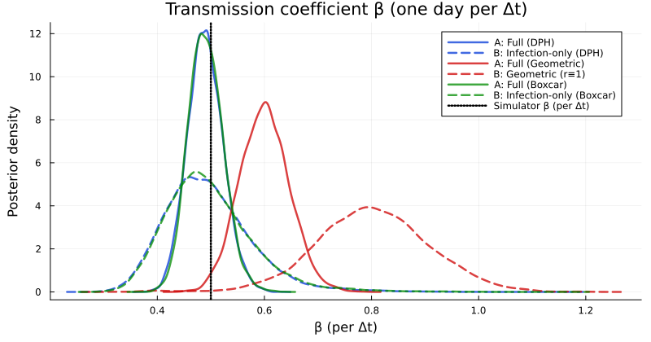
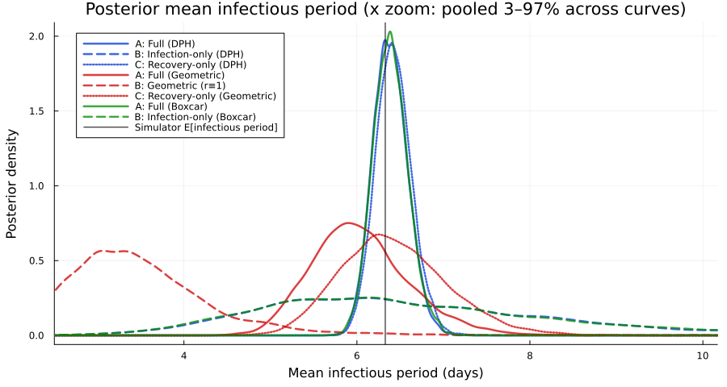
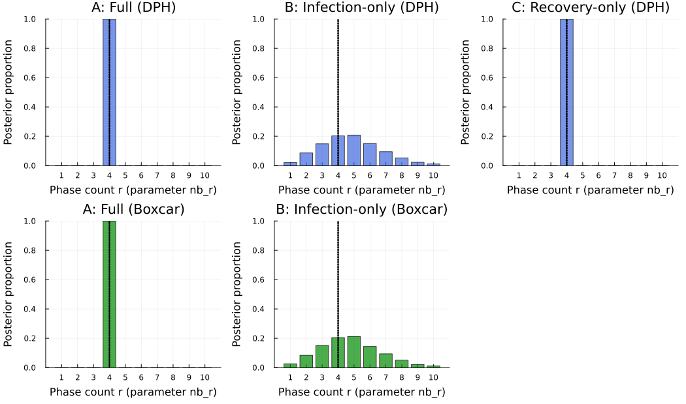
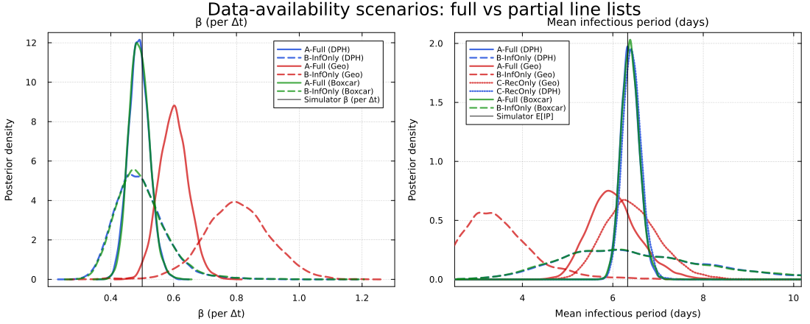
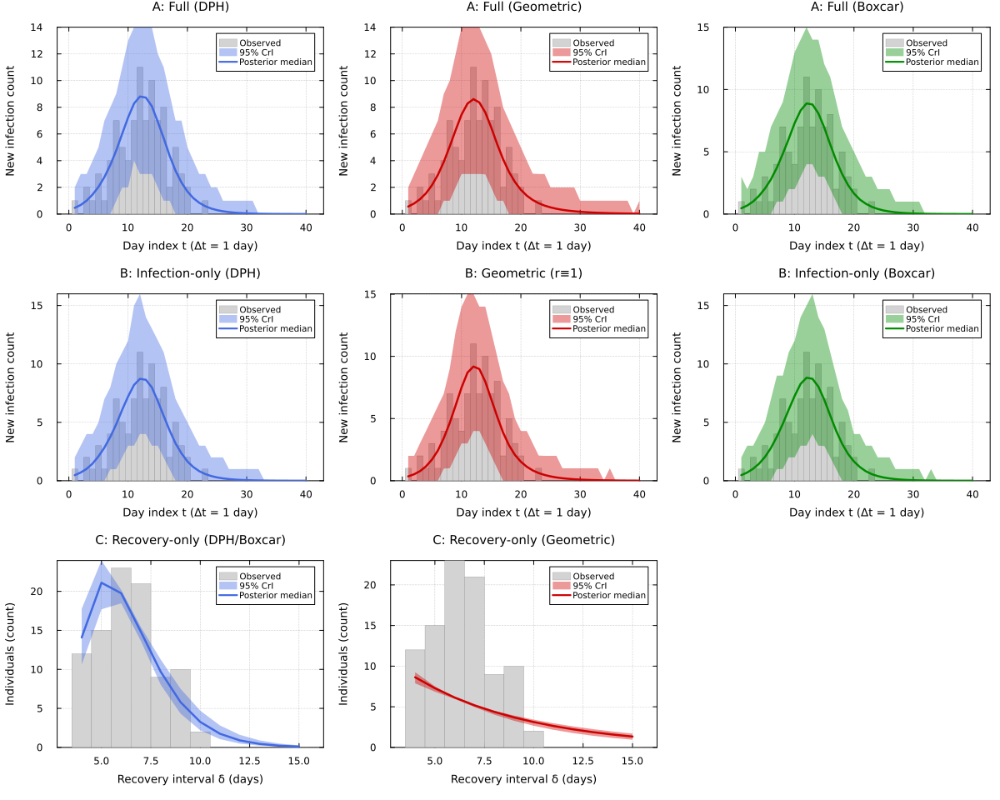

# DDSA data-availability scenarios
Sandra Montes (`@slmontes`)
2026-03-31

# Introduction

DDSA splits the log-likelihood into three parts: the infection-time
Multinomial term $\ell_I$, the recovery-interval phase-type term
$\ell_R$, and the Binomial final-size constraint $\ell_\text{constr}$.
Each piece contributes different information about transmission. In
practice, line lists are often incomplete: contact-tracing programmes
may capture infection onset times without follow-up on recovery, or
hospital records may provide recovery durations without precise
transmission dates. This notebook measures what each likelihood
component contributes by fitting DDSA under three data-availability
scenarios on one synthetic line list ($N=99$, $\rho=0.01$,
$\Delta t=1$,d, $T=40$,d). In every scenario, we compare three
infectious-period models: GLCT, Boxcar, and Geometric.

| Scenario | Observed data | Likelihood | Parameters identified |
|:---|:---|:---|:---|
| A — Full | Infection times, recovery intervals, final size | $\ell_I + \ell_R + \ell_\text{constr}$ | $\beta$, $\rho$, $r$, $p$; mean IP $= r/p$ |
| B — Infection only | Infection times and final size | $\ell_I + \ell_\text{constr}$ | $R_0$, $\rho$, mean IP (weakly); $r$ poorly identified |
| C — Recovery only | Recovery intervals | $\ell_R$ | $r$, $p$; $\beta$ and $\rho$ not identifiable |

The simulator uses a continuous Erlang infectious period with mean
$\mu=4$,d, then embeds it in discrete time at $\Delta t=1$,d using
per-step transition probabilities from constant hazards
(i.e. $p = 1-e^{-r\Delta t}$). This discretisation increases the mean
relative to the continuous target: in the discrete model, the expected
infectious duration is $E[W]\approx 6.33$,d (for $\mu=4$,d at
$\Delta t=1$,d). We therefore use $E[W]$, not $\mu$, as the reference
for posterior comparisons. We calibrate transmission as
$\beta_\text{rate}=R_0^\text{cal}/\mu=0.5$,d$^{-1}$ (with
$R_0^\text{cal}=2$), which implies a discrete-time reproduction number
$R_0^\text{imp}=\beta_\text{true}\times E[W]=3.164$. That value is the
target when comparing posterior $R_0=\beta\cdot r/p$. Inference uses a
flexible NegBin-DPH parameterisation $(r,p)$ with mean IP $=r/p$, and
does not force $r$ to match the simulator’s Erlang stage count $k=4$.

In Scenario B, the NegBin shape $r$ is not identifiable from incidence
alone: many $(r, p, R_0)$ combinations generate almost the same epidemic
trajectory. We therefore sum the likelihood over
$r \in \{1, \ldots, 10\}$, as in Scenarios A and C, and report its
posterior rather than choosing a single value. Because the meaning of
$p$ changes with $r$ (mean IP $= r/p$), Scenario B samples $R_0$ and the
mean infectious period $\mu$ directly and sets $p = r/\mu$ and
$\beta = R_0/\mu$, so the real-valued parameters keep the same meaning
for every $r$. The Geometric sub-scenario ($r\equiv1$) has no $r$ to sum
over.

## Libraries

The analysis uses Turing.jl for Bayesian inference and the shared
`PhaseTypeDistributions.jl` module (repository root) for discrete
phase-type distributions. The integer phase count $r$ is summed out of
the likelihood with the shared `IntegerParameters.jl` helpers, so no
Gibbs or Metropolis–Hastings steps are needed.

``` julia
using Random, LinearAlgebra, Statistics, Dates
using Turing
using StatsPlots
using Distributions
using StatsFuns: binomlogpdf
using Plots
using MCMCChains, DataFrames, Statistics
import Statistics: mean, var, std, median, quantile

if !isdefined(Main, :PhaseTypeDistributions)
    include("../PhaseTypeDistributions.jl")
end
using .PhaseTypeDistributions
include("../IntegerParameters.jl")  # shared helpers: sum integer parameters (N, r) out of the likelihood
using .IntegerParameters
```

``` julia
Random.seed!(1234)
```

## Parameters

Here we define simulation settings and build the discrete DPH used to
generate the synthetic data (daily line list, $Δt=1$,d, horizon
$T=40$,d). The printed output reports the effective discrete mean
($E[W]$), the infectious-period coefficient of variation ($CV$), and the
implied reproduction number
($R_0^\text{imp}=\beta_\text{true}\times E[W]$), which is the reference
target used in the results.

``` julia
R0_cal = 2.0       # continuous calibration target; β_rate = R0_cal/μ_ip
ρ_true = 0.01
μ_ip   = 4.0       # continuous Erlang mean (not the discrete E[W])
k      = 4         # Erlang stages in simulator
Δt_nom = 1.0       # one MCMC/map step = one day; per-stage g = 1 - exp(-(k/μ_ip)*Δt_nom)
tspan  = (0.0, 40.0)
nsteps = Int(round(tspan[2] / Δt_nom))

β_rate = R0_cal / μ_ip             # day^-1; before dwell discretisation
β_true = β_rate * Δt_nom           # per-step coefficient in simulate_discrete_glct
β_prior_hi = 2.5                   # upper bound for β ~ Uniform(1e-4, β_prior_hi) 


dph_nom = PhaseTypeDistributions.dph_erlang_from_mean(k, μ_ip, Δt_nom)
nb_r    = k                        # shape of the continuous simulator Erlang k 
nb_mean = PhaseTypeDistributions.mean(dph_nom)   # discrete E[W]
nb_cv   = sqrt(PhaseTypeDistributions.var(dph_nom)) / nb_mean  # coefficient of variation
nb_p    = k / μ_ip                 # continuous Erlang rate (as reference)
R0_imp = β_true * nb_mean          # Implied R₀: R₀_imp = β × E[W] (discrete)

K_age   = findfirst(kk -> PhaseTypeDistributions.cdf(dph_nom, kk) >= 0.999, 1:500)
```

    Simulator: k=4 stages, μ_ip=4.0 d (continuous-time mean infectious period), Δt=1.0 d → discrete E[W] = 6.328 d, CV = 0.303, β_true = 0.5/step
      R₀_cal = 2.0 uses μ_ip only for β_rate = R₀_cal/μ_ip (does not equal β_true×E[W]).
      R₀_imp = β_true × E[W] = 3.164 — Reference to compare to posterior R₀.
    nsteps = 40

## Utility functions

In this we section define the helper functions used across all
scenarios: safe normalisation of incidence probability vectors,
conversion of rates to per-step proportions, discrete hazard computation
from phase-type and standard distributions.

``` julia
"""Safely normalise a non-negative vector to sum to 1."""
function safe_normalise(f::AbstractVector{T}, n::Int) where T
    f_pos = ifelse.(isnan.(f) .| .!isfinite.(f), zero(T), max.(f, zero(T)))
    sF = sum(f_pos)
    (sF > T(1e-15) && isfinite(sF)) ? f_pos ./ sF : fill(one(T)/n, n)
end

"""Shared x-axis limits for mean infectious period (r/p) KDE plots: zoom to pooled quantiles."""
function mean_ip_density_xlims(vectors...; qlo=0.03, qhi=0.97, pad_frac=0.06)
    parts = [vec(v) for v in vectors if length(v) > 0]
    isempty(parts) && return (0.0, 15.0)
    v = reduce(vcat, parts)
    lo, hi = quantile(v, qlo), quantile(v, qhi)
    pad = max(pad_frac * (hi - lo), 0.5)
    return (max(0.0, lo - pad), hi + pad)
end

"""
Kernel density of posterior draws `x`, evaluated on a fine grid over `window`, added to plot `p`. StatsPlots'
`density` uses 200 grid points over the full range of the draws, which over-smooths a posterior with rare very
large draws (e.g. 1/p for a geometric fit under a Beta(1, 1) prior on p). Draws outside the window keep their
weight, so the curve is not renormalised.
"""
function wdensity!(p, x; window, kwargs...)
    v = vec(x)
    kd = StatsPlots.KernelDensity.kde(v; boundary = window, npoints = 2048,
                                      bandwidth = StatsPlots.KernelDensity.default_bandwidth(v))
    plot!(p, kd.x, kd.density; kwargs...)
end

"""Convert a rate to a proportion over a unit time interval."""
@inline function rate_to_proportion(r, t=1.0)
    if r < 0 || isnan(r)
        return 0.0
    elseif isinf(r)
        return 1.0
    else
        result = 1 - exp(-r * t)
        return isnan(result) ? 0.0 : max(min(result, 1.0), 0.0)
    end
end

"""Discrete hazard h[k] = P(W=k)/P(W≥k) for NegBin(r,p) parameters; AD-compatible.

Computed on the log scale, h[k] = exp(log P(W=k) − log P(W≥k)). In the far tail both
probabilities underflow, and the ratio pmf/sf then has a 0/0 derivative (NaN gradients
under ForwardDiff) even though its value is harmless."""
function hazard_vector_negbin(nb_r::Integer, nb_p::T, K::Integer) where T <: Real
    _logaddexp(a, b) = a == -Inf ? b : b == -Inf ? a : max(a, b) + log1p(exp(-abs(a - b)))
    lp  = [k < nb_r ? T(-Inf) : PhaseTypeDistributions.negbin_total_logpdf(k, nb_r, nb_p) for k in 1:K]
    lsf = similar(lp)                    # log P(W ≥ k), accumulated from the tail
    acc = T(-Inf)
    for k in K:-1:1
        acc = _logaddexp(acc, lp[k])
        lsf[k] = acc
    end
    h = [isfinite(lsf[k]) ? exp(lp[k] - lsf[k]) : zero(T) for k in 1:K]
    h[end] = one(T)
    return clamp.(h, zero(T), one(T))
end
```

# Boxcar SIR simulation

The Boxcar model represents the infectious period with explicit
infection-age cohorts: newly infected individuals enter the first age
class, then move through $r$ classes one step at a time, leaving each
class according to the NegBin hazard. Its incidence term,
$\beta(\sum I)S$, matches the GLCT forward map. So for a fixed
$(\beta,\rho)$ and dwell-time distribution, the two formulations induce
the same epidemic trajectory and should produce equivalent posteriors on
the same data.

``` julia
function sir_boxcar_map!(du, u, p, t)
    (β, h, K, Δt) = p
    Tel = eltype(u)
    S = u[1]
    ΣI = sum(u[2:K+1])
    R = u[K+2]
    # Probability-per-step infection update (hazard -> event probability).
    p_inf = rate_to_proportion(β * ΣI, Δt)
    new_inf = p_inf * S
    du[1] = S - new_inf
    du[K+2] = R
    @inbounds begin
        du[2] = new_inf
        for k in 2:K
            du[k+1] = zero(Tel)
        end
    end
    @inbounds for k in 1:K
        current_I = u[k+1]
        leave = current_I * h[k]
        stay = current_I - leave
        if k < K
            du[k+2] += stay
        end
        du[K+2] += leave
    end
    return nothing
end

function simulate_boxcar(β, h_rec, ρ, nsteps, K_age_classes, Δt)
    Tel = promote_type(typeof(β), eltype(h_rec), typeof(ρ))
    u0 = zeros(Tel, K_age_classes + 2)
    u0[1] = one(Tel) - ρ
    u0[2] = ρ
    u0[K_age_classes+2] = zero(Tel)
    sol = zeros(Tel, K_age_classes + 2, nsteps + 1)
    sol[:, 1] = u0
    p = (β, h_rec, K_age_classes, Δt)
    for t in 2:(nsteps+1)
        u_next = zeros(Tel, length(u0))
        sir_boxcar_map!(u_next, sol[:, t-1], p, t - 1)
        # NUTS + ForwardDiff can explore extreme parameters; keep S,I,R nonnegative and
        # S on [0,1] so τ = S(0)−S(T) stays finite (avoids NaN Dual in Binomial(N,τ)).
        u_next[1] = max(zero(Tel), min(one(Tel), u_next[1]))
        u_next[K_age_classes+2] = max(zero(Tel), u_next[K_age_classes+2])
        @inbounds for i in 2:(K_age_classes+1)
            u_next[i] = max(zero(Tel), u_next[i])
        end
        sol[:, t] = u_next
    end
    τ = u0[1] - sol[1, end]
    f = zeros(Tel, nsteps)
    for tt in 1:nsteps
        f[tt] = tt == 1 ? sol[1, 1] - sol[1, 2] : sol[1, tt] - sol[1, tt+1]
    end
    if sum(f) > 0
        f = f / sum(f)
    else
        f = fill(one(Tel)/nsteps, nsteps)
    end
    return sol, τ, f
end
```

# Discrete GLCT simulation

The GLCT forward map iterates the discrete SIR system using the
phase-type transition matrix for the infectious period. At each step,
new infections are distributed across infection stages according to the
initial probability vector $\alpha$, existing infections advance through
the sub-transition matrix $T$, and absorptions accumulate in the
recovered class. The incidence probability mass function is obtained
from the successive decrements in $S$.

``` julia
function simulate_discrete_glct(Tm::AbstractMatrix, α::AbstractVector, β::Real, ρ::Real, nsteps::Int, Δt::Real)
    k = length(α)
    @assert size(Tm, 1) == k == size(Tm, 2) "Tm must be k×k"
    S = 1.0 - ρ
    x = α .* ρ
    R = zero(ρ)
    S_hist = Any[S]
    I_hist = Any[sum(x)]
    R_hist = Any[R]
    times = collect(0.0:Δt:(nsteps*Δt))
    for _ in 1:nsteps
        I = sum(x)
        # Probability-per-step infection update (hazard -> event probability).
        p_inf = rate_to_proportion(β * I, Δt)
        new_inf = p_inf * S
        x = Tm' * x + α .* new_inf
        absorption_probs = ones(eltype(α), k) - Tm * ones(eltype(α), k)
        recov = dot(absorption_probs, x)
        S = S - new_inf
        R = R + recov
        push!(S_hist, S)
        push!(I_hist, sum(x))
        push!(R_hist, R)
    end
    τ = S_hist[1] - S_hist[end]
    dS = diff(S_hist)
    f = max.(-dS, 0.0)
    sF = sum(f)
    f = sF > 0 ? f ./ sF : fill(one(eltype(f))/length(f), length(f))
    return (times=times, S=S_hist, I=I_hist, R=R_hist, τ=τ, f=f)
end
```

# Synthetic line list

The synthetic dataset is generated in three steps: the deterministic
GLCT forward map produces the final attack rate $\tau$ and incidence PMF
$f$; the observed final size $K$ is then drawn from
$\text{Binomial}(N,\tau)$ and individual infection times from
$\text{Multinomial}(K,f)$; and each infectious period $\delta_i$ is
sampled from the Erlang-4 DPH by inverse CDF. All three scenarios
condition on the same single realisation of
$(K, \mathbf{th}, \boldsymbol{\delta})$.

``` julia
function generate_discrete_glct_data(β, Tm, α, ρ, N, M, n_events, Δt; rng::Union{Nothing,Random.AbstractRNG}=nothing)
    result = simulate_discrete_glct(Tm, α, β, ρ, n_events, Δt)
    τ = result.τ
    f = result.f
    K = isnothing(rng) ? rand(Binomial(N, τ)) : rand(rng, Binomial(N, τ))
    if K > 0 && length(f) > 0
        if length(f) != n_events
            f = f[1:n_events]
        end
        if sum(f) > 0
            f = f / sum(f)
        else
            f = fill(1.0/n_events, n_events)
        end
        th = isnothing(rng) ? rand(Multinomial(K, f)) : rand(rng, Multinomial(K, f))
    else
        th = zeros(Int, n_events)
    end
    delta = Int[]
    if M + K > 0
        dph = PhaseTypeDistributions.DPH(α, Tm)
        for _ in 1:(M + K)
            u = isnothing(rng) ? rand() : rand(rng)
            cum_prob = 0.0
            recovery_time = 1
            while cum_prob < u
                pmf_val = PhaseTypeDistributions.pmf(dph, recovery_time)
                cum_prob += pmf_val
                cum_prob >= u && break
                recovery_time += 1
            end
            push!(delta, recovery_time)
        end
    end
    return Dict(:K => K, :th => th, :delta => delta, :τ => τ, :f => f)
end
```

# Turing models

The following subsections define the Turing.jl probabilistic models for
each scenario and infectious-period representation. All models share the
same discrete epidemic forward map and differ only in which likelihood
components are active and which parameters are estimated.

## Scenario A — Full data ($\ell_I + \ell_R + \ell_\text{constr}$)

Scenario A uses the complete likelihood: the incidence histogram and
final size constrain the transmission parameters $(\beta, \rho)$, while
the individual recovery intervals identify the infectious period shape
$(r, p)$. With all three data streams present, the integer phase count
$r$ is summed out of the likelihood over its prior support, and NUTS
samples $(\beta, \rho, p)$.

``` julia
"""Full-data log-likelihood for a given phase count `nb_r` (GLCT map, NegBin DPH)."""
function dph_full_loglik(nb_r, β, ρ, nb_p, N, M, nsteps, K, th, delta, Δt)
    any(<(nb_r), delta) && return -Inf   # outside the NegBin support {r, r+1, ...}
    (0 < nb_p < 1) || return -Inf        # support of p (an extreme NUTS proposal can underflow p to 0)
    dph     = PhaseTypeDistributions.dph_negative_binomial(nb_r, nb_p)
    result  = simulate_discrete_glct(dph.S, dph.α, β, ρ, nsteps, Δt)
    τ_valid = clamp(result.τ, 0.001, 0.999)
    f_safe  = safe_normalise(result.f, nsteps)
    ll = logpdf(Binomial(N, τ_valid), K)
    if K > 0
        all(x -> isfinite(x) && !isnan(x), f_safe) && abs(sum(f_safe) - 1) < 0.01 || return -Inf
        ll += logpdf(Multinomial(K, f_safe), th)
    end
    return ll + sum(logpdf(dph, delta[i]) for i in 1:(M + K))
end

@model function dph_full(N::Int, M::Int, nsteps::Int, K::Int,
                          th::Vector{Int}, delta::Vector{Int},
                          nb_r_max::Int, Δt::Float64)
    # NegBin-DPH; Binomial/Multinomial for epidemic data; delta ~ DPH.
    # nb_r ~ DiscreteUniform(1, nb_r_max) is summed out (one forward-map run per value).
    β    ~ Uniform(1e-4, β_prior_hi)
    ρ    ~ Beta(1.0, N - 1)
    nb_p ~ Beta(1.0, 1.0)
    logmarg, lps = marginal_r_loglik(1:nb_r_max) do nb_r
        dph_full_loglik(nb_r, β, ρ, nb_p, N, M, nsteps, K, th, delta, Δt)
    end
    Turing.@addlogprob! logmarg
    return lps   # per-r log-likelihoods, used to draw nb_r after sampling
end
```

## Scenario B — Infection times only, summed over $r$

Scenario B uses only the infection-time likelihood
$\ell_I + \ell_\text{constr}$. The phase count $r$ is summed out over
$\{1, \ldots, r_{\max}\}$. The sampled parameters are $R_0$, the mean
infectious period $\mu$ and $\rho$, with $p = r/\mu$ and
$\beta = R_0 p / r = R_0/\mu$ derived for each $r$. This keeps
$(R_0, \mu)$ meaningful across all values of $r$; with $(R_0, p)$
sampled instead, the same $p$ implies a different mean IP for every $r$,
and the summed posterior mixes poorly.

``` julia
"""Infection-only log-likelihood (final size + incidence) for a given phase count `nb_r`,
with p = r/μ and β = R₀/μ."""
function dph_infonly_loglik(nb_r, R₀, μ, ρ, N, nsteps, K, th, Δt)
    nb_p = nb_r / μ
    (0 < nb_p < 1) || return -Inf       # mean IP must exceed the minimum duration r
    dph     = PhaseTypeDistributions.dph_negative_binomial(nb_r, nb_p)
    result  = simulate_discrete_glct(dph.S, dph.α, R₀ / μ, ρ, nsteps, Δt)
    (isfinite(result.τ) && all(isfinite, result.f)) || return -Inf
    τ_valid = clamp(result.τ, 0.001, 0.999)
    f_safe  = safe_normalise(result.f, nsteps)
    ll = binomlogpdf(N, τ_valid, K)     # AD-safe; avoids Binomial(N,p) constructor on Dual types
    if K > 0
        all(x -> isfinite(x) && !isnan(x), f_safe) && abs(sum(f_safe) - 1) < 0.01 || return -Inf
        ll += logpdf(Multinomial(K, f_safe), th)
    end
    return ll
end

@model function dph_infonly(N::Int, nsteps::Int, K::Int, th::Vector{Int},
                             nb_r_max::Int, Δt::Float64)
    R₀      ~ Uniform(0.5, 5.0)
    mean_ip ~ Uniform(1.0, 30.0)        # mean infectious period (days)
    ρ       ~ Beta(1.0, N - 1)
    # nb_r ~ DiscreteUniform(1, nb_r_max) is summed out
    logmarg, lps = marginal_r_loglik(1:nb_r_max) do nb_r
        dph_infonly_loglik(nb_r, R₀, mean_ip, ρ, N, nsteps, K, th, Δt)
    end
    Turing.@addlogprob! logmarg
    return lps
end
```

## Scenario C — Recovery times only ($\ell_R$)

Without infection time data, the transmission rate $\beta$ and initial
fraction $\rho$ are not identified. We estimate only the infectious
period distribution parameters $(r, p)$ directly from recovery
intervals.

``` julia
@model function dph_reconly(delta::Vector{Int}, nb_r_max::Int)
    # nb_r ~ DiscreteUniform(1, nb_r_max) is summed out
    nb_p    ~ Beta(1.0, 1.0)
    logmarg, lps = marginal_r_loglik(1:nb_r_max) do nb_r
        any(<(nb_r), delta) && return -Inf
        (0 < nb_p < 1) || return -Inf    # support of p
        dph = PhaseTypeDistributions.dph_negative_binomial(nb_r, nb_p)
        sum(logpdf(dph, d) for d in delta)
    end
    Turing.@addlogprob! logmarg
    return lps
end
```

## Scenario C — Recovery times only (Geometric baseline)

The Geometric model for recovery-only inference estimates $p$ from
$\delta_i$ directly. Since Geometric $\equiv$ NegBin$(r=1)$ has a single
parameter, this is a NUTS-only run with no Metropolis-Hastings step
required.

``` julia
@model function geo_reconly(delta::Vector{Int})
    nb_p ~ Beta(1.0, 1.0)
    dph_geo = PhaseTypeDistributions.dph_geometric(nb_p)
    for i in 1:length(delta)
        delta[i] ~ dph_geo
    end
    return (nb_p=nb_p,)
end
```

## Geometric baseline — Scenario A ($\ell_I + \ell_R + \ell_\text{constr}$)

The geometric model is the memoryless special case of the NegBin DPH,
equivalent to a single exponential infectious stage ($r=1$). Fitting it
alongside the DPH model under the full likelihood quantifies the cost of
assuming exponential dwell times when the true infectious period has
lower coefficient of variation.

``` julia
@model function geo_full(N::Int, M::Int, nsteps::Int, K::Int,
                          th::Vector{Int}, delta::Vector{Int},
                          Δt::Float64)
    β    ~ Uniform(1e-4, β_prior_hi)
    ρ    ~ Beta(1.0, N - 1)
    nb_p ~ Beta(1.0, 1.0)

    if !(0 < nb_p < 1)                   # support of p (an extreme NUTS proposal can underflow p to 0)
        Turing.@addlogprob! -Inf
        return (β=β, nb_p=nb_p, ρ=ρ, τ=0.0)
    end
    dph_geo = PhaseTypeDistributions.dph_geometric(nb_p)
    result  = simulate_discrete_glct(dph_geo.S, dph_geo.α, β, ρ, nsteps, Δt)
    τ_valid = clamp(result.τ, 0.001, 0.999)
    f_safe  = safe_normalise(result.f, nsteps)

    K ~ Binomial(N, τ_valid)
    if K > 0
        if all(x -> isfinite(x) && !isnan(x), f_safe) && abs(sum(f_safe) - 1) < 0.01
            th ~ Multinomial(K, f_safe)
        else
            Turing.@addlogprob! -Inf
        end
    end
    for i in 1:(M + K)
        delta[i] ~ dph_geo
    end

    return (β=β, nb_p=nb_p, ρ=ρ, τ=τ_valid)
end
```

## Geometric baseline — Scenario B ($\ell_I + \ell_\text{constr}$)

Under Scenario B, the geometric model requires no shape selection step
since $r \equiv 1$ is fixed by definition. This provides a clean
infection-only baseline against which the GLCT and Boxcar results can be
compared.

``` julia
@model function geo_infonly(N::Int, M::Int, nsteps::Int, K::Int,
                             th::Vector{Int}, Δt::Float64)
    β    ~ Uniform(1e-4, β_prior_hi)
    ρ    ~ Beta(1.0, N - 1)
    nb_p ~ Beta(1.0, 1.0)

    if !(0 < nb_p < 1)                   # support of p (an extreme NUTS proposal can underflow p to 0)
        Turing.@addlogprob! -Inf
        return (β=β, nb_p=nb_p, ρ=ρ, τ=0.0)
    end
    dph_geo = PhaseTypeDistributions.dph_geometric(nb_p)
    result  = simulate_discrete_glct(dph_geo.S, dph_geo.α, β, ρ, nsteps, Δt)
    τ_valid = clamp(result.τ, 0.001, 0.999)
    f_safe  = safe_normalise(result.f, nsteps)

    K ~ Binomial(N, τ_valid)
    if K > 0
        if all(x -> isfinite(x) && !isnan(x), f_safe) && abs(sum(f_safe) - 1) < 0.01
            th ~ Multinomial(K, f_safe)
        else
            Turing.@addlogprob! -Inf
        end
    end
    # NO recovery likelihood

    return (β=β, nb_p=nb_p, ρ=ρ, τ=τ_valid)
end
```

## Boxcar — Scenario A ($\ell_I + \ell_R + \ell_\text{constr}$)

The Boxcar model is the infection-age representation of the same NegBin
DPH likelihood. Its state space has dimension $K_\text{age}+2$ (vs $r+2$
for DPH), but it is mathematically equivalent. Both correctly-specified
models should produce identical posteriors on the same data.

``` julia
"""Full-data log-likelihood for a given phase count `nb_r` (Boxcar map, same NegBin DPH)."""
function boxcar_full_loglik(nb_r, β, ρ, nb_p, N, M, nsteps, K, th, delta, K_age_classes, Δt)
    any(<(nb_r), delta) && return -Inf
    (0 < nb_p < 1) || return -Inf        # support of p
    dph_bc  = PhaseTypeDistributions.dph_negative_binomial(nb_r, nb_p)
    h_rec   = hazard_vector_negbin(nb_r, nb_p, K_age_classes)
    _, τ, f = simulate_boxcar(β, h_rec, ρ, nsteps, K_age_classes, Δt)
    (isfinite(τ) && all(isfinite, f)) || return -Inf
    τ_valid = clamp(τ, 0.001, 0.999)
    f_safe  = safe_normalise(f, nsteps)
    ll = binomlogpdf(N, τ_valid, K)  # AD-safe Binomial
    if K > 0
        all(x -> isfinite(x) && !isnan(x), f_safe) && abs(sum(f_safe) - 1) < 0.01 || return -Inf
        ll += logpdf(Multinomial(K, f_safe), th)
    end
    return ll + sum(logpdf(dph_bc, delta[i]) for i in 1:(M + K))
end

@model function boxcar_full(N::Int, M::Int, nsteps::Int, K::Int,
                             th::Vector{Int}, delta::Vector{Int},
                             K_age_classes::Int, nb_r_max::Int, Δt::Float64)
    β    ~ Uniform(1e-4, β_prior_hi)
    ρ    ~ Beta(1.0, N - 1)
    nb_p ~ Beta(1.0, 1.0)
    # nb_r ~ DiscreteUniform(1, nb_r_max) is summed out, as in dph_full
    logmarg, lps = marginal_r_loglik(1:nb_r_max) do nb_r
        boxcar_full_loglik(nb_r, β, ρ, nb_p, N, M, nsteps, K, th, delta, K_age_classes, Δt)
    end
    Turing.@addlogprob! logmarg
    return lps
end
```

## Boxcar model for Scenario B ($\ell_I + \ell_\text{constr}$, summed over $r$)

The infection-only Boxcar model mirrors the DPH Scenario B
specification, with the GLCT transition matrix replaced by infection-age
cohort dynamics. This cross-checks that the two representations remain
consistent when recovery data are absent.

``` julia
"""Infection-only Boxcar log-likelihood for a given phase count `nb_r` (p = r/μ, β = R₀/μ)."""
function boxcar_infonly_loglik(nb_r, R₀, μ, ρ, N, nsteps, K, th, K_age_classes, Δt)
    nb_p = nb_r / μ
    (0 < nb_p < 1) || return -Inf
    h_rec   = hazard_vector_negbin(nb_r, nb_p, K_age_classes)
    _, τ, f = simulate_boxcar(R₀ / μ, h_rec, ρ, nsteps, K_age_classes, Δt)
    (isfinite(τ) && all(isfinite, f)) || return -Inf
    τ_valid = clamp(τ, 0.001, 0.999)
    f_safe  = safe_normalise(f, nsteps)
    ll = binomlogpdf(N, τ_valid, K)
    if K > 0
        all(x -> isfinite(x) && !isnan(x), f_safe) && abs(sum(f_safe) - 1) < 0.01 || return -Inf
        ll += logpdf(Multinomial(K, f_safe), th)
    end
    return ll
end

@model function boxcar_infonly(N::Int, nsteps::Int, K::Int, th::Vector{Int},
                                K_age_classes::Int, nb_r_max::Int, Δt::Float64)
    R₀      ~ Uniform(0.5, 5.0)
    mean_ip ~ Uniform(1.0, 30.0)
    ρ       ~ Beta(1.0, N - 1)
    logmarg, lps = marginal_r_loglik(1:nb_r_max) do nb_r
        boxcar_infonly_loglik(nb_r, R₀, mean_ip, ρ, N, nsteps, K, th, K_age_classes, Δt)
    end
    Turing.@addlogprob! logmarg
    return lps
end
```

# Data generation

The synthetic dataset is generated from the nominal parameters defined
above. The printed output reports the observed final size $K$, the
empirical mean and coefficient of variation of the recovery intervals,
and the Boxcar truncation length required to cover the worst-case prior
tail under Scenario B.

``` julia
# N = susceptibles followed, M = pre-study infected
N_sim  = 99
M_sim  = 1
ρ_sim  = ρ_true

data_fwd = generate_discrete_glct_data(β_true, dph_nom.S, dph_nom.α, ρ_sim,
                                        N_sim, M_sim, nsteps, Δt_nom)
K_obs      = data_fwd[:K]
th_obs     = data_fwd[:th]
delta_obs  = data_fwd[:delta]
τ_true_det = data_fwd[:τ]
f_true_det = data_fwd[:f]

nb_r_max_data = minimum(delta_obs)

# K_age_B: Boxcar state-space length for Scenario B; worst-case prior is Geometric(1/30)
# (r=1, mean=30 d), whose 99.9th percentile sets the required truncation.
dph_worst_B = PhaseTypeDistributions.dph_negative_binomial(1, 1.0/30.0)
K_age_B     = findfirst(k -> PhaseTypeDistributions.cdf(dph_worst_B, k) >= 0.999, 1:500)

println("Simulator: β_true=$β_true per Δt, k=$nb_r, μ_ip=$μ_ip d (CT mean input), E[W]=$(round(nb_mean,digits=3)) d, R₀_imp=$(round(R0_imp, digits=3)), τ_det=$(round(τ_true_det, digits=3))")
println("Observed: K=$K_obs / N=$N_sim  (attack rate $(round(K_obs/N_sim, digits=3)))")
println("Recovery: mean=$(round(mean(delta_obs), digits=2)) d, " *
        "min=$(minimum(delta_obs)), max=$(maximum(delta_obs)), " *
        "CV=$(round(std(delta_obs)/mean(delta_obs), digits=3))")
println("nb_r_max_data = $nb_r_max_data,  K_age = $K_age  (Scenario A),  K_age_B = $K_age_B  (Scenario B Boxcar)")
```

    Simulator: β_true=0.5 per Δt, k=4, μ_ip=4.0 d (CT mean input), E[W]=6.328 d, R₀_imp=3.164, τ_det=0.941
    Observed: K=91 / N=99  (attack rate 0.919)
    Recovery: mean=6.41 d, min=4, max=10, CV=0.246
    nb_r_max_data = 4,  K_age = 15  (Scenario A),  K_age_B = 204  (Scenario B Boxcar)

# MCMC inference

All NegBin DPH and Boxcar models (Scenarios A, B and C) sum the integer
phase count $r$ out of the likelihood and are sampled with NUTS alone:
four chains, each started from jittered data-based values (see the code
below), with 1,000 warm-up and 2,000 posterior draws per chain (4,000
for Scenario B, whose wide and correlated posterior over $R_0$ and the
mean infectious period needs more draws to reach $\hat{R} < 1.01$).
After sampling, each draw is paired with one draw of $r$ from its exact
conditional posterior, which is added to the chain as `:nb_r`.

The geometric fits (Scenarios A, B and C, $r \equiv 1$) have no integer
parameters and use the same sampler settings: four chains from jittered
data-based values, 1,000 warm-up and 2,000 draws per chain.

``` julia
nb_r_max   = 10        # upper bound for DiscreteUniform prior on nb_r (Scenarios A, Boxcar A)
Δt_val     = Δt_nom  # must match simulator time step (here: 1 day per step)

# Scenarios A, C and Boxcar A: nb_r summed out; NUTS with 4 chains from data-based starts
n_samples_int  = 2000
n_samples_B    = 4000   # Scenario B: wide, correlated (R₀, μ) posterior needs more draws for R̂ < 1.01
nuts_adapt_int = 1000
n_chains       = 4
nuts_int       = NUTS(nuts_adapt_int, 0.8; max_depth=12, Δ_max=1000.0)
# Chains start from jittered data-based values (Methods): R0 from the final-size relation R0 = −log(1 − K/N)/(K/N),
# the per-stage probability p from the recovery intervals as p = min δ / mean δ (the largest admissible phase count
# over the mean interval; 1/mean δ for the geometric model), ρ at its prior median, and the mean IP at its prior
# median where no recovery intervals are used (Scenario B). Each value is multiplied by exp(0.1 z), z ~ N(0, 1), per chain.
init_rng = Xoshiro(20261006)
function data_inits(model, n)
    z = K_obs / N_sim; R0h = clamp(-log(1 - z) / z, 0.6, 4.9); ip = mean(delta_obs); ρh = median(Beta(1.0, N_sim - 1))
    p_nb = clamp(minimum(delta_obs) / ip, 1e-3, 0.99)
    j() = exp(0.1 * randn(init_rng))
    f = model.f
    map(1:n) do _
        if f === dph_full || f === boxcar_full
            InitFromParams((β = j() * R0h / ip, ρ = j() * ρh, nb_p = clamp(j() * p_nb, 1e-3, 0.99)))
        elseif f === dph_infonly || f === boxcar_infonly
            InitFromParams((R₀ = clamp(j() * R0h, 0.55, 4.95), mean_ip = j() * 15.5, ρ = j() * ρh))
        elseif f === dph_reconly
            InitFromParams((nb_p = clamp(j() * p_nb, 1e-3, 0.99),))
        elseif f === geo_full
            InitFromParams((β = j() * R0h / ip, ρ = j() * ρh, nb_p = clamp(j() / ip, 1e-3, 0.99)))
        elseif f === geo_infonly
            InitFromParams((β = j() * R0h * 0.5, ρ = j() * ρh, nb_p = clamp(j() * 0.5, 1e-3, 0.99)))
        elseif f === geo_reconly
            InitFromParams((nb_p = clamp(j() / ip, 1e-3, 0.99),))
        else
            error("no data-based initial values defined for $(f)")
        end
    end
end

"""Standard sampler: NUTS, `n_chains` chains from jittered data-based starts, MCMCChains output."""
sample_std(model; n_draws = n_samples_int) =
    sample(model, nuts_int, MCMCThreads(), n_draws, n_chains;
           progress=false, chain_type=MCMCChains.Chains, initial_params=data_inits(model, n_chains))

"""Sample `model` (which returns per-r log-likelihoods) and add posterior draws of nb_r
(support 1:r_max) to the chain."""
function sample_summing_r(model; n_draws = n_samples_int)
    ch = sample_std(model; n_draws = n_draws)
    r_draws = [sample_index(lps) for lps in returned(model, ch)]
    return add_draws(ch, :nb_r, r_draws)
end

"""Add a matrix of derived draws (iterations × chains) to a chain under `name`."""
add_draws(ch, name, draws) =
    hcat(ch, setrange(Chains(reshape(draws, size(draws, 1), 1, :), [name]), range(ch)))

```

## Scenario A — Full DDSA (DPH)

Scenario A uses all three data streams:
$\ell_I + \ell_R + \ell_\text{constr}$. With full data, the phase count
$r$ is identifiable from recovery intervals: the NegBin recovery
likelihood discriminates sharply between different $r$ values, so its
posterior (recovered after sampling) concentrates on one value.

``` julia
model_A = dph_full(N_sim, M_sim, nsteps, K_obs, th_obs, delta_obs, nb_r_max, Δt_val)
_ = sample(model_A, nuts_int, 1; progress=false, chain_type=MCMCChains.Chains)
t_A = @elapsed chain_A = sample_summing_r(model_A)
```

    Scenario A (Full DPH): 7.6 s

## Scenario B — Infection-only DDSA (DPH)

With recovery intervals absent, the posterior of $r$ is expected to be
spread over several values. Summing over $r$ carries that uncertainty
into the posteriors of $R_0$ and the mean infectious period, instead of
conditioning on one selected value.

``` julia
model_B = dph_infonly(N_sim, nsteps, K_obs, th_obs, nb_r_max, Δt_val)
_ = sample(model_B, nuts_int, 1; progress=false, chain_type=MCMCChains.Chains)
t_B = @elapsed chain_B = sample_summing_r(model_B; n_draws = n_samples_B)
# Derived p = r/μ for each draw (used by the summaries and posterior predictive checks)
chain_B = add_draws(chain_B, :nb_p, Array(chain_B[:nb_r]) ./ Array(chain_B[:mean_ip]))
```

    Scenario B (DPH, infection-only, summed over r): 35.0 s
    Scenario B posterior P(r): [0.021, 0.086, 0.149, 0.203, 0.208, 0.151, 0.095, 0.053, 0.023, 0.012]

## Scenario C — Recovery-only DDSA (DPH)

Scenario C uses only the recovery likelihood $\ell_R$. With recovery
data alone, $r$ is identifiable: the likelihood is summed over
$r \in \{1, \ldots, r_\text{max\_data}\}$ where
$r_\text{max\_data} = \min(\delta_i)$ (the data-derived upper bound;
NegBin total-trials support is $\{r, r+1, \ldots\}$).

``` julia
model_C = dph_reconly(delta_obs, nb_r_max_data)
_ = sample(model_C, nuts_int, 1; progress=false, chain_type=MCMCChains.Chains)
t_C = @elapsed chain_C = sample_summing_r(model_C)
```

    Scenario C (Recovery-only DPH): 1.5 s
    Scenario C: inferred nb_r = 4  (Erlang k = 4)

## Scenario C — Recovery times only (Geometric)

The geometric recovery-only model provides a single-parameter baseline
for comparison with the DPH result under Scenario C.

``` julia
model_Cgeo = geo_reconly(delta_obs)
_ = sample(model_Cgeo, nuts_int, 1; progress=false, chain_type=MCMCChains.Chains)
t_Cgeo = @elapsed chain_Cgeo = sample_std(model_Cgeo)
```

    Scenario C (Recovery-only Geometric): 0.7 s

## Scenario A — Full (Geometric baseline)

The geometric model is fitted under the full likelihood to assess the
impact of exponential misspecification when all data streams are
available.

``` julia
model_Ageo = geo_full(N_sim, M_sim, nsteps, K_obs, th_obs, delta_obs, Δt_val)
_ = sample(model_Ageo, nuts_int, 1; progress=false, chain_type=MCMCChains.Chains)
t_Ageo = @elapsed chain_Ageo = sample_std(model_Ageo)
```

    Scenario A (Full Geometric): 2.0 s

## Scenario B — Geometric baseline ($r \equiv 1$)

The infection-only geometric model requires no shape selection step and
serves as a misspecification baseline against which the NegBin-DPH
Scenario B results can be compared.

``` julia
# Geo B: β–nb_p ridge (R₀ = β/nb_p) is poorly identified without recovery data.
model_Bgeo = geo_infonly(N_sim, M_sim, nsteps, K_obs, th_obs, Δt_val)
_ = sample(model_Bgeo, nuts_int, 1; progress=false, chain_type=MCMCChains.Chains)
t_Bgeo = @elapsed chain_Bgeo = sample_std(model_Bgeo)
```

    Scenario B (Geometric, r≡1, infection-only): 1.9 s

## Scenario A — Full (Boxcar)

The full Boxcar model is fitted to cross-check the DPH result: both use
the NegBin infectious period parameterisation and should produce
equivalent posteriors on the same data.

``` julia
model_Abc = boxcar_full(N_sim, M_sim, nsteps, K_obs, th_obs, delta_obs,
                         K_age, nb_r_max, Δt_val)
_ = sample(model_Abc, nuts_int, 1; progress=false, chain_type=MCMCChains.Chains)
t_Abc = @elapsed chain_Abc = sample_summing_r(model_Abc)
```

    Scenario A (Full Boxcar): 6.8 s

## Scenario B — Infection-only (Boxcar)

The infection-only Boxcar model is summed over $r$ in the same way as
the DPH model, allowing a direct comparison between the two
infectious-period representations under identical data availability.

``` julia
model_Bbc = boxcar_infonly(N_sim, nsteps, K_obs, th_obs, K_age_B, nb_r_max, Δt_val)
_ = sample(model_Bbc, nuts_int, 1; progress=false, chain_type=MCMCChains.Chains)
t_Bbc = @elapsed chain_Bbc = sample_summing_r(model_Bbc; n_draws = n_samples_B)
chain_Bbc = add_draws(chain_Bbc, :nb_p, Array(chain_Bbc[:nb_r]) ./ Array(chain_Bbc[:mean_ip]))
```

    Scenario B (Boxcar, infection-only, summed over r): 214.0 s

# Results

## Posterior summaries

The table below reports posterior medians and 95% credible intervals for
the transmission coefficient $\beta$, mean infectious period $r/p$,
phase count $r$, and $R_0 = \beta \cdot r/p$ under all scenarios and
infectious-period models. $R_0$ is computed draw by draw and then
summarised; in Scenario B the NegBin DPH and Boxcar models sample it
directly. Medians are used rather than means because the mean infectious
period can have a long right tail: under infection-only data the
geometric model’s $1/p$ has rare draws of hundreds of days, which make
posterior means, and products of means, vary from run to run even when
the chains have converged. All estimates are compared to the simulator’s
discrete-time targets: $\beta_\text{true} = 0.5$ per step,
$E[W] \approx 6.33$ d, and $R_0^\text{imp} = 3.164$.

    Truth: β = 0.5 per step, E[W] = 6.33 d, R₀_imp = 3.164
    Posterior median [95% CrI]
      A  NegBin DPH            β = 0.489 [0.428, 0.558]   mean IP = 6.38 [6.02, 6.79] d   R₀ = 3.12 [2.73, 3.55]   r = 4
      A  Geometric (misspec.)  β = 0.6 [0.512, 0.693]   mean IP = 5.99 [5.08, 7.27] d   R₀ = 3.6 [3.08, 4.24]   r ≡ 1
      A  Boxcar                β = 0.49 [0.431, 0.558]   mean IP = 6.38 [6.02, 6.82] d   R₀ = 3.12 [2.74, 3.59]   r = 4
      B  NegBin DPH            β = 0.487 [0.364, 0.681]   mean IP = 6.4 [3.87, 11.41] d   R₀ = 3.12 [2.46, 4.48]   r median 5; P(r) = [0.02, 0.09, 0.15, 0.2, 0.21, 0.15, 0.1, 0.05, 0.02, 0.01]
      B  Geometric (misspec.)  β = 0.801 [0.594, 1.01]   mean IP = 3.37 [2.3, 5.74] d   R₀ = 2.7 [2.2, 3.59]   r ≡ 1
      B  Boxcar                β = 0.488 [0.367, 0.691]   mean IP = 6.36 [3.83, 11.13] d   R₀ = 3.11 [2.45, 4.43]   r median 5; P(r) = [0.03, 0.08, 0.15, 0.2, 0.21, 0.14, 0.09, 0.05, 0.02, 0.01]
      C  NegBin DPH            β not identified   mean IP = 6.42 [6.04, 6.86] d   R₀ not identified   r = 4
      C  Geometric             mean IP = 6.39 [5.36, 7.74] d

    Geometric mean-IP tails (why medians are reported): max 1/p = 8.9 d (A), 646.4 d (B); mean vs median of 1/p in B: 4.15 vs 3.37 d

## Posterior density comparison: transmission rate β

Figure 1 compares the marginal posterior for $\beta$ across scenarios
that include epidemic dynamics (Scenario C does not identify $\beta$).
Under the full likelihood, all three infectious-period models
concentrate near the true value. Under Geometric misspecification, the
posterior shifts toward larger $\beta$ in both Scenarios A and B,
because the model compensates for the wrong period shape by inflating
the transmission coefficient. With recovery intervals (Scenario A) the
mean infectious period stays near its true value, so $R_0$ is inflated
as well. With infection times only (Scenario B) the model also shortens
the mean infectious period, and $R_0$ stays close to the value implied
by the observed final size.

<div id="fig-beta-scenarios">



Figure 1

</div>

## Posterior density comparison: mean infectious period

Figure 2 compares the marginal posterior for mean infectious period
across scenarios and infectious-period models. In Scenario A (full
data), all three models concentrate near the simulator’s discrete mean,
$E[W]\approx 6.33$ d, showing that the mean is well identified when
recovery intervals are observed. Scenario B posteriors are wider,
reflecting the lower information content of incidence data alone and the
uncertainty in $r$, which is carried into the DPH and Boxcar fits by
summing over it; the Geometric model adjusts through its single
parameter $1/p$. Scenario C (recovery only) gives the sharpest posterior
for the mean because it uses individual recovery durations directly,
without epidemic-dynamics terms. When recovery intervals are observed
(Scenarios A and C), the geometric model recovers the correct mean
despite misspecifying the distributional shape, because the mean
recovery duration identifies it. With infection times only (Scenario B)
it does not: its mean infectious period is roughly half the true value,
offset by a larger $\beta$. The distributional shape is identified only
by the full spread of individual recovery intervals.

<div id="fig-meanip-scenarios">



Figure 2

</div>

## Posterior for nb_r (phase count): identifiability across scenarios

Figure 3 shows the marginal posterior of the phase count $r$ in each
scenario, recovered after sampling from its exact conditional
distribution. In Scenario A (full data), the posterior concentrates near
the simulator’s Erlang stage count $k=4$, indicating that recovery
intervals provide enough information to identify shape. Scenario C
(recovery only) gives a similar posterior on $r$, summed over the
admissible integers $r \le \min_i \delta_i$. In Scenario B, the
posterior of $r$ is spread over several values, since infection-only
likelihood terms cannot sharply distinguish shapes independently of the
other epidemic parameters. The vertical dotted line marks the simulator
value $k=4$ in each panel.

<div id="fig-nbr-scenarios">



Figure 3

</div>

## Combined summary figure

Figure 4 provides a compact two-panel view: $\beta$ posteriors for
Scenarios A and B, and mean infectious-period posteriors across all
scenarios on shared axes. It combines the main patterns from Figures 1
and 2 in one place.

    Saved -> ../figures/fig_data_avail_summary.pdf

<div id="fig-data-availability-summary">



Figure 4

</div>

## Posterior predictive checks

Figure 5 shows posterior predictive checks: incidence curves for
Scenarios A and B, and recovery-interval histograms for Scenario C. For
each posterior draw, we run the discrete epidemic forward map to obtain
the expected daily number of new infections, and overlay the posterior
median and 95% credible band of these expected counts on the observed
histogram (parameter uncertainty only, as in the other case studies).
For Scenario C, we evaluate the predicted recovery-interval distribution
under inferred phase-type parameters and compare it directly with
observed individual durations. Boxcar posterior predictives use the same
infection-age state dimension as the corresponding fitted model to keep
inference and prediction aligned.

    Saved -> ../figures/fig_data_avail_ppc.pdf

<div id="fig-ppc-scenarios">



Figure 5

</div>

## Convergence

The diagnostics below are computed from four chains for every fit. The
ESS reported is the bulk ESS for the parameter with the lowest ESS among
non-constant parameters, which identifies the bottleneck for Monte Carlo
accuracy. Tags such as `[nb_r=4 (const)]` indicate that a parameter was
excluded from the ESS scan because its stored trace has numerically zero
variance (for example, posterior draws of $r$ concentrating entirely on
one integer). The recovery-only DPH scenario (C) often yields the lowest
ESS on $p$, because $r$ is effectively fixed by the data while $p$ can
be weakly identified or correlated with the discrete-$r$ prior support;
the Geometric variant can appear better simply because it has one fewer
discrete parameter.

    A-Full-DPH: max R̂ = 1.0007, ESS = 3633 (β) [nb_r=4 (const)]
    B-InfOnly-DPH: max R̂ = 1.0012, ESS = 1354 (mean_ip)
    C-RecOnly-DPH: max R̂ = 1.0, ESS = 3206 (nb_p) [nb_r=4 (const)]
    A-Full-Geo: max R̂ = 1.0022, ESS = 2764 (β)
    B-Geo (r≡1): max R̂ = 1.0031, ESS = 1238 (β)
    C-RecOnly-Geo: max R̂ = 1.0014, ESS = 3036 (nb_p)
    A-Full-Boxcar: max R̂ = 1.0008, ESS = 3216 (ρ) [nb_r=4 (const)]
    B-InfOnly-Boxcar: max R̂ = 1.0045, ESS = 1588 (mean_ip)

# Discussion

The analysis of these scenarios demonstrates how different data types
influence each model’s ability to estimate epidemic parameters.

- *Scenario A (Full Data)*: When both epidemic timing and individual
  recovery times are known, all parameters are clearly identified. The
  timing of cases defines the transmission rate $\beta$, while the
  variation in recovery times defines the duration and shape of the
  infectious period.
- *Scenario B (Incidence Only):* This scenario relies on the total
  number of cases and the daily incidence histogram. Without recovery
  data, the shape of the infectious period is poorly identified: several
  different shapes produce similar-looking daily case counts, so the
  posterior of $r$ is spread over several values, and summing over it
  widens the posteriors for $R_0$ and the mean infectious period. A
  simpler Geometric model is also tested here, which assumes a constant
  probability of recovery each day.
- *Scenario C (Recovery Only):* This focuses on how long individuals
  stay sick, using records like hospital stays. While this data
  identifies the infectious period, it tells us nothing about how fast
  the disease spreads.

We compared two mathematical methods for tracking infections: the DPH
method and the Boxcar method. Both are mathematically equivalent and
produce the same results. The DPH method is more computationally
efficient (using fewer states), while the Boxcar method is more
intuitive but requires more processing power and longer warmup periods
during estimation to reach accurate results.

Using the wrong model for the infectious period (e.g., a Geometric
model) often goes unnoticed if we only look at daily case counts. At the
aggregate level, the epidemic curve is driven by the product
$R_0 \approx \beta r/p$. Thus, a misspecified model compensates by
adjusting $\beta$ and $p$ to maintain the same $R_0$, generating a
misleadingly good fit to case counts. However, the mismatch becomes
apparent when examining individual recovery times. A Geometric model
assumes most people recover very quickly, whereas the simulated data
show a humped distribution in which most people recover after a few
days.
