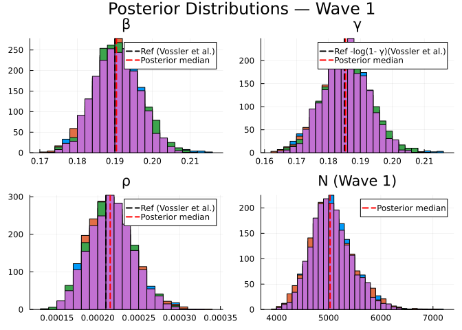
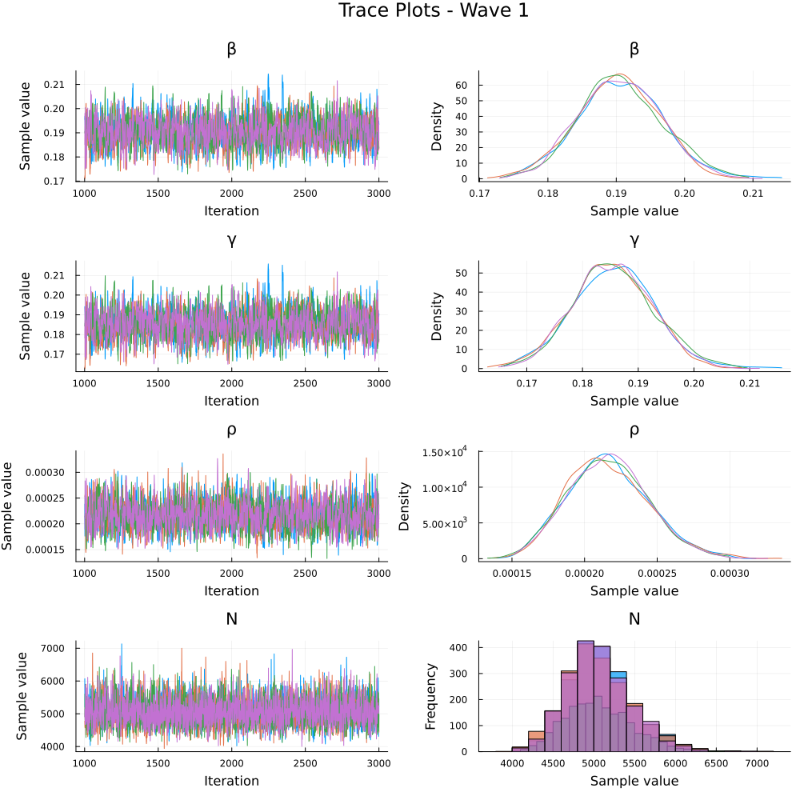
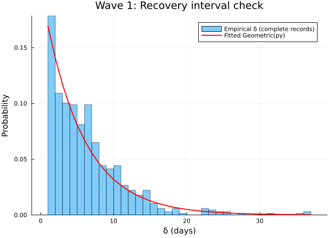
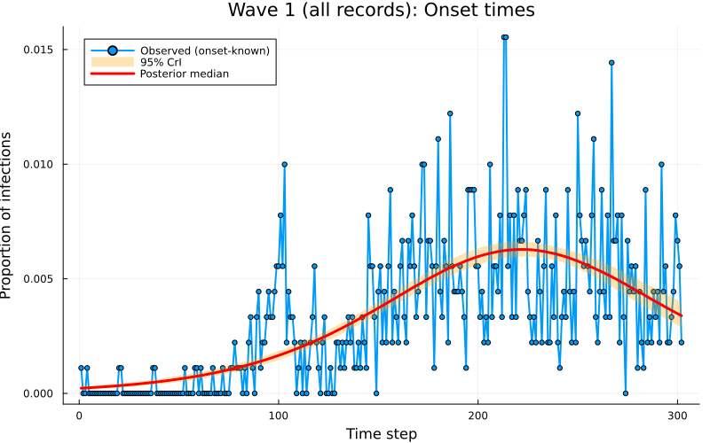

# Inference of an SIR difference equation model using dynamic survival analysis and Turing.jl - Wave 1 of the Ebola outbreak data
Sandra Montes `(@slmontes)` and Simon Frost `(@sdwfrost)`
2026-04-13

## Introduction

This notebook demonstrates how to implement and infer parameters for a
discrete-time SIR (Susceptible-Infected-Recovered) model using the
Survival Dynamical System (SDS) approach from KhudaBukhsh et al. (2019),
later referred to as Dynamic Survival Analysis (DSA). Our approach
(DDSA, Discrete Dynamical Survival Analysis) is a variant of the SDS
approach that discretises the continuous-time model into a discrete-time
model and use Turing.jl for probabilistic programming and inference.

DDSA reinterprets a discrete-time SIR map as a survival process: the map
PMF `f` gives the probability of infection at each time step, and
infection and recovery times in the case line list are treated as
event-time data. The full log-likelihood combines three components: a
Multinomial term for the onset-time histogram, a 1-indexed Geometric
term for recovery intervals (consistent with the per-step removal
probability `pγ = 1−e^{−γ}`), and a Binomial final-size constraint
linking the observed case count `K` to the at-risk population `N` and
attack fraction `τ`.

To showcase this approach we apply the method to real data. The
2018–2020 Ebola virus disease (EVD) epidemic in the Democratic Republic
of the Congo (DRC) unfolded in three successive waves across North Kivu,
South Kivu, and Ituri. In this notebook we focus on Wave 1, from the
outbreak declaration in August 2018 to 27 February 2019, and analyse 907
individual case records.

This dataset was previously analysed using the continuous version of DSA
by [Vossler et
al. (2022)](https://pmc.ncbi.nlm.nih.gov/articles/PMC8972744/#CR16). So
we will take their results as a point of comparison for our DDSA.
Therefore, our analysis inherits key data-interpretation and
epidemiological assumptions from Vossler et al. (2022), and introduces
additional discrete-time modelling assumptions specific to DDSA:

- *Hospitalisation date as removal*: the hospitalisation date is treated
  as the end of the infectious period (i.e., “removal” from
  transmission), so (δ=) `hosp − onset` is used as the infectious period
  proxy for complete records.
- *Homogeneous SIR map*: transmission and removal parameters are
  constant within-wave, with a closed, well-mixed at-risk population and
  no explicit heterogeneity (spatial, behavioural, or intervention
  time-variation) beyond what the likelihood encodes.
- *Discrete-time infectious period model (DDSA)*: infectious periods are
  modelled as 1-indexed `Geometric(pγ)` in daily time. This is the
  discrete analogue of the continuous-time exponential assumption; the
  bridge quantity is $(p_γ = 1 - e^{-γ})$, the per-day removal
  probability implied by the continuous-time rate.
- *Daily discretisation (DDSA)*: event times are analysed on a
  calendar-day grid, with onset dates contributing to the discrete
  infection-time histogram used by the map-based likelihood.

Among the 907 Wave 1 records, 679 are complete (both symptom onset and
hospitalisation dates known), 222 have a known onset but no recorded
hospitalisation, and 6 have a hospitalisation date but no known onset.
Each group contributes different likelihood terms, following the
three-case structure in [Vossler et
al. (2022)](https://pmc.ncbi.nlm.nih.gov/articles/PMC8972744/#CR16):

| Group | Count | Likelihood contribution |
|----|----|----|
| Complete (`e1=1, e2=1`) | 679 | Multinomial (onset) + Geometric (recovery) + Binomial |
| Onset-only (`e1=1, e2=0`) | 222 | Multinomial (onset) + Binomial only |
| Hosp-only (`e1=0, e2=1`) | 6 | Convolution over unknown onset + Binomial |

Onset-only records inform the infection-time distribution but not the
infectious-period term, because hospitalisation dates are missing.
Hosp-only records are handled with a convolution that marginalises over
unknown onset time:

$$\log P\left(T_{\mathrm{rem}}=t \mid f, p_\gamma\right)
=
\log\left(\sum_{u=1}^{t-1} f_u (1-p_\gamma)^{t-u-1} p_\gamma\right).$$

Since we are missing the “onset” time, but know the “removal” time, the
model treats the onset as a hidden variable and sums over every possible
day it could have happened (restricted to $u \leq t-1$ so that
$t-u \geq 1$ lies in the support of the 1-indexed Geometric infectious
period). Finally, the full log-likelihood is used to perform Bayesian
inference using NUTS in Turing.jl.

## Libraries

``` julia
using Turing              # For probabilistic programming
using Distributions       # For probability distributions
using SpecialFunctions    # For lgamma (log gamma function)
using Random              # For random number generation
using Plots               # For plotting
using StatsPlots          # For advanced plotting
using MCMCChains          # For handling MCMC output
using Dates               # For now()
using CSV                 # For reading CSV files
using DataFrames          # For data manipulation
using Statistics          # For statistical functions
include("../IntegerParameters.jl")  # shared helpers: sum integer parameters (N, r) out of the likelihood
using .IntegerParameters
```

We set a random seed for reproducibility.

``` julia
Random.seed!(1234);
```

## Utility functions

This function converts a rate, `r` over a unit time interval to a
proportion.

``` julia
function rate_to_proportion(r, t=1.0)
    if r < 0 || isnan(r)
        return 0.0
    elseif isinf(r)
        return 1.0
    else
        result = 1 - exp(-r * t)
        return isnan(result) ? 0.0 : max(min(result, 1.0), 0.0)
    end
end;
```

This function evaluates `log(exp(a) + exp(b))` by rescaling around
`max(a,b)`, avoiding underflow when summing many very small
probabilities expressed on the log scale.

``` julia
function logaddexp(a::Real, b::Real)
    m = max(a, b)
    isfinite(m) ? m + log(exp(a - m) + exp(b - m)) : m
end;
```

This function generates a vector of counts from a vector of times and
the total number of timesteps in a simulation.

``` julia
function time_counts(times::AbstractVector{<:Integer}, nsteps::Integer)
    counts = zeros(Int, nsteps)
    @inbounds for t in times
        1 ≤ t ≤ nsteps && (counts[t] += 1)
    end
    return counts
end;
```

## Transitions

We start by defining the deterministic SIR model in discrete time using
a system of difference equations. The model tracks the proportion of
susceptible (S), infected (I), cumulative infections (C), and new
infections per time step (Y).

``` julia
function sir_map!(du, u, p, t)
    (S, I, C, Y) = u
    (β, γ) = p
    infection = rate_to_proportion(β*I)*S     # New infections
    recovery = rate_to_proportion(γ)*I        # New recoveries
    @inbounds begin
        du[1] = S - infection                 # Update susceptibles
        du[2] = I + infection-recovery        # Update infected
        du[3] = C + infection                 # Update cumulative infections
        du[4] = infection                     # Store new infections
    end
    nothing
end;
```

This function solves a map with the above function signature.

``` julia
function solve_map(f, u0, nsteps, p)
    # Pre-allocate array with correct type
    sol = similar(u0, length(u0), nsteps + 1)
    # Initialize the first column with the initial state
    sol[:, 1] = u0
    # Iterate over the time steps
    @inbounds for t in 2:nsteps+1
        u = @view sol[:, t-1] # Get the current state
        du = @view sol[:, t] # Prepare the next state
        f(du, u, p, t)       # Call the function to update du
    end
    return sol
end;
```

Alternatively, we could use the `DifferentialEquations.jl` ecosystem
(via defining a `DiscreteSystem` and solving using `SimpleFunctionMap`
from `SimpleDiffEq.jl`) to simulate the model, although this incurs an
overhead in computational cost, in addition to introducing another
dependency.

This function simulates the SIR model and returns the solution, the
final epidemic size (τ) and the probability distribution of infection
times (f).

``` julia
function simulate(β, γ, ρ, nsteps)
    tspan = (0, nsteps)
    # Preserve type by using zero/one of the promoted type
    T = promote_type(typeof(β), typeof(γ), typeof(ρ))
    zero_T = zero(T)
    one_T = one(T)
    u0 = [one_T - ρ, ρ, zero_T, zero_T] # Initial conditions: S, I, C, Y
    p = [β, γ]
    sol = solve_map(sir_map!, u0, nsteps, p)
    τ = sol[3,end]      # Final size (total infected)
    f = Vector{eltype(sol)}(sol[4,2:end])  # Copy to preserve type
    f = abs.(f)         # Ensure non-negative values
    # Handle edge cases for probability vector 
    if τ <= 0 || any(isnan.(f)) || any(isinf.(f))
        f = fill(one(eltype(f))/nsteps, nsteps)
    else
        f = f/τ         # Normalise frequencies to sum to 1
    end
    return sol, τ, f
end;
```

## Data loading

We load the Ebola outbreak data from `EVD_Wave1.csv`.

``` julia
# Load the data
df_all = CSV.read("EVD_Wave1.csv", DataFrame);

# Split into three groups by data availability
df_complete   = df_all[(df_all.event1 .== 1) .& (df_all.event2 .== 1), :]
df_onset_only = df_all[(df_all.event1 .== 1) .& (df_all.event2 .== 0), :]
df_hosp_only  = df_all[(df_all.event1 .== 0) .& (df_all.event2 .== 1), :]

# Total observed infections for the Binomial final-size term
K_total = nrow(df_all)

# Use all records with a known onset time: complete + onset_only
onset_times_all = vcat(df_complete.onset, df_onset_only.onset)
# Calendar-day bins: step k holds the times in [k − 1, k), i.e. day k − 1 (day 0 is step 1). The grid ends on
# the day of the last onset.
nsteps = Int(floor(maximum(onset_times_all))) + 1
ti_onset = max.(1, min.(Int.(floor.(onset_times_all)) .+ 1, nsteps))
K_onset  = length(ti_onset)   # used in Multinomial
th_onset = time_counts(ti_onset, nsteps)

# Complete records only: hosp - onset 
raw_delta_complete = df_complete.hosp .- df_complete.onset
@assert all(raw_delta_complete .>= 0) "Found complete records with hosp < onset."
same_day_complete = count(<(1), raw_delta_complete)
delta_complete = max.(1, Int.(round.(raw_delta_complete)))

# The "onset" column for e1=0 records contains the hospitalisation time.
T_hosp_only = max.(1, min.(Int.(floor.(df_hosp_only.hosp)) .+ 1, nsteps))

# Minimum N: at least as many susceptibles as total observed infections
N_min = K_total
# Prior support of N, summed out in the likelihood: N ∈ {N_min, …, N_min + 19,999}
N_grid = NGrid(K_total, N_min, N_min + 19_999)
```

Summary of the loaded data:

    Wave 1 data summary:
      Total records (K_total, Binomial):     907
      With known onset (K_onset, Multinomial): 901
        of which complete (e1=1, e2=1):        679
        of which onset-only (e1=1, e2=0):      222
      Hosp-only (e1=0, e2=1, convolution):   6
      nsteps: 301
      Same-day/sub-day complete intervals (<1 day): 85
      Recovery intervals range: 1–37 days

## Turing Model

The Turing.jl probabilistic model for the model, specifies priors,
simulates the difference equations, and defines the likelihood for
observed data by defining the distributions of (a) the total infected
(b) the distribution of infection times, (c) the distribution of
recovery times and (d) the convolution over unknown onset time for
recovery-only records. We place uniform priors on the parameters, as
upper and lower bounds are typically easy for the user to define. Here,
we take advantage of the discrete nature of the data, by fitting a
histogram of the infection times using a multinomial distribution,
rather than a series of categorical distributions.

The wave-specific at-risk population $N$ is integer-valued and enters
the likelihood only through the Binomial final-size term. Instead of
sampling it, we sum that term over its prior support,
$N \in \{N_{\min}, \ldots, N_{\min} + 19{,}999\}$ with $N_{\min} = K$
(`marginal_N_loglik`, from the shared `IntegerParameters.jl`). The
discrete-time model and its likelihood are unchanged; only the
real-valued parameters $(\beta, \gamma, \rho)$ are sampled, with NUTS,
and posterior draws of $N$ are recovered afterwards from its exact
conditional distribution given $\tau$.

``` julia
@model function dsa_ebola_allrecords(nsteps::Int,
                                     K_total::Int,
                                     K_onset::Int,
                                     th_onset::Vector{Int},
                                     delta_complete::Vector{Int},
                                     T_hosp_only::Vector{Int},
                                     N_grid::NGrid)   # prior support of N

    # Priors for model parameters
    β ~ Uniform(0.01, 1.0)   # Transmission rate 
    γ ~ Uniform(0.01, 1.0)   # Recovery rate 
    ρ ~ Beta(1.0, 500.0)      # Initial infected proportion 
    # N ~ DiscreteUniform(N_min, N_min + 19_999) is summed out in term (1) below
    
    # Simulate deterministic model 
    _, τ, f = simulate(β, γ, ρ, nsteps)
    
    # Ensure τ is valid for binomial distribution
    τ_valid = clamp(τ, 1e-6, 1.0 - 1e-6)
    
    # Ensure f is valid for multinomial distribution
    f_valid = max.(f, 1e-10)           # Add small positive value to avoid zeros
    f_valid = f_valid / sum(f_valid)   # Normalise
    log_f_valid = log.(f_valid)
    
    # (1) Binomial final-size: all K_total infections, summed over N:
    #     log Σ_N P(N) · Binomial(K_total; N, τ)
    Turing.@addlogprob! marginal_N_loglik(N_grid, τ_valid)

    # (2) Multinomial onset histogram: records with known onset (K_onset)
    th_onset ~ Multinomial(K_onset, f_valid)

    # (3) Geometric recovery intervals: complete records only.
    # Build a 1-indexed geometric by shifting Julia's 0-indexed Geometric(p)
    # so the support matches recovery intervals in days (δ = 1,2,...).
    ϵ  = 1e-8
    pγ = clamp(rate_to_proportion(γ), ϵ, 1 - ϵ)
    G1 = LocationScale(1, 1, Geometric(pγ))
    for i in eachindex(delta_complete)
        delta_complete[i] ~ G1
    end

    # (4) Convolution for hosp-only records: marginalise over unknown onset u.
    #     L_i = Σ_{u=1}^{T_rem-1} f[u] · P(W = T_rem - u), using the same
    #     1-indexed geometric distribution G1 as above.
    for T_rem in T_hosp_only
        u_max = min(T_rem - 1, nsteps)
        log_terms = (log_f_valid[u] + logpdf(G1, T_rem - u) for u in 1:u_max)
        Turing.@addlogprob! foldl(logaddexp, log_terms; init = -Inf)
    end

    return τ_valid   # used to draw N after sampling
end;
```

## Inference

We now perform inference using the Turing model. We start by setting the
number of samples to be used in the sampler and instantiating the model.

``` julia
n_samples  = 2000
nuts_adapt = 1000
n_chains   = 4
model = dsa_ebola_allrecords(nsteps, K_total, K_onset,
                              th_onset, delta_complete, T_hosp_only, N_grid);
```

Next, we run inference using the No U-Turn Sampler (NUTS).

``` julia
sampler = NUTS(nuts_adapt, 0.8; max_depth=12, Δ_max=1000.0)
# Turing's default start (uniform(-2, 2) on the unconstrained scale) can lie far outside the prior's
# mass, e.g. ρ ≈ 0.5 under Beta(1, 500), so it is not used.
# Chains start from jittered data-based values (Methods): γ from the mean recorded onset-to-hospitalisation
# interval (p_γ = 1/mean δ), β at R0 = 1 (N is unknown, so the final size cannot be used) and ρ at its prior
# median; each value is multiplied by exp(0.1 z), z ~ N(0, 1), per chain.
init_rng = Xoshiro(20261006)
function data_inits(n)
    pγ0 = 1 / mean(delta_complete); γ0 = -log(1 - pγ0); ρh = median(Beta(1.0, 500.0))
    j() = exp(0.1 * randn(init_rng))
    [InitFromParams((β = clamp(j() * pγ0, 0.011, 0.99), γ = clamp(j() * γ0, 0.011, 0.99), ρ = j() * ρh)) for _ in 1:n]
end
# Warmup
_ = sample(model, sampler, 1; progress=false, chain_type=MCMCChains.Chains)
# Run sampler on 4 chains
@time chain = sample(model, sampler, MCMCThreads(), n_samples, n_chains;
                     progress=false, chain_type=MCMCChains.Chains, initial_params=data_inits(n_chains));

# Posterior draws of N: one draw from P(N | K, τ) per MCMC draw, added to the chain as :N
τ_draws = returned(model, chain)
N_draws = [sample_N(N_grid, τ) for τ in τ_draws]
chain   = hcat(chain, setrange(Chains(reshape(N_draws, size(N_draws, 1), 1, :), [:N]), range(chain)));
```

## Results Analysis

Once we have run the sampler, we can get a summary of the parameter
estimates, along with the expected number of samples.

``` julia
describe(chain)
```

    Chains MCMC chain (2000×18×4 Array{Float64, 3}):

    Iterations        = 1001:1:3000
    Number of chains  = 4
    Samples per chain = 2000
    Wall duration     = 30.86 seconds
    Compute duration  = 119.81 seconds
    parameters        = β, γ, ρ, N
    internals         = n_steps, is_accept, acceptance_rate, log_density, hamiltonian_energy, hamiltonian_energy_error, max_hamiltonian_energy_error, tree_depth, numerical_error, step_size, nom_step_size, logprior, loglikelihood, logjoint

    Summary Statistics

      parameters        mean        std      mcse    ess_bulk    ess_tail      rha ⋯
          Symbol     Float64    Float64   Float64     Float64     Float64   Float6 ⋯

               β      0.1906     0.0060    0.0001   1707.2905   2347.1793    1.001 ⋯
               γ      0.1857     0.0071    0.0002   1777.1635   2371.7315    1.001 ⋯
               ρ      0.0002     0.0000    0.0000   2279.5824   2755.8283    1.001 ⋯
               N   5128.6791   413.4713    5.3866   5872.5219   6515.8952    1.000 ⋯

                                                                   2 columns omitted

    Quantiles

      parameters        2.5%       25.0%       50.0%       75.0%       97.5% 
          Symbol     Float64     Float64     Float64     Float64     Float64 

               β      0.1790      0.1865      0.1906      0.1946      0.2023
               γ      0.1719      0.1808      0.1856      0.1904      0.1996
               ρ      0.0002      0.0002      0.0002      0.0002      0.0003
               N   4405.0000   4838.0000   5099.0000   5388.2500   6031.0750

NUTS diagnostics:

    NUTS internals available: [:n_steps, :is_accept, :acceptance_rate, :log_density, :hamiltonian_energy, :hamiltonian_energy_error, :max_hamiltonian_energy_error, :tree_depth, :numerical_error, :step_size, :nom_step_size, :logprior, :loglikelihood, :logjoint]
    Divergent transitions: 0 / 8000
    Max tree depth reached: 9.0
    Step size ε (median [min, max]): 0.0802 [0.0439, 0.112]

We can also plot posterior distributions for each parameter.

``` julia
β_med = median(chain[:β])
γ_med = median(chain[:γ])
ρ_med = median(chain[:ρ])
N_med = median(chain[:N])

# Vossler et al. (2022) Wave 1 reference values
p1 = histogram(chain[:β], label="", title="β", density=true)
vline!(p1, [0.190], label="Ref (Vossler et al.)", color=:black, linestyle=:dash, linewidth=2)
vline!(p1, [β_med], label="Posterior median", color=:red, linestyle=:dash, linewidth=2)

p2 = histogram(chain[:γ], label="", title="γ", density=true)
vline!(p2, [0.185], label="Ref -log(1- γ)(Vossler et al.)", color=:black, linestyle=:dash, linewidth=2)
vline!(p2, [γ_med], label="Posterior median", color=:red, linestyle=:dash, linewidth=2)

p3 = histogram(chain[:ρ], label="", title="ρ", density=true)
vline!(p3, [0.00021], label="Ref (Vossler et al.)", color=:black, linestyle=:dash, linewidth=2)
vline!(p3, [ρ_med], label="Posterior median", color=:red, linestyle=:dash, linewidth=2)

# N is wave-specific
p4 = histogram(chain[:N], label="", title="N (Wave 1)", density=true, bins=50)
vline!(p4, [N_med], label="Posterior median", color=:red, linestyle=:dash, linewidth=2)

plot(p1, p2, p3, p4, layout=(2,2), plot_title="Posterior Distributions — Wave 1")
```



Plot trace plots for MCMC diagnostics.

``` julia
plot(chain, plot_title="Trace Plots - Wave 1")
```



## Parameter Estimates

We summarise the posterior estimates for the model parameters.

``` julia
β_chain  = vec(chain[:β])
γ_chain  = vec(chain[:γ])
ρ_chain  = vec(chain[:ρ])
N_chain  = vec(chain[:N])
pγ_chain = rate_to_proportion.(γ_chain)

R0_chain       = β_chain ./ pγ_chain           # R0 of the discrete process
IP_steps_chain = 1 ./ pγ_chain                 # mean infectious period in steps (1-indexed Geometric)
I0_chain       = ρ_chain .* N_chain            # implied initial infected count
tau_chain      = K_total ./ N_chain            # observed attack rate posterior

# Posterior point estimates (medians)
β_post  = median(β_chain)
γ_post  = median(γ_chain)
ρ_post  = median(ρ_chain)
N_post  = median(N_chain)
pγ_post = rate_to_proportion(γ_post)

function posterior_summary(x; digits=4)
    (median = round(median(x); digits=digits),
     mean   = round(mean(x);   digits=digits),
     q025   = round(quantile(x, 0.025); digits=digits),
     q975   = round(quantile(x, 0.975); digits=digits))
end

posterior_table = (
    N         = posterior_summary(N_chain;        digits=0),
    β         = posterior_summary(β_chain;        digits=4),
    γ         = posterior_summary(γ_chain;        digits=4),
    ρ         = posterior_summary(ρ_chain;        digits=5),
    R0        = posterior_summary(R0_chain;       digits=3),
    IP_steps  = posterior_summary(IP_steps_chain; digits=2),
    I0        = posterior_summary(I0_chain;       digits=2),
    K_over_N  = posterior_summary(tau_chain;      digits=4),
)
```

    (N = (median = 5099.0, mean = 5129.0, q025 = 4405.0, q975 = 6031.0), β = (median = 0.1906, mean = 0.1906, q025 = 0.179, q975 = 0.2023), γ = (median = 0.1856, mean = 0.1857, q025 = 0.1719, q975 = 0.1996), ρ = (median = 0.00022, mean = 0.00022, q025 = 0.00017, q975 = 0.00028), R0 = (median = 1.125, mean = 1.125, q025 = 1.11, q975 = 1.141), IP_steps = (median = 5.9, mean = 5.91, q025 = 5.53, q975 = 6.33), I0 = (median = 1.11, mean = 1.13, q025 = 0.8, q975 = 1.53), K_over_N = (median = 0.1779, mean = 0.178, q025 = 0.1504, q975 = 0.2059))

    N           median = 5099.0   mean = 5129.0   95% CI = [4405.0, 6031.0]
    β           median = 0.1906   mean = 0.1906   95% CI = [0.179, 0.2023]
    γ           median = 0.1856   mean = 0.1857   95% CI = [0.1719, 0.1996]
    ρ           median = 0.00022   mean = 0.00022   95% CI = [0.00017, 0.00028]
    R0          median = 1.125   mean = 1.125   95% CI = [1.11, 1.141]
    IP_steps    median = 5.9   mean = 5.91   95% CI = [5.53, 6.33]
    I0          median = 1.11   mean = 1.13   95% CI = [0.8, 1.53]
    K_over_N    median = 0.1779   mean = 0.178   95% CI = [0.1504, 0.2059]

    Vossler et al. (2022) Wave 1 reference (continuous-time, β/γ):
      β = 0.190, γ = 0.169, ρ = 0.00021, β/γ = 1.124, 1/γ = 5.9 d

## Recovery interval fit check

``` julia
# Empirical δ histogram vs fitted Geometric(pγ_post) PMF (1-indexed)
δ = delta_complete
kmax = maximum(δ)
ks = 1:kmax
pmf = pdf.(LocationScale(1, 1, Geometric(pγ_post)), ks)

pδ = histogram(δ;
    normalize=true,
    bins=1:kmax,
    alpha=0.5,
    label="Empirical δ (complete records)",
    xlabel="δ (days)",
    ylabel="Probability",
    title="Wave 1: Recovery interval check"
)
plot!(pδ, ks, pmf; linewidth=2, color=:red, label="Fitted Geometric(pγ)")
pδ
```



## Epidemic curve

``` julia
sol, τ, f = simulate(β_post, γ_post, ρ_post, nsteps)

n_samples_ci = min(500, length(chain[:β]))
sample_idx   = rand(1:length(chain[:β]), n_samples_ci)
f_samples    = Matrix{Float64}(undef, nsteps, n_samples_ci)

for (idx, i) in enumerate(sample_idx)
    _, _, f_i = simulate(chain[:β][i], chain[:γ][i], chain[:ρ][i], nsteps)
    f_samples[:, idx] = f_i
end

f_median = [quantile(f_samples[t, :], 0.5)   for t in 1:nsteps]
f_lower  = [quantile(f_samples[t, :], 0.025) for t in 1:nsteps]
f_upper  = [quantile(f_samples[t, :], 0.975) for t in 1:nsteps]

# Normalised onset histogram 
p1 = plot(1:nsteps, th_onset ./ K_onset,
          label="Observed (onset-known)",
          title="Wave 1 (all records): Onset times",
          xlabel="Time step", ylabel="Proportion of infections",
          linewidth=2, marker=:circle, markersize=3)
plot!(p1, 1:nsteps, f_lower,
      fillrange=f_upper, fillalpha=0.3, fillcolor=:orange,
      linecolor=:orange, label="95% CrI", linewidth=0)
plot!(p1, 1:nsteps, f_median,
      label="Posterior median", linewidth=3, color=:red)
plot(p1, size=(800, 500))
```



## Save epidemic curve data

## Discussion

This example demonstrates a probabilistic programming approach to
inference of individual infection and recovery times using a discrete
version of dynamic survival analysis (DDSA) applied to Wave 1 of the
Ebola outbreak data from the Democratic Republic of the Congo. The model
provides posterior estimates for the transmission rate (β), recovery
rate (γ), initial proportion of infected individuals (ρ), the implied
initial infected count $I_0 = \rho N$, and the wave-specific effective
at-risk scale (N) that enters the Binomial final-size observation model.

Compared to the original implementation of DSA from Vossler et
al. (2022), which used a stochastic SIR model solved via continuous-time
ordinary differential equations (ODEs), we use a deterministic SIR map
(discrete-time transition function) that updates the system state at
discrete time steps using difference equations. Despite this difference
in modelling approach, our posterior medians for β, ρ fall within the
95% credible intervals of the original implementation: β = 0.191
\[0.179, 0.202\] (Vossler point estimate 0.190, CI \[0.178, 0.204\]); γ
= 0.186 \[0.172, 0.200\] (Vossler 0.169 \[0.157, 0.183\]);
$p_\gamma = 1 - e^{-\gamma}$ = 0.169 at the quoted γ, comparable to
interpreting Vossler’s continuous removal rate on a daily scale; ρ =
0.00022 \[0.00017, 0.00028\] (Vossler 0.00021 \[0.00016, 0.00027\]);
$I_0 = \rho N$ = 1.1 \[0.8, 1.5\]; $R_0 = \beta / p_\gamma$ = 1.125
(Vossler β/γ = 1.124); mean infectious period $1 / p_\gamma$ = 5.90 days
(Vossler 1/γ = 5.9 days).

Vossler et al. (2022) reported inference with a joint likelihood across
waves and a single effective population size $N$ shared by all waves
(together with wave-specific transmission and removal parameters). Here
we fit Wave 1 only, in its own time window with re-initialised
compartmental conditions, so our $N$ is a wave-specific effective
susceptible scale in $K \sim \mathrm{Binomial}(N,\tau)$ for that window.
Thus, it is not the same globally pooled $N$ estimand, though both play
the same role of linking observed case counts to the model-implied
attack fraction $\tau$.
