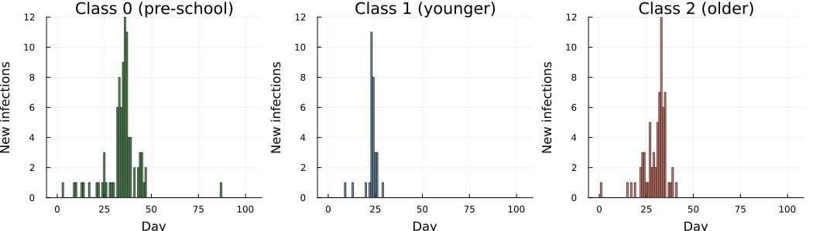
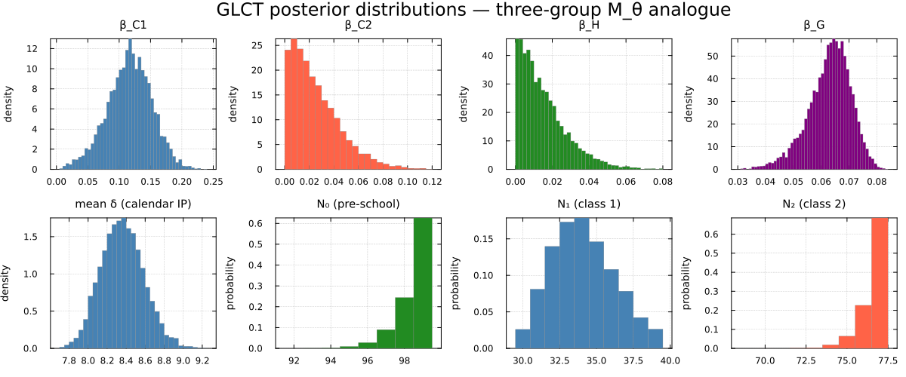
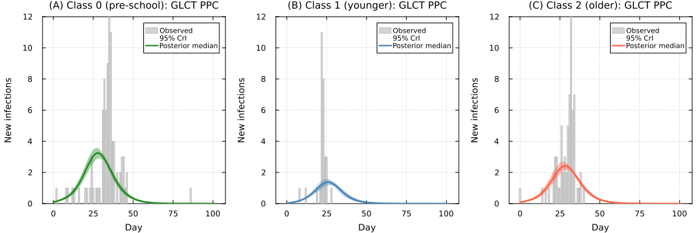
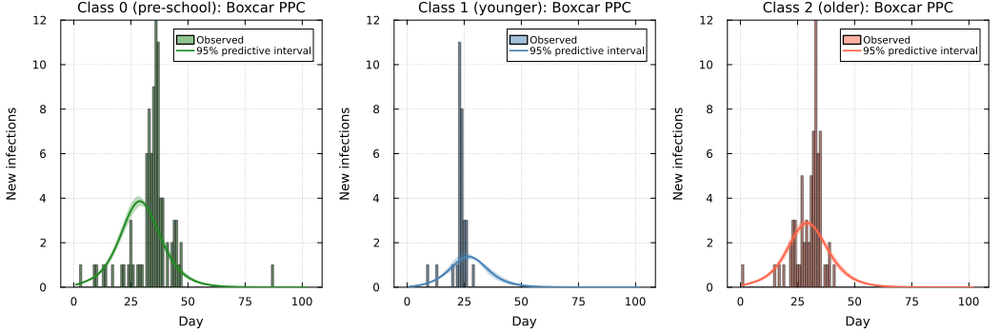
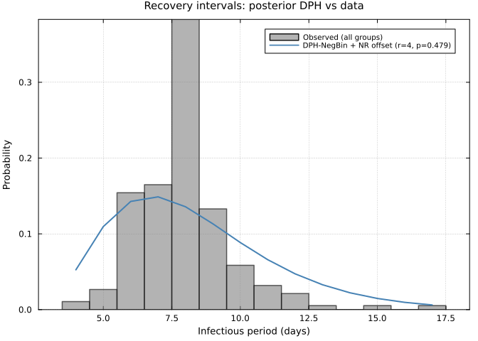

# Hagelloch 1861 measles: GLCT vs Boxcar DDSA comparison (M_θ analogue)
Sandra Montes (`@slmontes`)
2026-03-25

# Introduction

We apply discrete dynamic survival analysis (DDSA) to the 1861 measles
outbreak in Hagelloch, Germany (188 cases over 86 days). The line list
of this outbreak was used on an individual-level analysis by Neal &
Roberts (2004, hereafter NR), which we use as a reference point.

This study treats the Hagelloch measles outbreak as a stress test of our
stratified mean-field DDSA model. The Hagelloch data are a challenging
case because transmission is strongly shaped by individual-level contact
structure (household and classroom links), which is explicitly
represented in the Neal and Roberts framework. By contrast, our
specification intentionally aggregates transmission into three
interacting groups and therefore does not attempt to reproduce the full
contact network.

Our goal is not to reproduce NR’s individual-level household/contact
likelihood, but to assess what a mean-field DDSA analogue can recover
from the case line list with a simplified model: the qualitative
hierarchy of transmission parameters (specifically
$\beta_{C1} > \beta_{C2}$ and $\beta_H > 0$, together with correct
epidemic sequencing of the three groups) and the susceptible group
sizes, which NR treat as fixed but DDSA infers via final-size
constraints. Because the contact structure is aggregated into mean-field
terms, we expect per-group attack rates to be underestimated relative to
the data.

The dataset is available in R’s `outbreaks` package as
`measles_hagelloch_1861`. Individual prodrome-onset dates and rash-onset
dates are recorded for all cases, allowing us to:

1.  Construct the infection-time histogram (`th`) from prodrome-onset
    dates.
2.  Compute observed infectious-period durations (`delta`) as
    $\delta_i = (t_{\mathrm{ERU},i} - t_{\mathrm{PRO},i}) + 4$ days,
    following Neal & Roberts (2004) with $d_0 = 3$ (child remains
    infectious 3 days after rash onset) and $d_1 = 1$ (child becomes
    infectious 1 day before prodrome onset), so the +4 = $d_0 + d_1$.

The infectious period has empirical mean $\approx$ 8 days. We model it
with a NegBin discrete phase-type (DPH) distribution (rather than a
simple geometric period).

Neal & Roberts (2004) partitions the 188 cases into three groups based
on school enrolment:

- *Class 0 (not yet enrolled)*: No initial cases; infected via household
  transmission, peaked later (infection times 8–28 days).
- *Class 1 (younger school class)*: No initial cases; concentrated wave
  peaking around days 21–28.
- *Class 2 (older school class)*: Contains index case; infection times
  span the full epidemic window (days 0–40), with the main wave peaking
  around day 28–30.

We use the four transmission parameters from NR’s model $M_\theta$:
within-class 1 ($\beta_{C1}$), within-class 2 ($\beta_{C2}$), a
household-route term from school to pre-school ($\beta_H$), and a global
uniform-mixing term ($\beta_G$). The infectious period is shared across
classes and modelled with a NegBin DPH. Inference uses NUTS for
$\beta_{C1}$, $\beta_{C2}$, $\beta_H$, $\beta_G$ and the calendar mean
$\mathbb{E}[\delta]$. The integer-valued phase count $r$ and population
sizes $N_0$, $N_1$, $N_2$ are summed out of the likelihood over their
prior supports, and their posterior draws are recovered after sampling
(see Inference). We set $p = r/(\mathbb{E}[\delta]-\delta_{\min}+r)$
given $\mathbb{E}[\delta]$ and $r$. Calendar infectious period $\delta$
includes NR’s fixed $+4$ days, so we prepend $(\delta_{\min}-r)$
deterministic day-states to that DPH (with
$\delta_{\min}=\min_i \delta_i = 4$ here), giving support
$\{\delta_{\min},\delta_{\min}+1,\ldots\}$ and
$\mathbb{E}[\delta]=(\delta_{\min}-r)+r/p$.

NR parameterise the per-day rate at which infectious individual $i$
infects susceptible $j$ as

$$\alpha_{ij} = \beta_H \mathbf{1}_{\{\text{same household}\}} + \beta_C^1 \mathbf{1}_{\{L_i = L_j = 1\}} + \beta_C^2 \mathbf{1}_{\{L_i = L_j = 2\}} + \beta_G,$$

where the global term $\beta_G$ replaces the distance-decay
$\beta_G \exp(-\theta\rho(i,j))$ of the full model M by setting
$\theta = 0$. Our mean-field analogue translates this individual-level
rate into group-level forces of infection:

$$\lambda_0 = \bigl(1 - e^{-[\beta_H (I_1 + I_2) + \beta_G (I_0 + I_1 + I_2)]}\bigr)S_0$$

$$\lambda_1 = \bigl(1 - e^{-[\beta_{C1}\, I_1 + \beta_G (I_0 + I_1 + I_2)]}\bigr)S_1$$

$$\lambda_2 = \bigl(1 - e^{-[\beta_{C2}\, I_2 + \beta_G (I_0 + I_1 + I_2)]}\bigr)S_2$$

Here $S_k$ and $I_k$ are the susceptible and infectious fractions of
group $k$ (each ranging over $[0,1]$), and $N_0$, $N_1$, $N_2$ are
inferred via Binomial final-size likelihoods.

We treat Class 0 as downstream of the school epidemic via the
household-route term $\beta_H$ and allow mixing between the school
classes through $\beta_G$. No spatial coordinates enter the model
($\theta=0$ in the NR notation).

We fit the model using two function-map implementations (GLCT and
Boxcar) that share the same likelihood terms and recovery model. The
agreement between them is used as an implementation check.

## Libraries

``` julia
using Random, LinearAlgebra
import Statistics: mean, std, median, quantile
using Distributions
using Turing
using MCMCChains   # sample(...; chain_type=MCMCChains.Chains)
using StatsPlots, Plots
using ForwardDiff
using CSV, DataFrames
using MCMCDiagnosticTools

include("../PhaseTypeDistributions.jl")
import .PhaseTypeDistributions
include("../IntegerParameters.jl")  # shared helpers: sum integer parameters (N, r) out of the likelihood
using .IntegerParameters
```

``` julia
Random.seed!(1234)
```

# Data

``` julia
df = CSV.read("hagelloch.csv", DataFrame)

# CSV.jl return type IDs / class labels as Int
function _line_list_id(v)
    ismissing(v) && return nothing
    if v isa Union{Integer, AbstractFloat}
        x = Float64(v)
        isfinite(x) || return nothing
        return Int(round(x))
    end
    s = strip(string(v))
    (isempty(s) || uppercase(s) in ("NA", "N/A", ".")) && return nothing
    return tryparse(Int, s)
end

df0 = filter(r -> coalesce(_line_list_id(r.class), -1) == 0, df)
df1 = filter(r -> coalesce(_line_list_id(r.class), -1) == 1, df)
df2 = filter(r -> coalesce(_line_list_id(r.class), -1) == 2, df)

K0 = nrow(df0)
K1 = nrow(df1)
K2 = nrow(df2)

# Bounds from the 197 children under 14 recorded by Pfeilsticker (1863; as cited by Neal & Roberts 2004):
# infer N0,N1,N2 from K0,K1,K2 with N_total=197.
N_total = 197
N0_max  = N_total - K1 - K2   # = 197 - 30 - 68 = 99
N1_max  = N_total - K0 - K2   # = 197 - 90 - 68 = 39
N2_max  = N_total - K0 - K1   # = 197 - 90 - 30 = 77

# Shared epidemic window across all three classes
Tmax = maximum(vcat(df0.t_infection, df1.t_infection, df2.t_infection))

# Shared recovery intervals (all three groups)
delta = vcat(df0.inf_period, df1.inf_period, df2.inf_period)

# Buffer beyond Tmax: a couple of mean infectious periods
nsteps = Tmax + 2 * round(Int, mean(delta))

# Infection-time histograms (1-indexed)
th0 = zeros(Int, nsteps)
th1 = zeros(Int, nsteps)
th2 = zeros(Int, nsteps)
for row in eachrow(df0); idx = row.t_infection + 1; idx <= nsteps && (th0[idx] += 1); end
for row in eachrow(df1); idx = row.t_infection + 1; idx <= nsteps && (th1[idx] += 1); end
for row in eachrow(df2); idx = row.t_infection + 1; idx <= nsteps && (th2[idx] += 1); end

# Support condition for offset NegBin DPH: r ≤ δ_min.
nb_r_max = minimum(delta)
```

    K0=90 (class 0),  K1=30 (class 1),  K2=68 (class 2)
    nsteps = 102  (covers epidemic window to day 86 + buffer)
    Recovery intervals: mean=7.95 d,  min=4,  max=17,  CV=0.219
    nb_r_max = 4  (geometric CV would be 1.0; empirical CV=0.22 → NegBin DPH warranted)

``` julia
# Data-derived: source of infection for class 0 (pre-school) cases
class_lookup = Dict{Int, Int}()
for row in eachrow(df)
    kid = _line_list_id(row.case_ID)
    kid === nothing && continue
    cid = _line_list_id(row.class)
    cid === nothing && continue
    class_lookup[kid] = cid
end
c0_from_school = count(eachrow(df0)) do row
    inf = row.infector
    iid = _line_list_id(inf)
    iid === nothing && return false
    cls = get(class_lookup, iid, nothing)
    cls !== nothing && cls in (1, 2)
end
c0_from_c0 = count(eachrow(df0)) do row
    inf = row.infector
    iid = _line_list_id(inf)
    iid === nothing && return false
    cls = get(class_lookup, iid, nothing)
    cls !== nothing && cls == 0
end
c0_unresolved = K0 - c0_from_school - c0_from_c0
```

    Class 0 infection source (from `infector` column):
      from school siblings (class 1 or 2): 53 / 90  (58.9%)
      from class 0 (community play):        34 / 90  (37.8%)
      unresolved (missing or unknown infector): 3 / 90  (3.3%)

Plot of the infection-time histograms extracted from the data:



# Models

Both the GLCT and Boxcar maps implement the same three-group $M_\theta$
force-of-infection structure and the same NegBin DPH infectious-period
distribution. They differ only in how the infectious-period distribution
is propagated in time: the GLCT updates a phase-vector by matrix
multiplication, while the Boxcar tracks infection-age cohorts using a
discrete hazard vector derived from that same DPH.

## GLCT

The SIR map tracks susceptible fractions $S_k$ and phase-vector
$\mathbf{x}_k$ for each group $k \in \{0, 1, 2\}$. Transmission follows
the forces of infection $\lambda_k$ previously defined, and there is no
feedback from class 0 to school classes.

``` julia
"""GLCT model (M_θ analogue).
Propagates three phase-vectors using the exponential rate-to-probability force of infection.
All arrays are allocated once per call and updated in place."""
function run_sir_mtheta(T_mat, alpha, beta_C1, beta_C2, beta_H, beta_G,
                         rho0, rho1, rho2, nsteps)
    T_el = promote_type(eltype(T_mat), eltype(alpha),
                        typeof(beta_C1), typeof(beta_C2),
                        typeof(beta_H),  typeof(beta_G),
                        typeof(rho0), typeof(rho1), typeof(rho2))
    k  = length(alpha)
    αT = T_el.(alpha)

    S0 = one(T_el) - T_el(rho0);  x0 = αT .* T_el(rho0)
    S1 = one(T_el) - T_el(rho1);  x1 = αT .* T_el(rho1)
    S2 = one(T_el) - T_el(rho2);  x2 = αT .* T_el(rho2)
    y0 = similar(x0);  y1 = similar(x1);  y2 = similar(x2)   # next-step buffers

    S0_hist = Vector{T_el}(undef, nsteps + 1);  S0_hist[1] = S0
    S1_hist = Vector{T_el}(undef, nsteps + 1);  S1_hist[1] = S1
    S2_hist = Vector{T_el}(undef, nsteps + 1);  S2_hist[1] = S2

    for t in 1:nsteps
        I0 = sum(x0);  I1 = sum(x1);  I2 = sum(x2)
        I_total = I0 + I1 + I2

        # Forces of infection (M_θ)
        # p = 1 − exp(−rate·Δt) with Δt=1; clamp to [0, Sk] for numerical safety
        r0 = T_el(beta_H) * (I1 + I2) + T_el(beta_G) * I_total
        r1 = T_el(beta_C1) * I1        + T_el(beta_G) * I_total
        r2 = T_el(beta_C2) * I2        + T_el(beta_G) * I_total
        λ0 = min(max((one(T_el) - exp(-r0)) * S0, zero(T_el)), S0)
        λ1 = min(max((one(T_el) - exp(-r1)) * S1, zero(T_el)), S1)
        λ2 = min(max((one(T_el) - exp(-r2)) * S2, zero(T_el)), S2)

        # y = T_matᵀ x + α λ, written as explicit loops (same order as T_mat' * x)
        @inbounds for j in 1:k
            a0 = T_mat[1, j] * x0[1];  a1 = T_mat[1, j] * x1[1];  a2 = T_mat[1, j] * x2[1]
            for i in 2:k
                a0 += T_mat[i, j] * x0[i];  a1 += T_mat[i, j] * x1[i];  a2 += T_mat[i, j] * x2[i]
            end
            y0[j] = a0 + αT[j] * λ0;  y1[j] = a1 + αT[j] * λ1;  y2[j] = a2 + αT[j] * λ2
        end
        x0, y0 = y0, x0;  x1, y1 = y1, x1;  x2, y2 = y2, x2
        S0 -= λ0;  S1 -= λ1;  S2 -= λ2

        S0_hist[t + 1] = S0;  S1_hist[t + 1] = S1;  S2_hist[t + 1] = S2
    end

    function to_pmf(S_hist)
        f = T_el[max(S_hist[t] - S_hist[t+1], zero(T_el)) for t in 1:nsteps]
        sF = sum(f)
        sF > T_el(1e-12) ? f ./ sF : fill(one(T_el)/nsteps, nsteps)
    end

    tau0 = S0_hist[1] - S0_hist[end]
    tau1 = S1_hist[1] - S1_hist[end]
    tau2 = S2_hist[1] - S2_hist[end]

    return (tau0=tau0, f0=to_pmf(S0_hist),
            tau1=tau1, f1=to_pmf(S1_hist),
            tau2=tau2, f2=to_pmf(S2_hist))
end
```

## Boxcar

The Boxcar model uses infection-age cohort bookkeeping: newly infected
individuals enter age class 1 and advance one step per day, exiting at
the discrete hazard $h(k) = P(W=k \mid W \geq k)$ derived from the same
offset NegBin DPH. Both representations share the same marginal
recovery-time distribution and the same $1 - e^{-\text{rate}}$
discretisation of the force of infection.

The hazard vector $\mathbf{h}$ is computed by iterating the
transient-state vector $\mathbf{x}_{k+1} = S^\top\mathbf{x}_k$ (starting
from $\mathbf{x}_1 = \alpha$) and setting
$h(k) = (\mathbf{x}_k \cdot \mathbf{s})/\sum\mathbf{x}_k$, where
$\mathbf{s}$ is the absorption probability vector. The implementation is
ForwardDiff-compatible (Dual-valued parameters), other AD methods may
also work but have not been tested here.

``` julia
"""Compute discrete hazard h[k] = P(W=k|W≥k) from a DPH by iterating the state vector.
If dph has ForwardDiff Dual parameters, returns a Dual-typed vector."""
function hazard_vector_from_dph(dph, K_age::Integer)
    T   = eltype(dph.α)
    s   = dph.s
    h   = Vector{T}(undef, K_age)
    x   = copy(dph.α)          # state probability vector at infection-age 1
    for k in 1:K_age
        sf_val  = sum(x)
        pmf_val = dot(x, s)
        h[k]    = (sf_val > T(1e-15) && isfinite(sf_val)) ? pmf_val / sf_val : T(0.01)
        x       = dph.S' * x   # advance to next infection age
    end
    h[end] = one(T)            # boundary: everyone at the last class recovers
    return clamp.(h, zero(T), one(T))
end

"""Boxcar model (M_θ analogue).
Propagates three infection-age vectors using discrete hazard h_rec and the same exponential rate-to-probability force.
All arrays are allocated once per call and updated in place."""
function run_sir_mtheta_boxcar(h_rec, K_age::Int,
                                beta_C1, beta_C2, beta_H, beta_G,
                                rho0, rho1, rho2, nsteps::Int)
    T_el = promote_type(eltype(h_rec), typeof(beta_C1), typeof(beta_C2),
                        typeof(beta_H),  typeof(beta_G),
                        typeof(rho0), typeof(rho1), typeof(rho2))

    S0 = one(T_el) - T_el(rho0)
    S1 = one(T_el) - T_el(rho1)
    S2 = one(T_el) - T_el(rho2)

    # All initial infecteds placed in age class 1 (consistent with offset DPH α[1]=1)
    x0 = zeros(T_el, K_age);  x0[1] = T_el(rho0)
    x1 = zeros(T_el, K_age);  x1[1] = T_el(rho1)
    x2 = zeros(T_el, K_age);  x2[1] = T_el(rho2)
    surv = Vector{T_el}(undef, K_age)                          # 1 − h[k], computed once
    @inbounds for k in 1:K_age
        surv[k] = one(T_el) - T_el(h_rec[k])
    end

    S0_hist = Vector{T_el}(undef, nsteps + 1);  S0_hist[1] = S0
    S1_hist = Vector{T_el}(undef, nsteps + 1);  S1_hist[1] = S1
    S2_hist = Vector{T_el}(undef, nsteps + 1);  S2_hist[1] = S2

    for t in 1:nsteps
        I0 = sum(x0);  I1 = sum(x1);  I2 = sum(x2)
        I_total = I0 + I1 + I2

        # Exponential rate-to-probability discretisation — identical to run_sir_mtheta
        r0 = T_el(beta_H) * (I1 + I2) + T_el(beta_G) * I_total
        r1 = T_el(beta_C1) * I1        + T_el(beta_G) * I_total
        r2 = T_el(beta_C2) * I2        + T_el(beta_G) * I_total
        λ0 = min(max((one(T_el) - exp(-r0)) * S0, zero(T_el)), S0)
        λ1 = min(max((one(T_el) - exp(-r1)) * S1, zero(T_el)), S1)
        λ2 = min(max((one(T_el) - exp(-r2)) * S2, zero(T_el)), S2)

        # New infections enter age class 1; h[k] fraction absorbs (recovers), 1−h[k] advances.
        # k == K_age: h[K_age]=1, all remaining mass is absorbed
        # shift ages in place, from the oldest class down, so no second buffer is needed
        @inbounds for k in (K_age - 1):-1:1
            x0[k+1] = x0[k] * surv[k]
            x1[k+1] = x1[k] * surv[k]
            x2[k+1] = x2[k] * surv[k]
        end
        x0[1] = λ0;  x1[1] = λ1;  x2[1] = λ2
        S0 = max(zero(T_el), S0 - λ0)
        S1 = max(zero(T_el), S1 - λ1)
        S2 = max(zero(T_el), S2 - λ2)

        S0_hist[t + 1] = S0;  S1_hist[t + 1] = S1;  S2_hist[t + 1] = S2
    end

    function to_pmf(S_hist)
        f = T_el[max(S_hist[t] - S_hist[t+1], zero(T_el)) for t in 1:nsteps]
        sF = sum(f)
        sF > T_el(1e-12) ? f ./ sF : fill(one(T_el)/nsteps, nsteps)
    end

    tau0 = S0_hist[1] - S0_hist[end]
    tau1 = S1_hist[1] - S1_hist[end]
    tau2 = S2_hist[1] - S2_hist[end]

    return (tau0=tau0, f0=to_pmf(S0_hist),
            tau1=tau1, f1=to_pmf(S1_hist),
            tau2=tau2, f2=to_pmf(S2_hist))
end
```

    K_age_boxcar = 40  (99.99th-percentile truncation for Boxcar age dimension)

# Inference

The model has four integer-valued parameters: the phase count nb_r of
the NegBin–DPH (with Neal–Roberts offset) and the group sizes $N_0$,
$N_1$, $N_2$. Instead of sampling them, we sum them out of the
likelihood over their prior supports, using the shared
`IntegerParameters.jl` helpers. The discrete-time model and its
likelihood are unchanged. $N_0$ and $N_1$ enter only their Binomial
final-size terms, so each is summed with `marginal_N_loglik`. $N_2$ also
sets the seed $\rho_2 = 1/N_2$, and nb_r changes the DPH, so these two
change the forward map and are summed jointly over their $4 \times 10$
grid with `marginal_r_loglik` (one forward-map run per combination; the
40 runs are evaluated in parallel with `threaded = true`, which does not
change the results). NUTS then samples the real-valued parameters
$\beta_{C1}$, $\beta_{C2}$, $\beta_H$, $\beta_G$ and
$\mathbb{E}[\delta]$, and posterior draws of the four integer parameters
are recovered afterwards from their exact conditional distributions. The
epidemic is seeded by a single index case in Class 2 ($\rho_2 = 1/N_2$)
with no initial infections in Classes 0 or 1 ($\rho_0 = \rho_1 = 0$),
consistent with the Hagelloch data where the first recorded case belongs
to Class 2.

The group population sizes are not recoverable from `hagelloch.csv`,
which records only the 188 infected individuals. All three susceptible
population sizes are therefore inferred from the data via the Binomial
final-size constraints $K_k \sim \mathrm{Binomial}(N_k, \tau_k)$ for
$k \in \{0, 1, 2\}$. By contrast, in the Hagelloch analysis of Neal &
Roberts (2004), population size is treated as given (they assume
$m=n=188$) within an individual event-history likelihood. Thus, their
framework does not identify group denominators from aggregate case
counts alone.

Each $N_k$ is given a $\mathrm{DiscreteUniform}(K_k, N_{k,\max})$ prior.
The lower bound $K_k$ is the minimum possible group size (cannot have
fewer susceptibles than observed cases). For the upper bound we use an
external population count: Pfeilsticker’s original epidemic
documentation (as cited in Neal & Roberts, 2004) records 197 children
under 14 in Hagelloch at the time of the outbreak. Of these, 185 were
infected and are present in the line list (plus 3 teenagers aged 14–15,
giving $K = 188$ total); the 12 non-infected children each had a
documented reason for non-infection (7 infants with placental immunity,
3 kept in total isolation, 1 two-year-old, 1 immigrant who had
previously had measles). Neal & Roberts therefore conclude that
virtually all truly susceptible children were infected, and treat the
total susceptible population as $N_{\mathrm{total}} = 197$.

Assuming all 197 children belong to one of the three groups, the maximum
possible size of group $k$ is:

$$N_{k,\max} = N_{\mathrm{total}} - K_{k'} - K_{k''}.$$

This gives $N_0 \in [90, 99]$, $N_1 \in [30, 39]$, $N_2 \in [68, 77]$,
tight ranges reflecting the near-complete attack rate (188/197 = 95%).

## GLCT Turing model

``` julia
function safe_normalise(f::AbstractVector{T}, n::Int) where T
    f_pos = ifelse.(isnan.(f) .| .!isfinite.(f), zero(T), max.(f, zero(T)))
    sF = sum(f_pos)
    (sF > T(1e-15) && isfinite(sF)) ? f_pos ./ sF : fill(one(T)/n, n)
end

# Infectious period: offset NegBin DPH with minimum δ_floor.

# Forward maps with the transmission rates fixed, as functions of the DPH and the class-2 seed ρ2.
# Index case in class 2: ρ0 = ρ1 = 0.
glct_propagate(beta_C1, beta_C2, beta_H, beta_G) =
    (dph, rho2) -> run_sir_mtheta(dph.S, dph.α, beta_C1, beta_C2, beta_H, beta_G,
                                  0.0, 0.0, rho2, nsteps)
boxcar_propagate(beta_C1, beta_C2, beta_H, beta_G) =
    (dph, rho2) -> run_sir_mtheta_boxcar(hazard_vector_from_dph(dph, K_age_boxcar), K_age_boxcar,
                                         beta_C1, beta_C2, beta_H, beta_G, 0.0, 0.0, rho2, nsteps)

"""Log-likelihood for one (nb_r, N2) combination, with N0 and N1 summed out of their
Binomial final-size terms. Shared by the GLCT and Boxcar models, which differ only in
`propagate`. Also returns the class 0 and 1 attack rates, used to draw N0 and N1."""
function hagelloch_cell(propagate, nb_r, N2, mean_δ, δ_floor,
                        N0_grid, N1_grid, K2, th0, th1, th2, delta)
    nb_p = nb_r / (mean_δ - δ_floor + nb_r)
    dph  = PhaseTypeDistributions.dph_negative_binomial_min_support(nb_r, nb_p, δ_floor)
    sim  = propagate(dph, 1.0 / N2)   # rho2 seeds one case out of N2 susceptibles

    tau0 = clamp(sim.tau0, 0.001, 0.999)
    tau1 = clamp(sim.tau1, 0.001, 0.999)
    tau2 = clamp(sim.tau2, 0.001, 0.999)

    f0 = safe_normalise(sim.f0, nsteps)
    f1 = safe_normalise(sim.f1, nsteps)
    f2 = safe_normalise(sim.f2, nsteps)

    # Binomial final-size constraints (N0 and N1 summed over their prior supports)
    ll = marginal_N_loglik(N0_grid, tau0) + marginal_N_loglik(N1_grid, tau1) +
         logpdf(Binomial(N2, tau2), K2)

    # Infection-time histograms
    for (K, f, th) in ((N0_grid.K, f0, th0), (N1_grid.K, f1, th1), (K2, f2, th2))
        (K > 0 && all(isfinite, f) && abs(sum(f) - 1) < 0.01) || return (ll = -Inf, tau0 = tau0, tau1 = tau1)
        ll += logpdf(Multinomial(K, f), th)
    end

    # Shared NegBin DPH recovery likelihood
    ll += sum(logpdf(dph, d) for d in delta)
    return (ll = ll, tau0 = tau0, tau1 = tau1)
end

@model function ddsa_hagelloch_mtheta(N0_grid::NGrid, N1_grid::NGrid, K2::Int, cells,
                                       th0::Vector{Int}, th1::Vector{Int},
                                       th2::Vector{Int},
                                       delta::Vector{Int},
                                       δ_floor::Int)
    # Priors. N0, N1 (NGrid) and (nb_r, N2) (cells) are summed out below, with
    # N_k ~ DiscreteUniform(K_k, N_k,max) and nb_r ~ DiscreteUniform(1, nb_r_max).
    # Exponential priors to avoid near-zero-rate initialisation.
    beta_C1 ~ Exponential(0.2)
    beta_C2 ~ Exponential(0.1)
    beta_H  ~ Exponential(0.1)
    beta_G  ~ Exponential(0.1)
    # Reparameterise (r, p) by mean δ, so p = r/(mean δ − δ_floor + r) keeps its meaning across r.
    mean_δ ~ Uniform(δ_floor + 0.5, 25.0)

    propagate = glct_propagate(beta_C1, beta_C2, beta_H, beta_G)
    # threaded: the 40 (nb_r, N2) forward-map runs are evaluated as parallel tasks
    logmarg, lps = marginal_r_loglik(cells; threaded = true) do (nb_r, N2)
        hagelloch_cell(propagate, nb_r, N2, mean_δ, δ_floor,
                       N0_grid, N1_grid, K2, th0, th1, th2, delta).ll
    end
    Turing.@addlogprob! logmarg
    return lps   # per-(nb_r, N2) log-likelihoods, used to draw the integer parameters
end
```

## Boxcar Turing model

``` julia
@model function ddsa_hagelloch_mtheta_boxcar(N0_grid::NGrid, N1_grid::NGrid, K2::Int, cells,
                                              th0::Vector{Int}, th1::Vector{Int},
                                              th2::Vector{Int},
                                              delta::Vector{Int},
                                              δ_floor::Int)
    beta_C1 ~ Exponential(0.2)
    beta_C2 ~ Exponential(0.1)
    beta_H  ~ Exponential(0.1)
    beta_G  ~ Exponential(0.1)
    mean_δ  ~ Uniform(δ_floor + 0.5, 25.0)

    # Same likelihood as the GLCT model; only the forward map differs.
    propagate = boxcar_propagate(beta_C1, beta_C2, beta_H, beta_G)
    # threaded: the 40 (nb_r, N2) forward-map runs are evaluated as parallel tasks
    logmarg, lps = marginal_r_loglik(cells; threaded = true) do (nb_r, N2)
        hagelloch_cell(propagate, nb_r, N2, mean_δ, δ_floor,
                       N0_grid, N1_grid, K2, th0, th1, th2, delta).ll
    end
    Turing.@addlogprob! logmarg
    return lps
end
```

## Sampler

Both models use an identical sampler configuration: one NUTS sampler for
the five real-valued parameters ($\beta_{C1}$, $\beta_{C2}$, $\beta_H$,
$\beta_G$, `mean_δ`), with target acceptance 0.8 and four parallel
chains started from jittered data-based values. The integer parameters
are summed out of the likelihood (see above), so no Gibbs or
Metropolis–Hastings steps are needed. After sampling, each MCMC draw is
paired with one draw of (nb_r, $N_2$) from its exact conditional
posterior, and then one draw each of $N_0$ and $N_1$ given the resulting
attack rates. These are added to the chain as `:nb_r`, `:N0`, `:N1` and
`:N2`.

``` julia
n_samples  = 2000
nuts_adapt = 1000
n_chains   = 4
sampler    = NUTS(nuts_adapt, 0.8; max_depth=12, Δ_max=1000.0)
# Chains start from jittered data-based values (Methods): the mean infectious period at the mean recorded
# duration, and the four transmission rates at their prior medians; each value is multiplied by exp(0.1 z),
# z ~ N(0, 1), per chain.
init_rng = Xoshiro(20261006)
function data_inits(n)
    j() = exp(0.1 * randn(init_rng)); md = mean(delta)
    [InitFromParams((beta_C1 = j() * median(Exponential(0.2)), beta_C2 = j() * median(Exponential(0.1)),
                     beta_H = j() * median(Exponential(0.1)), beta_G = j() * median(Exponential(0.1)),
                     mean_δ = clamp(j() * md, minimum(delta) + 0.6, 24.9))) for _ in 1:n]
end

# Prior supports of the integer parameters, summed out in the likelihood
δ_floor_ip = minimum(delta)
N0_grid = NGrid(K0, K0, N0_max)                              # N0 ~ DiscreteUniform(K0, N0_max)
N1_grid = NGrid(K1, K1, N1_max)                              # N1 ~ DiscreteUniform(K1, N1_max)
cells   = vec(collect(Iterators.product(1:nb_r_max, K2:N2_max)))   # (nb_r, N2) grid

"""Add posterior draws of nb_r, N0, N1 and N2 to `chain`: for each MCMC draw, sample
(nb_r, N2) from its exact conditional posterior, then N0 and N1 given the attack rates."""
function add_integer_draws(model, chain, make_propagate)
    lps_draws = returned(model, chain)
    n_iter, n_ch = size(lps_draws)
    draws = zeros(Int, n_iter, 4, n_ch)
    for c in 1:n_ch, i in 1:n_iter
        nb_r, N2 = cells[sample_index(lps_draws[i, c])]
        β = [chain[s][i, c] for s in (:beta_C1, :beta_C2, :beta_H, :beta_G)]
        cell = hagelloch_cell(make_propagate(β...), nb_r, N2, chain[:mean_δ][i, c], δ_floor_ip,
                              N0_grid, N1_grid, K2, th0, th1, th2, delta)
        draws[i, :, c] = [nb_r, sample_N(N0_grid, cell.tau0), sample_N(N1_grid, cell.tau1), N2]
    end
    return hcat(chain, setrange(Chains(draws, [:nb_r, :N0, :N1, :N2]), range(chain)))
end
```

**GLCT**

``` julia
model_mtheta = ddsa_hagelloch_mtheta(N0_grid, N1_grid, K2, cells,
                                      th0, th1, th2, delta, δ_floor_ip)

# Warm-up sample to trigger JIT
_ = sample(model_mtheta, sampler, 1; progress=false, chain_type=MCMCChains.Chains)

chain = sample(model_mtheta, sampler, MCMCThreads(), n_samples, n_chains;
               progress=false, chain_type=MCMCChains.Chains, initial_params=data_inits(n_chains))
chain = add_integer_draws(model_mtheta, chain, glct_propagate)
```

    Chains MCMC chain (2000×23×4 Array{Float64, 3}):

    Iterations        = 1001:1:3000
    Number of chains  = 4
    Samples per chain = 2000
    Wall duration     = 286.05 seconds
    Compute duration  = 1130.7 seconds
    parameters        = beta_C1, beta_C2, beta_H, beta_G, mean_δ, nb_r, N0, N1, N2
    internals         = n_steps, is_accept, acceptance_rate, log_density, hamiltonian_energy, hamiltonian_energy_error, max_hamiltonian_energy_error, tree_depth, numerical_error, step_size, nom_step_size, logprior, loglikelihood, logjoint

    Summary Statistics

      parameters      mean       std      mcse    ess_bulk    ess_tail      rhat   ⋯
          Symbol   Float64   Float64   Float64     Float64     Float64   Float64   ⋯

         beta_C1    0.1164    0.0354    0.0007   2326.9100   2127.7645    1.0032   ⋯
         beta_C2    0.0255    0.0199    0.0004   2205.6167   2787.3116    1.0024   ⋯
          beta_H    0.0155    0.0128    0.0003   2429.1378   2693.1533    1.0015   ⋯
          beta_G    0.0629    0.0077    0.0002   1903.9150   1852.2920    1.0032   ⋯
          mean_δ    8.3600    0.2245    0.0037   3740.5520   4044.0375    1.0004   ⋯
            nb_r    4.0000    0.0000       NaN         NaN         NaN       NaN   ⋯
              N0   98.4433    0.8717    0.0098   8008.4883         NaN    0.9998   ⋯
              N1   34.0989    2.1186    0.0265   6451.2862   7621.2576    1.0001   ⋯
              N2   76.5657    0.7594    0.0084   8218.7280         NaN    0.9998   ⋯

                                                                    1 column omitted

    Quantiles

      parameters      2.5%     25.0%     50.0%     75.0%     97.5% 
          Symbol   Float64   Float64   Float64   Float64   Float64 

         beta_C1    0.0412    0.0937    0.1174    0.1407    0.1831
         beta_C2    0.0010    0.0099    0.0210    0.0366    0.0746
          beta_H    0.0006    0.0056    0.0124    0.0218    0.0479
          beta_G    0.0451    0.0584    0.0638    0.0683    0.0759
          mean_δ    7.9451    8.2024    8.3537    8.5090    8.8152
            nb_r    4.0000    4.0000    4.0000    4.0000    4.0000
              N0   96.0000   98.0000   99.0000   99.0000   99.0000
              N1   30.0000   33.0000   34.0000   36.0000   39.0000
              N2   75.0000   76.0000   77.0000   77.0000   77.0000

**Boxcar**

``` julia
model_boxcar = ddsa_hagelloch_mtheta_boxcar(N0_grid, N1_grid, K2, cells,
                                             th0, th1, th2, delta, δ_floor_ip)

_ = sample(model_boxcar, sampler, 1; progress=false, chain_type=MCMCChains.Chains)

chain_bc = sample(model_boxcar, sampler, MCMCThreads(), n_samples, n_chains;
                  progress=false, chain_type=MCMCChains.Chains, initial_params=data_inits(n_chains))
chain_bc = add_integer_draws(model_boxcar, chain_bc, boxcar_propagate)
```

    Chains MCMC chain (2000×23×4 Array{Float64, 3}):

    Iterations        = 1001:1:3000
    Number of chains  = 4
    Samples per chain = 2000
    Wall duration     = 341.23 seconds
    Compute duration  = 1327.91 seconds
    parameters        = beta_C1, beta_C2, beta_H, beta_G, mean_δ, nb_r, N0, N1, N2
    internals         = n_steps, is_accept, acceptance_rate, log_density, hamiltonian_energy, hamiltonian_energy_error, max_hamiltonian_energy_error, tree_depth, numerical_error, step_size, nom_step_size, logprior, loglikelihood, logjoint

    Summary Statistics

      parameters      mean       std      mcse    ess_bulk    ess_tail      rhat   ⋯
          Symbol   Float64   Float64   Float64     Float64     Float64   Float64   ⋯

         beta_C1    0.1176    0.0372    0.0009   1767.7906   1640.7469    1.0041   ⋯
         beta_C2    0.0268    0.0209    0.0005   1660.0152   2502.0872    1.0021   ⋯
          beta_H    0.0162    0.0132    0.0003   2037.9351   2589.1347    1.0037   ⋯
          beta_G    0.0625    0.0081    0.0002   1551.7200   1595.0287    1.0044   ⋯
          mean_δ    8.3601    0.2209    0.0033   4444.8425   4423.8798    1.0005   ⋯
            nb_r    3.9999    0.0112    0.0001   8016.0481         NaN    1.0000   ⋯
              N0   98.4205    0.8894    0.0100   7922.5611         NaN    0.9999   ⋯
              N1   34.0478    2.1176    0.0252   7125.3017   7607.6983    1.0003   ⋯
              N2   76.5498    0.7532    0.0083   8261.9266         NaN    1.0005   ⋯

                                                                    1 column omitted

    Quantiles

      parameters      2.5%     25.0%     50.0%     75.0%     97.5% 
          Symbol   Float64   Float64   Float64   Float64   Float64 

         beta_C1    0.0392    0.0936    0.1183    0.1429    0.1885
         beta_C2    0.0011    0.0105    0.0221    0.0383    0.0790
          beta_H    0.0005    0.0058    0.0131    0.0234    0.0492
          beta_G    0.0433    0.0578    0.0636    0.0681    0.0760
          mean_δ    7.9401    8.2097    8.3569    8.5075    8.8026
            nb_r    4.0000    4.0000    4.0000    4.0000    4.0000
              N0   96.0000   98.0000   99.0000   99.0000   99.0000
              N1   30.0000   32.0000   34.0000   35.0000   38.0000
              N2   75.0000   76.0000   77.0000   77.0000   77.0000

# Results

## Convergence

**GLCT**

    ESS and R̂:

    ESS/R-hat

      parameters         ess      rhat   ess_per_sec 
          Symbol     Float64   Float64       Float64 

         beta_C1   2326.9100    1.0032        2.0579
         beta_C2   2205.6167    1.0024        1.9507
          beta_H   2429.1378    1.0015        2.1484
          beta_G   1903.9150    1.0032        1.6838
          mean_δ   3740.5520    1.0004        3.3082
            nb_r         NaN       NaN           NaN
              N0   8008.4883    0.9998        7.0828
              N1   6451.2862    1.0001        5.7056
              N2   8218.7280    0.9998        7.2687

**Boxcar**

    Boxcar — ESS and R̂:

    ESS/R-hat

      parameters         ess      rhat   ess_per_sec 
          Symbol     Float64   Float64       Float64 

         beta_C1   1767.7906    1.0041        1.3313
         beta_C2   1660.0152    1.0021        1.2501
          beta_H   2037.9351    1.0037        1.5347
          beta_G   1551.7200    1.0044        1.1685
          mean_δ   4444.8425    1.0005        3.3472
            nb_r   8016.0481    1.0000        6.0366
              N0   7922.5611    0.9999        5.9662
              N1   7125.3017    1.0003        5.3658
              N2   8261.9266    1.0005        6.2218

## Posterior summaries

GLCT posterior medians:

    β_C1 median = 0.1174  (mean 0.1164; within-class 1)
    β_C2 median = 0.021  (mean 0.0255; within-class 2)
    β_H median = 0.0124  (mean 0.0155; household: school → class 0)
    β_G median = 0.0638  (mean 0.0629; global uniform mixing)
    nb_r  = 4,  nb_p = 0.479 (derived),  mean δ = 8.35 d  (joint NUTS on β's + mean_δ; δ_floor=4),  CV = 0.361
    N0 = 99 (K0=90)  prior: [90, 99]
    N1 = 34 (K1=30)  prior: [30, 39]
    N2 = 77 (K2=68)  prior: [68, 77]

    Observed attack rate K_k/N_k (sample-by-sample, median [95% CI]):
      K0/N0 = 0.909  [0.909, 0.938]
      K1/N1 = 0.882  [0.769, 1.0]
      K2/N2 = 0.883  [0.883, 0.907]

    Comparison with Neal and Roberts M_θ structure:
      β_C1/β_C2 ratio = 5.6  (expect > 1: younger class has higher within-class rate)
      β_H/β_G ratio   = 0.19  (mean-field β_H diluted over all class-0 × school pairs; expect < 1 vs NR individual-level)

GLCT 95% credible intervals:

      beta_C1   : (0.0412, 0.1831)
      beta_C2   : (0.001, 0.0746)
      beta_H    : (0.0006, 0.0479)
      beta_G    : (0.0451, 0.0759)
      mean_δ    : (7.9451, 8.8152)
      nb_p       (derived): (0.4538, 0.5035)
      nb_r      : (4, 4)
      N0        : (96, 99)
      N1        : (30, 39)
      N2        : (75, 77)

Boxcar posterior medians:

    β_C1  = 0.1183
    β_C2  = 0.0221
    β_H   = 0.0131
    β_G   = 0.0636
    nb_r  = 4,  nb_p = 0.479,  mean δ = 8.36 d
    N0 = 99  (K0=90)
    N1 = 34  (K1=30)
    N2 = 77  (K2=68)

    Observed attack rate K_k/N_k (sample-by-sample, median [95% CI]):
      K0/N0 = 0.909  [0.909, 0.938]
      K1/N1 = 0.882  [0.789, 1.0]
      K2/N2 = 0.883  [0.883, 0.907]

The table below displays the posterior medians for all parameters, and
both GLCT and Boxcar maps should recover essentially the same parameter
values.

    Parameter     GLCT          Boxcar
    ------------------------------------------
    β_C1          0.1174        0.1183
    β_C2          0.021         0.0221
    β_H           0.0124        0.0131
    β_G           0.0638        0.0636
    mean δ        8.3537        8.3569
    nb_p          0.4788        0.4786
    N0            99.0          99.0
    N1            34.0          34.0
    N2            77.0          77.0

    Saved -> ../figures/fig_hagelloch_mtheta_posteriors.pdf

<div id="fig-posteriors">



Figure 1

</div>

## R0

The basic reproduction number for the three-group model is the dominant
eigenvalue of the next-generation matrix $K$, where entry $K_{ij}$ gives
the expected number of secondary infections in group $i$ caused by a
single infectious individual in group $j$, introduced into a fully
susceptible population.

From the M_θ force-of-infection equations the NGM is:

$$K = \mathrm{mean\_ip} \times \begin{pmatrix} \frac{N_0}{N_0}\beta_G & \frac{N_0}{N_1}(\beta_H+\beta_G) & \frac{N_0}{N_2}(\beta_H+\beta_G) \\ \frac{N_1}{N_0}\beta_G & \frac{N_1}{N_1}(\beta_{C1}+\beta_G) & \frac{N_1}{N_2}\beta_G \\ \frac{N_2}{N_0}\beta_G & \frac{N_2}{N_1}\beta_G & \frac{N_2}{N_2}(\beta_{C2}+\beta_G) \end{pmatrix}$$

where entry $K_{ij}$ equals
$(N_i/N_j) \times \beta_{ij} \times \mathrm{mean\_ip}$, with the
$N_i/N_j$ factor arising because the model state variables are per-group
fractions (one infected in group $j$ corresponds to fraction $1/N_j$).

      GLCT:   median = 2.167  95% CI = (2.017, 2.365)
      Boxcar: median = 2.169  95% CI = (2.018, 2.365)

## Posterior predictive checks

``` julia
function posterior_predictions_mtheta(chain, n_draws=200)
    n_total = length(vec(chain[:beta_C1]))
    idx = round.(Int, range(1, n_total, length=n_draws))
    τ0_v = zeros(n_draws)
    τ1_v = zeros(n_draws)
    τ2_v = zeros(n_draws)
    f0_m = zeros(nsteps, n_draws)
    f1_m = zeros(nsteps, n_draws)
    f2_m = zeros(nsteps, n_draws)
    for (k, i) in enumerate(idx)
        bC1 = vec(chain[:beta_C1])[i]
        bC2 = vec(chain[:beta_C2])[i]
        bH  = vec(chain[:beta_H])[i]
        bG  = vec(chain[:beta_G])[i]
        nr  = round(Int, vec(chain[:nb_r])[i])
        mδ  = vec(chain[:mean_δ])[i]
        np  = nr / (mδ - δ_floor_ip + nr)
        n2_i  = round(Int, vec(chain[:N2])[i])
        dph_i = PhaseTypeDistributions.dph_negative_binomial_min_support(nr, np, δ_floor_ip)
        sim = run_sir_mtheta(dph_i.S, dph_i.α, bC1, bC2, bH, bG,
                              0.0, 0.0, 1.0/n2_i, nsteps)
        τ0_v[k] = sim.tau0
        τ1_v[k] = sim.tau1
        τ2_v[k] = sim.tau2
        f0_m[:, k] .= sim.f0
        f1_m[:, k] .= sim.f1
        f2_m[:, k] .= sim.f2
    end
    return τ0_v, τ1_v, τ2_v, f0_m, f1_m, f2_m
end

τ0_post, τ1_post, τ2_post, f0_ppc, f1_ppc, f2_ppc =
    posterior_predictions_mtheta(chain)
```

Predicted attack rates $\tau_k$ from the forward map, against the
observed attack rates $K_k/N_k$ (both per posterior draw):

    Class 0  predicted τ = 0.772 [0.704, 0.822]   observed K/N = 0.909 [0.909, 0.938]   relative difference = -15.1%
    Class 1  predicted τ = 0.881 [0.823, 0.917]   observed K/N = 0.882 [0.769, 1.0]   relative difference = -0.1%
    Class 2  predicted τ = 0.753 [0.682, 0.8]   observed K/N = 0.883 [0.883, 0.907]   relative difference = -14.8%

    Saved -> ../figures/fig_hagelloch_mtheta_ppc.pdf

<div id="fig-ppc">



Figure 2

</div>

``` julia
function posterior_predictions_mtheta_boxcar(chain, n_draws=200)
    n_total = length(vec(chain[:beta_C1]))
    idx     = round.(Int, range(1, n_total, length=n_draws))
    τ0_v    = zeros(n_draws);  τ1_v = zeros(n_draws);  τ2_v = zeros(n_draws)
    f0_m    = zeros(nsteps, n_draws)
    f1_m    = zeros(nsteps, n_draws)
    f2_m    = zeros(nsteps, n_draws)
    for (k, i) in enumerate(idx)
        bC1   = vec(chain[:beta_C1])[i];  bC2 = vec(chain[:beta_C2])[i]
        bH    = vec(chain[:beta_H])[i];   bG  = vec(chain[:beta_G])[i]
        nr    = round(Int, vec(chain[:nb_r])[i])
        mδ    = vec(chain[:mean_δ])[i]
        np    = nr / (mδ - δ_floor_ip + nr)
        n2_i  = round(Int, vec(chain[:N2])[i])
        dph_i = PhaseTypeDistributions.dph_negative_binomial_min_support(nr, np, δ_floor_ip)
        h_i   = hazard_vector_from_dph(dph_i, K_age_boxcar)
        sim   = run_sir_mtheta_boxcar(h_i, K_age_boxcar, bC1, bC2, bH, bG,
                                       0.0, 0.0, 1.0/n2_i, nsteps)
        τ0_v[k] = sim.tau0;  τ1_v[k] = sim.tau1;  τ2_v[k] = sim.tau2
        f0_m[:, k] .= sim.f0;  f1_m[:, k] .= sim.f1;  f2_m[:, k] .= sim.f2
    end
    return τ0_v, τ1_v, τ2_v, f0_m, f1_m, f2_m
end

τ0_bc, τ1_bc, τ2_bc, f0_ppc_bc, f1_ppc_bc, f2_ppc_bc =
    posterior_predictions_mtheta_boxcar(chain_bc)
```

<div id="fig-ppc-boxcar">



Figure 3

</div>

## Recovery interval fit

    Empirical mean δ = 7.95 d,  DPH posterior mean δ = 8.35 d

<div id="fig-recovery-ppc">



Figure 4

</div>

# Discussion

We developed a mean-field analogue of Neal & Roberts (2004) with grouped
compartments. Neal & Roberts (2004) explicitly set $n = m = 188$ for
their analysis: the susceptible population size equals the total number
of infected individuals, implying a 100% attack rate across all three
groups. They justify this by noting that 185 of 197 children under 14
were infected, and that the 12 non-infected children were either infants
carrying placental immunity, children kept in total isolation, a
two-year-old who did not attend school, or an immigrant who had
previously had measles.

In our DDSA model, all three susceptible population sizes are inferred
jointly via Binomial final-size constraints, with priors derived from
the number of children under 14: $N_{\mathrm{total}} = 197$ (Neal &
Roberts, 2004). This yields $N_0 \in [90,99]$, $N_1 \in [30,39]$,
$N_2 \in [68,77]$. Neal & Roberts instead set $n = m = 188$, assuming
that every susceptible child was infected. In our fit the class sizes
concentrate at their upper bounds, which reflects the smaller final size
of the mean-field model.

We note that the $\beta$ parameter values are not directly comparable in
scale: Neal & Roberts use individual-to-individual per-day rates; our
mean-field formulation uses $\beta \times I \times S$. Thus, we present
a qualitative comparison of the parameter structure. Neal & Roberts
report posterior densities for their full spatial model rather than
numerical estimates: like them, we find a strong classroom 1 effect, and
weak household and classroom 2 effects (the intervals for $\beta_H$ and
$\beta_{C2}$ extend almost to zero), as their noticeable support for
models without these terms suggests.

Neal & Roberts’ full model included a spatial distance-decay term; in
the non-spatial comparison considered here, this corresponds to setting
$\theta = 0$ so the global component reduces to uniform mixing. A
separate distinction concerns household transmission. In the NR
individual-level model, $\beta_H$ applies only to genuine household
pairs (a Class 0 child is exposed via $\beta_H$ only to infectious
school-age siblings in the same household). In our mean-field analogue,
the household term enters at the group level and is applied across all
(Class 0) $\times$ (Class 1 + Class 2) pairs. This difference affects
the scale of $\beta_H$: to match an aggregate household contribution,
the mean-field $\beta_H$ is typically smaller (spread over many more
potential pairs), and transmission not attributed to $\beta_H$ is
absorbed by $\beta_G$.

    Population treatment (all three N inferred via Binomial final-size):
      N0 = 99 [90, 99]  →  K0=90/N0=99 = 90.9%
      N1 = 34 [30, 39]  →  K1=30/N1=34 = 88.2%
      N2 = 77 [68, 77]  →  K2=68/N2=77 = 88.3%
      (NR n=m=188 implies 100% attack rate; DDSA infers from data within census bounds)

    Qualitative checks:
      1. β_C1 > β_C2:  true  (NR: evidence for different classroom rates)
      2. β_H > 0:      true  (NR: household effect weakly identified)
      3. β_G > 0:      true  (NR: global mixing component)
      4. P(β_C1>β_C2) = 0.996

The posterior attack rate for Class 1 ($\hat{\tau}_1 \approx K_1/N_1$)
is consistent with DDSA recovering both the transmission dynamics and
final size for internally homogeneous groups. The underprediction of
attack rates for Classes 0 and 2 ($\hat{\tau} \approx 0.74$–$0.77$ vs
observed $\approx 0.88$–$0.92$) is a consequence of the mean-field
approximation applied to groups with heterogeneous internal contact
structure, and the $\beta$ estimates for these groups should be
interpreted accordingly. A wider choice of $N_{\mathrm{total}}$
(i.e. relaxing the census bound of 197 children under 14) would increase
the uncertainty on $N_0$ and $N_2$ but would not qualitatively change
the recovered parameter ordering or the $\beta_{C1} > \beta_{C2}$
finding.

For the infectious period, `dph_negative_binomial_min_support` enforces
$r \leq \delta_{\min}$ when $\delta_{\min}$ is the calendar minimum
(here, 4 days), so $r$ cannot exceed 4 in this construction. The
dwell-time parameters are in any case estimated jointly with
transmission. A hard upper bound on $r$ can make residual marginal
misfit interpretable as a model-class limit rather than as precise
identification of $r$, but the fit is still consistent with the data.

    Class 0:  K=90,  N=99 [96, 99]  K/N (median [95% CI]) = 0.909 [0.909, 0.938]  model-implied τ = 0.772 [0.704, 0.822]
    Class 1:  K=30,  N=34 [30, 39]  K/N (median [95% CI]) = 0.882 [0.769, 1.0]  model-implied τ = 0.881 [0.823, 0.917]
    Class 2:  K=68,  N=77 [75, 77]  K/N (median [95% CI]) = 0.883 [0.883, 0.907]  model-implied τ = 0.753 [0.682, 0.8]

In the observed data, Class 1 infection times cluster around days 21–28
while Class 2’s main wave spans days 26–40, so
`P(Class 1 peaks after Class 2)` near zero. Another check is that
`P(Class 0 peaks after Class 1)` should be close to 1, confirming that
the household-driven pre-school epidemic is correctly identified as a
downstream consequence of the school outbreak.

    Mean peak days:  Class 0=29.0,  Class 1=27.1,  Class 2=29.2
    P(Class 1 peaks after Class 2) = 0.03
      → expected near 0: Class 1 should peak before Class 2's main wave
    P(Class 0 peaks after Class 1) = 1.0
      → expected near 1: pre-school wave is driven by household transmission from school children

In sum, both GLCT and Boxcar implementations produce consistent
posteriors across all parameters, confirming that the two formulations
are equivalent. With the integer parameters summed out of the
likelihood, convergence is clean for all parameters in both
implementations ($\hat{R} \le 1.003$, bulk ESS $\ge 1{,}490$ from 8,000
draws). The household and global terms $\beta_H$ and $\beta_G$ remain
only weakly separated (wide credible intervals for $\beta_H$ and
$\beta_{C2}$), reflecting their limited identifiability under mean-field
contact structure. The model captures the primary qualitative dynamics
by recovering a higher transmission rate in the younger school class
compared to the older class with posterior probability
$P(\beta_{C1}>\beta_{C2}) = 0.996$ (GLCT). It also identifies a positive
household transmission route ($\beta_H > 0$), which characterises the
pre-school epidemic as a secondary wave following the school outbreak,
and gives consistent reproduction-number estimates between
implementations (GLCT $R_0 = 2.17$, 95% CI $[2.01,\,2.37]$ vs. Boxcar
$R_0 = 2.17$, 95% CI $[2.02,\,2.37]$, both posterior medians). Although
the model underpredicts attack rates for certain classes due to
aggregating heterogeneous contact structure into mean-field terms, these
results do not alter the directional findings.
