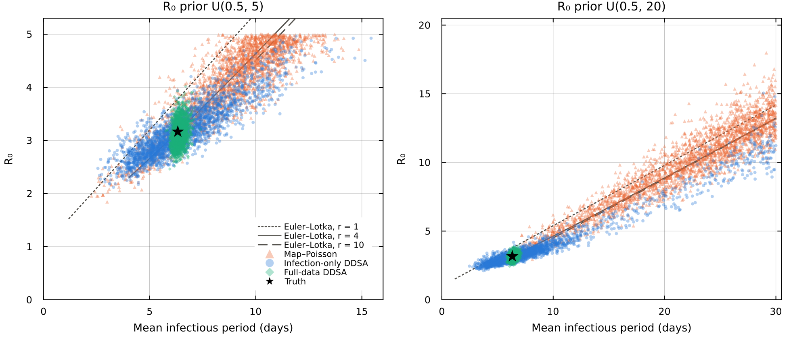
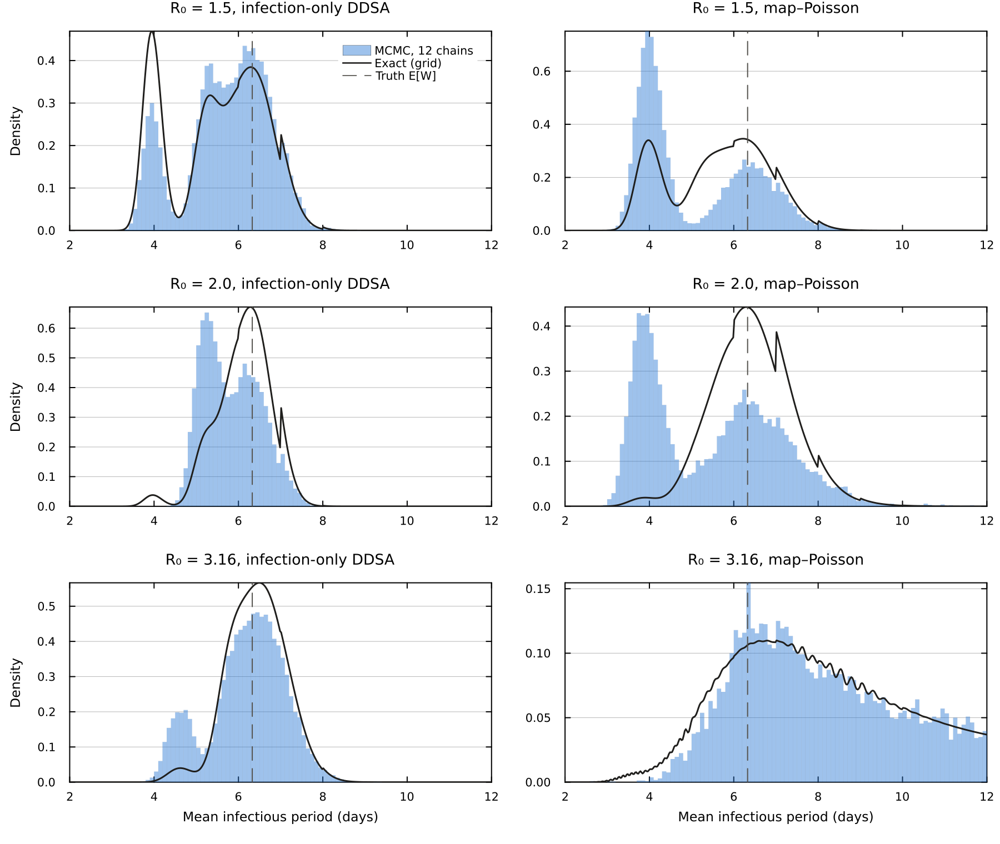

# Introduction

This notebook is a guide to the supplementary analyses of our manuscript (Sections S2–S9 of the supplementary material). For each section, we describe what we tested and how, list the scripts that produce the results and the command to rerun them, and then show the results that appear in the supplement. The notebook only reads the saved outputs, so rendering it takes a few minutes. Rerunning all the analyses takes about ten hours and is done with `run_method_supplement.sh` (see Section [S9](#s9-reproducibility)). 

We attribute each result to the part of DDSA it comes from: the likelihood (L), the discrete-time forward map and its step $\Delta t$ (M), the GLCT (Generalized Linear Chain Trick) structure with a NegBin DPH (discrete phase-type) infectious period (G), the Boxcar structure (B), or the closed, homogeneous, mean-field assumptions that DDSA shares with continuous-time DSA. Unless stated otherwise, the continuous-time DSA results come from our own Julia re-implementations. Where we also show results from the published code of previous DSA analyses by other authors, namely the SDS R package of KhudaBukhsh et al. (2020) and the non-Markovian DSA Python code of Di Lauro et al. (2022), these come from our runs of their code, in the settings we set for this analysis.

Throughout, $N$ is the whole population at risk, including the initial infectives. When the two are given separately, $n$ is the number of individuals initially susceptible and $m$ the number of initial infectives, so that $N = n + m$. $K$ is the number of cases and $\tau$ the fraction of the $N$ expected to be infected during the observation period (the attack rate). IP is the infectious period, and $r$ the number of geometric stages of a NegBin DPH infectious period.

## Table of contents

The table below shows where the code and the saved outputs of each section are.

| Supplement | Folder | Main scripts | Saved outputs |
|---|---|---|---|
| S2 What the data identify; S8 grid posteriors | `S2_identifiability/` | `s2_model.jl` (shared), `s2_0`–`s2_7` | `out/*.txt`, `figs/`, `chains/` |
| S3 DDSA vs continuous-time DSA | `S3_S6_dsa_comparison/` | `s3_core.jl` (shared), `s3_0_checks.jl`, `s3_1_run.jl` | `out/s3_main.csv` |
| S4 Unknown population size | `S3_S6_dsa_comparison/` | `s4_popsize.jl` | `out/s4_main.csv` |
| S5 Non-exponential infectious periods | `S3_S6_dsa_comparison/` | `s5_nonexp.jl`, `s5_0_checks.jl`, `s5_boxcar_dt.jl` | `out/s5_main.csv`, `out/s5_boxcar_dt.csv` |
| S6 Computational cost | `S3_S6_dsa_comparison/` | `s6_0_export.jl`, `s6_1_benchmarks.jl`, `s6_2_sds.R`, `s6_3_dsa_python.py` | `out/s6_*.csv`, `out/s6_dsa_python.jsonl` |
| S7 Stress tests | `S7_stress_tests/` | `stress_core.jl`, `stress_run.jl`, `stress_check.jl`; baseline grid in `baseline_grid/` | `out/stress_main.csv`; `baseline_grid/out/` |
| Tables of S3–S7 | (this folder) | `make_supplement_tables.py` | `supp_tables/*.tex` (shown in this guide) |

The published code of KhudaBukhsh et al. ([SDS.Epidemic](https://github.com/cbskust/SDS.Epidemic), in R) and Di Lauro et al. ([DSA_refactor](https://github.com/Zkeggia/DSA_refactor), in Python) that we used for comparison is available from their repositories. We used commits `3ecb29d` and `26671d6`, unmodified.

The helper functions below read the saved outputs and print them as tables.

```{julia}
#| label: setup
#| code-summary: "Helpers: read the saved outputs"
#| output: false
using CSV, DataFrames, Printf, Statistics
const SA  = @__DIR__
const S2O = joinpath(SA, "S2_identifiability", "out")
const D3  = joinpath(SA, "S3_S6_dsa_comparison", "out")
const D7  = joinpath(SA, "S7_stress_tests")

"First `(median [lo, hi])` after `key=` or `key = ` in a line of an S2 output file."
function grab(line, key)
    m = match(Regex(key * raw"\s*=\s*([-0-9.]+) \[([-0-9.]+), ([-0-9.]+)\]"), line)
    m === nothing ? "—" : "$(m[1]) [$(m[2]), $(m[3])]"
end
"Lines of an S2 output file whose start matches `prefix`."
lines_starting(file, prefix) = filter(l -> startswith(strip(l), prefix), readlines(joinpath(S2O, file)))
"Names of the six S2 models. The S2 scripts and output files number them 1–6 (`rung 1` … `rung 6`)."
const MODEL = Dict("1" => "infection-only DDSA", "2" => "map–Poisson", "3" => "map–NegBin",
                   "4" => "ODE–Poisson", "5" => "ODE–NegBin", "6" => "full-data DDSA")
"Replace `rung k` / `Rung k` in a line of an S2 output file with the model name."
withnames(l) = replace(replace(l, r"[Rr]ung (\d)" => s -> (n = MODEL[string(s[end])]; s[1] == 'R' ? uppercasefirst(n) : n)),
                       r"\((=|≡)(?! )" => s"(\1 ")

const TABLES = joinpath(SA, "supp_tables")
"Print a supplement table (written by make_supplement_tables.py) as a markdown table with the given column headers."
function tex_table(file, header)
    L = readlines(joinpath(TABLES, file))
    body = L[findfirst(l -> occursin("\\midrule", l), L)+1:end]
    rows = [strip(replace(l, r"\\\\\s*$" => "")) for l in body if endswith(strip(l), "\\\\")]
    clean(c) = strip(replace(c, "\\,/\\," => " / ", "{+}" => "+", "{,}" => ",", "--" => "–", "\\%" => "%"))
    mdrow(header); mdrow(fill("---", length(header)))
    for r in rows
        mdrow(clean.(split(r, "&")))
    end
    println("\n*Supplement table file: `supp_tables/$file`.*")
end

"Convergence of a set of fits: number with R̂ > 1.01 and with at least one divergent transition."
conv(df) = println("*Convergence: $(nrow(df)) fits; $(count(>(1.01), df.rhat)) with R̂ > 1.01, $(count(>(0), df.div)) with at least one divergent transition (all kept in the summaries).*")

"Relative bias (%) and 95% CrI coverage of the posterior median over replicates, as in the supplement tables."
function bias_cov(df, p)
    t = df[!, "$(p)_true"]; m = df[!, "$(p)_med"]
    (bias = 100 * mean((m .- t) ./ t), cov = mean(df[!, "$(p)_lo"] .<= t .<= df[!, "$(p)_hi"]))
end
mdrow(cells) = println("| ", join(cells, " | "), " |")
```

# S1 Prior specifications

Supplement S1 (Tables S1–S5) lists the priors of every main-text analysis. These are the priors defined in the `@model` blocks of the case-study notebooks, where the integer-valued parameters ($N$, $r$) are summed out of the likelihood.

# S2 What the data identify {#s2}

In Section 3(b) of the manuscript, the count-based models are fitted only to the daily incidence counts (the number of new infections per day, with a Poisson or Negative-Binomial observation model), whereas DDSA is fitted to the full line list: each case's infection day and recovery interval, and the final size out of the $N = 99$ at risk. With the removal rate estimated, the count-based models leave $R_0$ almost as uncertain as its prior, whereas DDSA does not. The two approaches differ in several ways at once, so in this section we change one factor at a time, building an identifiability ladder. All models use the synthetic outbreak of Sections 3(a)–(b) (Erlang-4 DPH, $\beta = 0.5$, $N = 99$, $T = 40$ d, $K = 91$ cases; true $R_0 = 3.164$ and mean infectious period 6.33 d) and the same priors: $R_0 \sim \mathrm{U}(0.5, 5)$, mean IP $\mu \sim \mathrm{U}(1, 30)$ and $\rho \sim \mathrm{Beta}(1, N-1)$, with $r$ summed out over $1, \ldots, 10$. 

The ladder has six models, each fitted to this outbreak:

1. **Infection-only DDSA** (Scenario B of manuscript Section 3(a)). The discrete map, with the infection days scored by the Multinomial timing term and the number of cases by the Binomial final-size term.
2. **Map–Poisson.** The discrete map, with the daily incidence counts scored by independent Poisson terms.
3. **Map–NegBin.** As map–Poisson, with Negative Binomial terms.
4. **ODE–Poisson.** As map–Poisson, with an Erlang-$r$ ODE in place of the discrete map.
5. **ODE–NegBin.** As map–NegBin, with the Erlang-$r$ ODE.
6. **Full-data DDSA** (Scenario A of manuscript Section 3(a)). Infection-only DDSA plus the recovery-interval term $\ell_R$.

The first five models use no recovery intervals. The four count models replace the likelihood of infection-only DDSA with a count likelihood. The S2 scripts and output files number the models 1–6 in this order (`rung1` to `rung6`). The tables and outputs below show their names.

The scripts are in `S2_identifiability/`. `s2_model.jl` defines the data, the forward maps and the likelihood of each model, and `s2_0_check_likelihoods.jl` checks the infection-only DDSA likelihood against Scenario B of the data-availability notebook. `s2_1` fits the six models, the $2\times2$ design and the unknown-$N$ models; `s2_2` runs the wide-prior checks, the never-infected-cell models and the Section 3(b) priors; `s2_3` produces the growth-rate ridge (Figure S1) and the information on $r$; `s2_4` and `s2_5` run the attack-rate sweep by MCMC and on exact grids (Table S8); and `s2_6` runs the unknown-$N$ grid with a seed prior on the count scale.

```{julia}
#| eval: false
# from this folder
./run_method_supplement.sh S2
```

## Table S6: the ladder

Each row of the table is one model of the ladder.

```{julia}
#| label: table-s6
#| output: asis
rungs = Dict(split(l)[1] => l for l in readlines(joinpath(S2O, "s2_1_rungs.txt")) if !isempty(l) && isdigit(l[1]))
wide  = Dict(split(l)[1] => l for f in ("s2_2_corroborations_wide_rungs123.txt", "s2_2_corroborations_wide_rungs456.txt")
             for l in readlines(joinpath(S2O, f)) if !isempty(l) && isdigit(l[1]))
rungname = Dict("1" => "discrete map, Multinomial + Binomial (Scenario B)", "2" => "discrete map, Poisson counts",
             "3" => "discrete map, NegBin counts", "4" => "Erlang-r ODE, Poisson counts",
             "5" => "Erlang-r ODE, NegBin counts", "6" => "discrete map, full line list (Scenario A)")
mdrow(["Model", "Forward model and likelihood", "R0, U(0.5,5)", "Mean IP (d)", "R0, U(0.5,20)"]); mdrow(fill("---", 5))
for r in string.(1:6)
    mdrow([uppercasefirst(MODEL[r]), rungname[r], grab(rungs[r], "R0"), grab(rungs[r], "meanIP"), grab(wide[r], "R0")])
end
println("\n*Source: `S2_identifiability/out/s2_1_rungs.txt`, `s2_2_corroborations_wide_rungs*.txt`. Truth: R0 = 3.16, mean IP 6.33 d.*")
```

With $N$ known and no recovery intervals, $R_0$ is only bounded by its prior once we replace the Binomial final-size term by count likelihoods (the four count models). Overdispersion and the continuous-time ODE do not change this materially. Adding the recovery intervals (full-data DDSA) narrows the interval further.

## Table S7: isolating the final-size term

Next, we keep the data of infection-only DDSA (infection times and the final size, no recovery intervals) and change only the likelihood, to isolate what the final-size term contributes. "Mult" is the Multinomial timing term of DDSA. The first four rows form the $2\times2$ design: Multinomial timing or Poisson daily counts, each with or without the Binomial final-size term. The never-infected-cell rows add one count cell for the individuals never infected. The last three rows sum $N$ out, with $\rho \sim \mathrm{Beta}(1, 98)$ on the fraction of initial infectives (the fraction scale) or with an Exp(1) prior on their number $I_0 = \rho N$ (the count scale).

```{julia}
#| label: table-s7
#| output: asis
mdrow(["Likelihood (data of infection-only DDSA)", "R0", "Source"]); mdrow(fill("---", 3))
for l in lines_starting("s2_1_2x2.txt", "2x2")
    mdrow([withnames(strip(split(split(l, "|")[1], "2x2")[2])), grab(l, "R0"), "`s2_1_2x2.txt`"])
end
for l in lines_starting("s2_2_corroborations_misc.txt", "R0≤5")
    mdrow(["Never-infected cell, " * replace(strip(split(split(l, "|")[1], "R0≤5")[2]), " + cell" => "", "continuous ODE" => "ODE"), grab(l, "R0"), "`s2_2_corroborations_misc.txt`"])
end
for l in lines_starting("s2_1_unknownN.txt", "1N")
    mdrow([withnames(strip(split(split(l, "|")[1], "1N")[2])), grab(l, "R0") * " (N " * something(match(r"N=([0-9.]+ \[[0-9., ]+\])", l), ["—"])[1] * ")", "`s2_1_unknownN.txt`"])
end
ex = only(lines_starting("s2_6_unknownN_seedprior_grid.txt", "Exact posterior"))
mdrow(["Infection-only DDSA, N ~ U(91, 20,090), seed count I0 = ρN ~ Exp(1) (exact grid)", grab(ex, "R0"), "`s2_6_unknownN_seedprior_grid.txt`"])
```

When $N$ has a wide support and the seed prior is on the fraction scale, the chains of this fit end up in two modes. The per-chain output below shows the second, local mode (a sub-critical outbreak seeded by about 91 infectives) and its lower log-density. IP is the mean infectious period and $\rho N$ the number of initial infectives:

```{julia}
#| label: s7-modes
foreach(println, filter(l -> occursin("chain", l), readlines(joinpath(S2O, "s2_1_unknownN.txt")))[6:10])
```

## Figure S1: the growth-rate ridge



In the output below, R0≤5 and R0≤20 mark the prior on $R_0$, U(0.5, 5) or U(0.5, 20), and E\[W\] is the true mean infectious period.

```{julia}
#| label: s2-ridge
foreach(println ∘ withnames, readlines(joinpath(S2O, "s2_3_ridge_r.txt"))[1:8])
```

The infection times fix the growth rate ($\lambda \approx 0.36$ d$^{-1}$ in all three fits), and $R_0$ and the mean infectious period trade off along it. The recovery intervals then fix where on this ridge the posterior lies. Without recovery intervals, the shape of the infectious period is, in most cases, not identified, as the KL divergences from the prior to the posterior of $r$ show. The effective prior of $r$ is its uniform prior on 1–10, restricted to $r < \mu$ by the prior on the mean infectious period:

```{julia}
#| label: s2-kl
foreach(l -> println(withnames(replace(l, r"(rung \d) [^:]+:" => s"\1:"))),
        filter(l -> occursin("KL", l), readlines(joinpath(S2O, "s2_3_ridge_r.txt"))))
```

## Table S8: the attack-rate sweep (exact grid posteriors)

Finally, we vary the attack rate and compare infection-only DDSA against map–Poisson, using exact grid posteriors.

```{julia}
#| label: table-s8
#| output: asis
function sweep_rows(file)
    L = readlines(joinpath(S2O, file)); out = []
    for (i, l) in enumerate(L)
        m = match(r"N=(\d+) R0_true=([0-9.]+) rung (\d)", l)
        m === nothing && continue
        ex = L[i+1]
        push!(out, (N = m[1], R0 = m[2], rung = m[3], est = grab(ex, "R0"),
                    sdtau = parse(Float64, match(r"SD\(τ\) = ([0-9.]+)", ex)[1])))
    end
    out
end
rows = vcat(sweep_rows("s2_5_tausweep_grid_N99.txt"),
            [sweep_rows("s2_5_tausweep_grid_N1000_R0$c.txt") for c in ("1.5", "2.0", "3.16")]...)
mdrow(["N", "True R0", "Infection-only DDSA (Binomial final size)", "Map–Poisson (Poisson counts)", "SD(τ) ratio, map–Poisson / infection-only DDSA"]); mdrow(fill("---", 5))
for N in ("99", "1000"), R0 in ("1.5", "2.0", "3.16")
    r1 = only(filter(x -> x.N == N && x.R0 == R0 && x.rung == "1", rows)); r2 = only(filter(x -> x.N == N && x.R0 == R0 && x.rung == "2", rows))
    mdrow([N, R0, r1.est, r2.est, @sprintf("%.2f", r2.sdtau / r1.sdtau)])
end
println("\n*Source: `S2_identifiability/out/s2_5_tausweep_grid_*.txt`.*")
```

The information from the never-infected individuals matters most when nearly everyone is infected and the population is small. At moderate attack rates, the Poisson count model also identifies $R_0$, although less precisely.

# S3 DDSA and continuous-time DSA on simulated outbreaks {#s3}

In this section we ask whether DDSA, fitted to daily records with the full line list and $n$ known, estimates $R_0$ and the mean infectious period as well as continuous-time DSA fitted to exact event times. We simulated exact event-driven SIR outbreaks with $n \in \{100, 1{,}000, 10{,}000\}$ and $R_0 \in \{1.5, 2, 4\}$, observed up to near the peak or near the end of the outbreak, with 50 replicates per cell and an exponential infectious period with mean 5 d. Each outbreak was analysed with a complete-data benchmark (the conjugate posterior of $\beta$ and $\gamma$ given the whole simulated epidemic, a reference for what the data can identify), with DDSA (geometric infectious period, where GLCT and Boxcar coincide), and with our implementation of continuous-time DSA, both on exact times and on daily records spread within the day (each event placed uniformly within its day). We also fitted DDSA with $\Delta t = 0.5$, 0.25 and 0.1 d.

The scripts are in `S3_S6_dsa_comparison/`: `s3_core.jl` contains the simulator, observation formats, likelihoods, models and complete-data benchmark; `s3_0_checks.jl` checks the solver and the likelihoods; and `s3_1_run.jl` runs the fits.

```{julia}
#| eval: false
#| code-summary: "Rerun (about 2 h on 10 threads, resumable)"
./run_method_supplement.sh S3
```

The column headers give the numbers in each cell, in order: bias / coverage, plus $k$ in Table S10.

- **Bias:** the difference between the posterior median and the true value, relative to the true value, in %, averaged over the replicates.
- **Coverage:** the proportion of replicates whose 95% CrI contains the true value.
- **Spread ratio $k$:** the SD of the posterior medians over replicates divided by the mean posterior SD. It is close to 1 when the intervals match the variability between replicates, and above 1 when they are too narrow.

The "DSA" columns are our implementation of continuous-time DSA. The cut-off is where observation ends (near the peak or near the end of the outbreak), and $n$ is the number initially susceptible, with $m = 0.05n$ initial infectives.

Table S10 shows the results for $R_0$:

```{julia}
#| label: table-s10
#| output: asis
s3 = CSV.read(joinpath(D3, "s3_main.csv"), DataFrame)
conv(filter(r -> r.model != "exact", s3))
println()
tex_table("s3_R0.tex", ["Cut-off", "n", "True R0", "Complete data: bias % / cov. / k", "DDSA, geometric (daily): bias % / cov. / k", "DSA (exact times): bias % / cov. / k", "DSA (daily, spread): bias % / cov. / k"])
```

Table S11 shows the effect of the step of the map at $n = 1{,}000$ with the end cut-off ($R_0$ bias / coverage):

```{julia}
#| label: table-s11
#| output: asis
tex_table("s3_dt.tex", ["True R0", "DDSA Δt = 1: bias % / cov.", "Δt = 0.5: bias % / cov.", "Δt = 0.25: bias % / cov.", "Δt = 0.1: bias % / cov.", "DSA (exact times): bias % / cov.", "Complete data: bias % / cov."])
```

Table S12 shows the results for the mean infectious period (bias / coverage):

```{julia}
#| label: table-s12
#| output: asis
tex_table("s3_meanIP.tex", ["Cut-off", "n", "True R0", "Complete data: bias % / cov.", "DDSA, geometric (daily): bias % / cov.", "DSA (exact times): bias % / cov.", "DSA (daily, spread): bias % / cov."])
```

The tables are written by `make_supplement_tables.py` from `out/s3_main.csv`. DDSA and our implementation of continuous-time DSA both give $R_0$ intervals that are too narrow, while the complete-data benchmark is calibrated, so this comes from the likelihood (L). The $R_0$ bias at $R_0 = 4$ and the +2% bias in the mean infectious period from same-day removals shrink as the step is refined, so they come from the map (M).

# S4 Unknown population size {#s4}

When $N$ is not known, we compare three approaches: DDSA, which sums $N$ out of the Binomial final-size term; our re-implementation of the imputation step of KhudaBukhsh et al. (Algorithm 4.1); and our continuous-time DSA with $n$ summed out. We used the same outbreaks as in S3 (replicates 1–10). We also ran the published SDS R package of KhudaBukhsh et al., with its code unchanged, on replicates 1–5 of the $n = 1{,}000$ cells.

The script is `S3_S6_dsa_comparison/s4_popsize.jl`, and the results are in Tables S13 (our implementations) and S14 (the SDS R package of KhudaBukhsh et al.) of the supplement.

```{julia}
#| eval: false
#| code-summary: "Rerun (about 40 min on 10 threads)"
./run_method_supplement.sh S4
```

Table S13 gives the bias and coverage for $N = n + m$ and $R_0$, with 10 replicates per row. "$n$ imputed" is our re-implementation of the imputation step, and "$n$ summed" our continuous-time DSA with $n$ summed out:

```{julia}
#| label: table-s13
#| output: asis
s4 = CSV.read(joinpath(D3, "s4_main.csv"), DataFrame)
conv(filter(r -> r.model != "dsa_sds", s4)); println("*(NUTS arms; the imputation arm uses our adaptive Metropolis sampler.)*\n")
tex_table("s4_N.tex", ["Cut-off", "n", "True R0", "N, DDSA: bias % / cov.", "N, DSA (n imputed): bias % / cov.", "N, DSA (n summed): bias % / cov.", "R0, DDSA: bias % / cov.", "R0, DSA (n imputed): bias % / cov.", "R0, DSA (n summed): bias % / cov."])
```

Table S14 gives the results of our runs of the SDS R package of KhudaBukhsh et al., with the code unchanged, on replicates 1–5 of the $n = 1{,}000$ cells. With $n$ known, the never-infected individuals are included in the data. "$j$/5 cover" is the number of the five replicates whose 95% interval contains the true value:

```{julia}
#| label: table-s14
#| output: asis
tex_table("s6_sds.tex", ["Cut-off", "True R0", "n known or imputed", "R0 estimate, range of medians", "N, range of medians", "Fit (s)"])
```

# S5 Non-exponential infectious periods {#s5}

Here we use the synthetic setting of Di Lauro et al. (a Gamma infectious period with mean 9 d and shape 13.5, and $N = 10{,}000$) to see what the GLCT (NegBin DPH) and Boxcar structures recover from daily data, with the full line list (A), infection times only (B) or recovery intervals only (C). We compare them with our implementation of continuous-time DSA with a Gamma infectious period, and with the published non-Markovian DSA Python code of Di Lauro et al. (maximum likelihood) on replicates 1–5.

The scripts are in `S3_S6_dsa_comparison/`: `s5_nonexp.jl` runs the main fits; `s5_0_checks.jl` checks the convergence of the renewal grid, compares the discretised Gamma with the simulated intervals and looks at the shortest intervals (log in `out/logs/s5_0_checks.log`); and `s5_boxcar_dt.jl` refits the Boxcar arm at $\Delta t = 0.5$ and 0.25 d, and is run separately. The results are in Tables S15 and S16 of the supplement.

```{julia}
#| eval: false
#| code-summary: "Rerun (main runs about 1 h 20 min; the step refinement about 65 min, run separately)"
./run_method_supplement.sh S5
DTS=0.5,0.25 REPS=20 SCEN=A BUDGET=30000 RUN=s5_boxcar_dt julia --project=@. -t 10 S3_S6_dsa_comparison/s5_boxcar_dt.jl
```

Table S15 summarises 20 replicates per row. The true values are $R_0 = 2.25$, a mean infectious period of 9 d and an SD of 2.45 d. Each $R_0$ and mean-IP cell gives three numbers, bias / coverage / $k$, and each IP SD cell gives the first two:

- **Bias:** the difference between the posterior median and the true value, relative to the true value, in %, averaged over the replicates.
- **Coverage:** the proportion of replicates whose 95% CrI contains the true value.
- **Spread ratio $k$:** the SD of the posterior medians over replicates divided by the mean posterior SD. It is close to 1 when the intervals match the variability between replicates, and above 1 when they are too narrow.

For example, the first row's $R_0$ cell, +10.4 / 0.00 / 5.5, means that the posterior median of $R_0$ was on average 10.4% above 2.25, that none of the 20 intervals contained 2.25, and that the medians varied 5.5 times more between replicates than the posterior SDs indicate. The shape is the posterior median of the Gamma shape ($r$ for the NegBin DPH), and $r_{\max}$ is the largest $r$ allowed, the shortest recorded interval. Both are medians over replicates. The NegBin DPH fits of scenario B did not converge:

```{julia}
#| label: table-s15
#| output: asis
conv(CSV.read(joinpath(D3, "s5_main.csv"), DataFrame))
println()
tex_table("s5_nonexp.tex", ["Scenario", "Model", "R0: bias % / cov. / k", "Mean IP: bias % / cov. / k", "IP SD: bias % / cov.", "Shape (median)", "r_max = shortest interval (median)"])
```

Table S16 gives the results of our runs of the Python code of Di Lauro et al., with the code unchanged (maximum likelihood; range of the point estimates over replicates 1–5):

```{julia}
#| label: table-s16
#| output: asis
tex_table("s6_dsa_python.tex", ["Scenario", "R0 (true 2.25)", "Mean IP (true 9)", "IP SD (true 2.45)", "Shape (true 13.5)", "Fit (s)"])
```

## The remaining Boxcar $R_0$ bias and the time step

The Boxcar structure recovers the shape of the infectious period. Its remaining $R_0$ bias halves each time we halve the step, which shows that it comes from the map (M):

```{julia}
#| label: s5-dt
#| output: asis
s5 = CSV.read(joinpath(D3, "s5_main.csv"), DataFrame); dtr = CSV.read(joinpath(D3, "s5_boxcar_dt.csv"), DataFrame)
box = filter(r -> r.scenario == "A" && r.model == "ddsa_box", s5); dsa = filter(r -> r.scenario == "A" && r.model == "dsa", s5)
dsa_med = Dict(r.rep => r.R0_med for r in eachrow(dsa))
mdrow(["Fit (scenario A, 20 replicates)", "R0 bias (%)", "R0 coverage", "R0 median minus that of our continuous-time DSA (mean over replicates)"]); mdrow(fill("---", 4))
for (lab, d) in (("Boxcar, Δt = 1 d", box), ("Boxcar, Δt = 0.5 d", filter(r -> r.dt == 0.5, dtr)),
                 ("Boxcar, Δt = 0.25 d", filter(r -> r.dt == 0.25, dtr)), ("our continuous-time DSA", dsa))
    bc = bias_cov(d, "R0"); ex = lab == "our continuous-time DSA" ? "—" : @sprintf("%+.3f", mean(r.R0_med - dsa_med[r.rep] for r in eachrow(d)))
    mdrow([lab, @sprintf("%+.1f", bc.bias), @sprintf("%.2f", bc.cov), ex])
end
```

# S6 Computational cost {#s6}

In this section we measure the cost of one log-likelihood evaluation, one gradient and one complete fit for each model, on one thread of an otherwise idle machine. The ratios compare our implementations, not the methods in general.

The scripts are in `S3_S6_dsa_comparison/`: `s6_1_benchmarks.jl` runs the timings, `s6_0_export.jl` exports the datasets for the code of KhudaBukhsh et al. and Di Lauro et al., `s6_2_sds.R` runs SDS.Epidemic and `s6_3_dsa_python.py` runs DSA_refactor. The rerun command first downloads their code with `get_authors_code.sh` if it is missing. That script installs the Python packages at the versions we used (`dsa_refactor_requirements.txt`) and the current CRAN versions of the R packages, and lists any R package whose version differs from the one we used. We used R 4.6.1 with SDSMCMC 0.1.0, plyr 1.8.9, MASS 7.3-65, smfsb 1.5, abind 1.4-8, ramcmc 0.1.2 and Rcpp 1.1.2 (`sds_r_versions.txt`). The results are in Table S17 and in the timings given in the text of the supplement.

```{julia}
#| eval: false
#| code-summary: "Rerun (about 1 h 30 min; run on an otherwise idle machine)"
./run_method_supplement.sh S6
```

Table S17 gives the timings on one thread; the continuous-time DSA rows are our Julia re-implementations. ESS/s is the minimum bulk effective sample size per second of fit, and MH the Metropolis sampler of our re-implementation of the imputation step:

```{julia}
#| label: table-s17
#| output: asis
tex_table("s6_cost.tex", ["Section", "Model", "n", "K", "Log-lik. (ms)", "Gradient (ms)", "Fit (s)", "ESS/s"])
```

# S7 Stress tests of DDSA (GLCT structure) {#s7}

Using the GLCT structure of the main text, we change one assumption at a time to find where the estimates become biased or the intervals miscalibrated, and whether the usual checks (posterior predictive $p$-values, $\hat R$ and divergences) reveal it.

The baseline grid (`S7_stress_tests/baseline_grid/`) uses chain-binomial outbreaks with $n \in \{100, 1{,}000, 10{,}000\}$, $R_0 \in \{1.3, 2, 3\}$ and $r \in \{1, 4\}$ (the number of geometric stages of the simulated infectious period), with 100 replicates per cell, fitted with the NegBin DPH and geometric models. It also includes a Gillespie grid with Erlang-4 infectious periods rounded to days, and refits without the final-size term or with a corrected one. The stress tests (`S7_stress_tests/`) are 30 levels of 50 replicates each around the baseline ($n = 1{,}000$, $R_0 = 2$, $r = 4$), classified by the detection rule described below.

```{julia}
#| eval: false
#| code-summary: "Rerun (about 1 h 30 min on 10 threads)"
./run_method_supplement.sh S7
```

## Baseline grid (Table S18), correctly specified model ($r = 4$)

Table S18 shows the baseline grid when the fitted model matches the simulated infectious period ($r = 4$):

```{julia}
#| label: table-s18
#| output: asis
tex_table("s7_grid.tex", ["n", "True R0", "R0: bias / coverage", "Mean IP: bias / coverage", "Geometric model, R0: bias / coverage"])
println("\nAll cells, including \$r = 1\$, spread ratios and convergence, are in `S7_stress_tests/baseline_grid/out/summary_cb.md`.")
```

## Is the final-size term the cause of the narrow $R_0$ intervals?

To check this, we refitted the $n = 1{,}000$, $r = 4$ cells of the baseline grid with three final-size terms: (a) the Binomial term of the main text, (b) no final-size term, and (c) a Normal term whose variance includes the extra-binomial variability of a stochastic epidemic. The biases in this table are relative, as fractions (+0.011 is +1.1%). The spread ratio is $k$, and "div \> 0" counts fits with at least one divergent transition:

```{julia}
#| label: s7-terms
#| output: asis
L = readlines(joinpath(D7, "baseline_grid", "out", "final_step2_summary.md"))
i = findfirst(l -> startswith(l, "| Variant"), L); j = findnext(isempty, L, i)
foreach(println, L[i:j-1])
```

## Stress tests (Table S19)

We classify each level with the following detection rule. A level fails if the mean relative bias of the $R_0$ median exceeds 5% (*biased*), or if, with a smaller bias, its coverage is more than 0.15 below the baseline's (*miscalibrated*). A level is *detected* if the share of flagged fits (posterior predictive $p < 0.05$, $\hat R > 1.01$ or a divergence) exceeds the baseline's by at least 0.25, and *silent* otherwise.

The levels of each factor are:

- **Recording resolution:** continuous-time Erlang-4 infectious periods with the given mean, rounded to whole days.
- **Mis-recorded 1-d intervals:** the given share of intervals recorded as one day.
- **Missing recoveries:** missing completely at random (MCAR), or preferentially when the interval is long.
- **Observation window:** cut at the peak or early in the outbreak, with the unrecovered cases right-censored, dropped, or conditioned on recovery with a truncation term.
- **Ascertainment:** the share of cases recorded, at random, with $N$ known.
- **Unknown $N$:** $N$ summed out, with $\rho \sim \mathrm{Beta}(1, 10)$ (fraction scale) or an Exp(1) prior on the seed count $\rho N$ (count scale).
- **Time-varying $\beta$:** halved at the peak (day 45), or declining linearly to half its initial value.
- **Heterogeneous mixing:** five out-of-phase subpopulations, or gamma-distributed susceptibility with the given coefficient of variation (CV).
- **Superspreading:** individual infectiousness drawn from a Gamma distribution with mean 1 and the given dispersion.
- **Importations:** one imported case a week.
- **Near-critical:** $R_0 = 1.1$, conditioned on a major outbreak.

"Median r" is the median over fits of the posterior median of $r$, and "Flagged" the share of flagged fits.

```{julia}
#| label: table-s19
#| output: asis
tex_table("s7_stress.tex", ["Factor", "Level", "R0: bias / cov. / k", "Mean IP: bias / cov.", "Median r", "Flagged", "Class"])
```

# S8 Grid posteriors {#s8}

In the infection-only fits of the attack-rate sweep (S2, Table S8), the posterior of the mean infectious period can be bimodal, and the NUTS chains did not move between the modes. We therefore evaluated these posteriors on exact grids after summing $r$ out. `s2_7_grid_vs_turing_check.jl` checks that the grid log densities equal the Turing log-joints, and running `s2_5_tau_sweep_grid.jl` with `REFINE=2` checks the effect of refining the grid.

```{julia}
#| eval: false
#| code-summary: "Rerun (about 35 min)"
./run_method_supplement.sh S8
```



```{julia}
#| label: s8-checks
println(readlines(joinpath(S2O, "logs", "s2_7_grid_vs_turing_check.log"))[end])
for c in ("2.0", "3.16")
    f = "s2_5_tausweep_grid_N99_R0$(c)_refine2.txt"; L = readlines(joinpath(S2O, f))
    println("N = 99, true R0 = $c, grid steps halved ($f):")
    for (i, l) in enumerate(L)
        m = match(r"^N=\d+ R0_true=\S+ rung (\d)", l)
        m === nothing || println("   ", MODEL[m[1]], ": ", strip(L[i+1]))
    end
end
```

# S9 Reproducibility {#s9-reproducibility}

All runs use the shared environment at the root of the repository (Julia 1.11, Turing.jl 0.49; `Manifest.toml`), which `--project=@.` finds from this folder, and the repository's phase-type and integer-parameter modules, which the scripts find by searching the parent folders. A single script reruns every section, with a time cap on each process, and writes the tables of the supplement to `supp_tables/`:

```{julia}
#| eval: false
#| code-summary: "Rerun everything (about 10 h), or selected sections"
# from this folder
./run_method_supplement.sh                # S2 S3 S4 S5 S6 S7 S8 TABLES
./run_method_supplement.sh S2 S8          # selected sections
DRY=1 ./run_method_supplement.sh          # print the commands only
python3 -I make_supplement_tables.py      # tables only: supp_tables/*.tex
```
