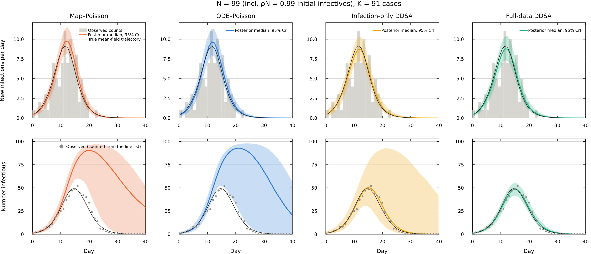
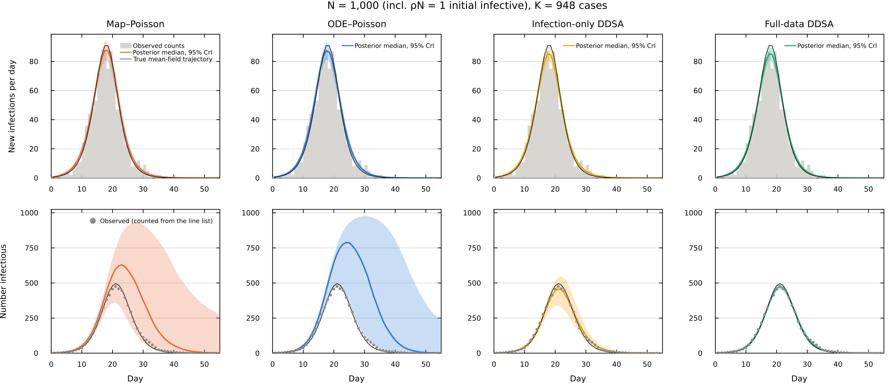
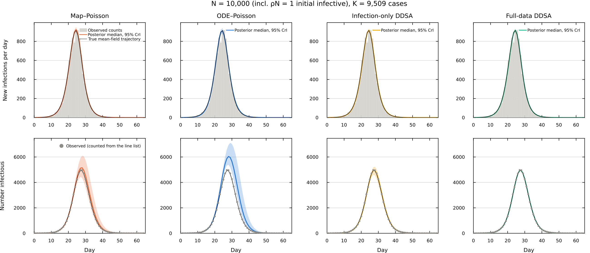

# Introduction

This notebook is a guide to the supplementary analyses of our manuscript (Sections S2–S5 of the supplementary material). For each section, we describe what we tested and how, list the scripts that produce the results and the command to rerun them, and then show the results. The guide shows every analysis of the supplement, in more detail than the supplement gives; the tables and figures of the supplement keep their numbers (Table S10, Figure S2, …). The notebook only reads the saved outputs, so rendering it takes a few minutes. Rerunning all the analyses takes about a day on 10 threads and is done with `run_method_supplement.sh` (see Section [S5](#s5-reproducibility)). 

We attribute each result to the part of DDSA it comes from: the likelihood (L), the discrete-time forward map and its step $\Delta t$ (M), the GLCT (Generalized Linear Chain Trick) structure with a NegBin DPH (discrete phase-type) infectious period (G), the Boxcar structure (B), or the closed, homogeneous, mean-field assumptions that DDSA shares with continuous-time DSA. Unless stated otherwise, the continuous-time DSA results come from our own Julia re-implementations. Where we also show results from the published code of previous DSA analyses by other authors, namely the SDS R package of KhudaBukhsh et al. (2020) and the non-Markovian DSA Python code of Di Lauro et al. (2022), these come from our runs of their code, unchanged, in the settings of their own examples (Table S9).

Throughout, $N$ is the whole population at risk, including the initial infectives. When the two are given separately, $n$ is the number of individuals initially susceptible and $m$ the number of initial infectives, so that $N = n + m$. $K$ is the number of cases and $\tau$ the fraction of the $N$ expected to be infected during the observation period (the attack rate). IP is the infectious period, and $r$ the number of geometric stages of a NegBin DPH infectious period.

## Table of contents

The table below shows where the code and the saved outputs of each section are.

| Supplement | Folder | Main scripts | Saved outputs |
|---|---|---|---|
| S2 Identifiability and information in the data (including the grid posteriors) | `S2_identifiability/` | `s2_model.jl` (shared), `s2_0`–`s2_10` | `out/*.txt`, `figs/` (`chains/` is written by the reruns and not distributed) |
| S3 Validation against continuous-time DSA: published codes in their own settings (Table S9), WSU (Table S11) | `S3_S6_dsa_comparison/` | `s6_4`–`s6_8` | `out/s6_4_*`–`out/s6_8_*` |
| S3: agreement on simulated outbreaks (Table S10) | `S3_S6_dsa_comparison/` | `s3_core.jl` (shared), `s3_0_checks.jl`, `s3_1_run.jl` | `out/s3_main.csv` |
| S4 Simulation checks of the stated limitations: calibration (Table S12), daily step (Table S13), stage cap (Table S14) | `S7_stress_tests/baseline_grid/`, `S3_S6_dsa_comparison/` | `sim_core.jl` (shared), `sim_run.jl`, `final_step2_*`, `final_step3_*`; `s3_1_run.jl` (Table S13); `s5_nonexp.jl`, `s5_0_checks.jl`, `s5_boxcar_dt.jl`, `s5_negbin_uncapped.py` | `baseline_grid/out/`; `out/s5_*.csv` |
| Tables of S2–S4 | (this folder) | `make_supplement_tables.py` | `supp_tables/*.tex` (shown in this guide) |

Script and folder names keep their original section numbers (`s4_…`, `s5_…`, `S7_stress_tests/`, and the section names of `run_method_supplement.sh`).

The published code of KhudaBukhsh et al. ([SDS.Epidemic](https://github.com/cbskust/SDS.Epidemic), in R) and Di Lauro et al. ([DSA_refactor](https://github.com/Zkeggia/DSA_refactor), in Python) that we used for comparison is available from their repositories. We used commits `3ecb29d` and `26671d6`, unmodified.

The helper functions below read the saved outputs and print them as tables.

```{julia}
#| label: setup
#| code-summary: "Helpers: read the saved outputs"
#| output: false
using CSV, DataFrames, Printf, Statistics
const SA  = @__DIR__
const S2O = joinpath(SA, "S2_identifiability", "out")
const D3  = joinpath(SA, "S3_S6_dsa_comparison", "out")
const D7  = joinpath(SA, "S7_stress_tests")

"First `(median [lo, hi])` after `key=` or `key = ` in a line of an S2 output file."
function grab(line, key)
    m = match(Regex(key * raw"\s*=\s*([-0-9.]+) \[([-0-9.]+), ([-0-9.]+)\]"), line)
    m === nothing ? "—" : "$(m[1]) [$(m[2]), $(m[3])]"
end
"Lines of an S2 output file whose start matches `prefix`."
lines_starting(file, prefix) = filter(l -> startswith(strip(l), prefix), readlines(joinpath(S2O, file)))
"Names of the six S2 models. The S2 scripts and output files number them 1–6 (`rung 1` … `rung 6`)."
const MODEL = Dict("1" => "infection-only DDSA", "2" => "map–Poisson", "3" => "map–NegBin",
                   "4" => "ODE–Poisson", "5" => "ODE–NegBin", "6" => "full-data DDSA")
"Replace `rung k` / `Rung k` in a line of an S2 output file with the model name."
withnames(l) = replace(replace(l, r"[Rr]ung (\d)" => s -> (n = MODEL[string(s[end])]; s[1] == 'R' ? uppercasefirst(n) : n)),
                       r"\((=|≡)(?! )" => s"(\1 ")

const TABLES = joinpath(SA, "supp_tables")
"Print a supplement table (written by make_supplement_tables.py) as a markdown table with the given column headers."
function tex_table(file, header)
    L = readlines(joinpath(TABLES, file))
    body = L[findfirst(l -> occursin("\\midrule", l), L)+1:end]
    rows = [strip(replace(l, r"\\\\\s*$" => "")) for l in body if endswith(strip(l), "\\\\")]
    # cells shown in grey in the supplement (most fits not converged) are marked † here
    clean(c) = strip(replace(replace(c, r"\\textcolor\{gray\}\{(.*)\}\s*$" => s"\1 †"),
                             "\\,/\\," => " / ", "{+}" => "+", "{,}" => ",", "--" => "–", "\\%" => "%", "\$^{\\dagger}\$" => "",
                             "\$^{a}\$" => " (n = 9,950)", "\\quad " => "", "\\," => " "))
    mdrow(header); mdrow(fill("---", length(header)))
    for r in rows
        # a panel or group heading row, \multicolumn{k}{l}{\textit{...}}, is shown in bold across the first cell
        m = match(r"^\\multicolumn\{\d+\}\{l\}\{\\textit\{(.*)\}\}$", r)
        m === nothing ? mdrow(clean.(split(r, "&"))) : mdrow(["**" * clean(m[1]) * "**"; fill("", length(header) - 1)])
    end
    println("\n*Table file: `supp_tables/$file`.*")
end

"Convergence of a set of fits: number with R̂ > 1.01 and with at least one divergent transition."
conv(df) = println("*Convergence: $(nrow(df)) fits; $(count(>(1.01), df.rhat)) with R̂ > 1.01, $(count(>(0), df.div)) with at least one divergent transition (all kept in the summaries).*")

"Relative bias (%) and 95% CrI coverage of the posterior median over replicates, as in the supplement tables."
function bias_cov(df, p)
    t = df[!, "$(p)_true"]; m = df[!, "$(p)_med"]
    (bias = 100 * mean((m .- t) ./ t), cov = mean(df[!, "$(p)_lo"] .<= t .<= df[!, "$(p)_hi"]))
end
mdrow(cells) = println("| ", join(cells, " | "), " |")
fmtint(n) = replace(string(n), r"(\d)(?=(\d{3})+$)" => s"\1,")
fmtN(n) = fmtint(n)
```

# S1 Prior specifications

Supplement S1 (Tables S1–S5) lists the priors of every main-text analysis. These are the priors defined in the `@model` blocks of the case-study notebooks, where the integer-valued parameters ($N$, $r$) are summed out of the likelihood.

# S2 Identifiability and information in the data {#s2}

In Section 3(b) of the manuscript, the count-based models are fitted only to the daily incidence counts (the number of new infections per day, with a Poisson or Negative-Binomial observation model), whereas DDSA is fitted to the full line list: each case's infection day and recovery interval, and the final size out of the $N = 99$ at risk. With the removal rate estimated, the count-based models leave $R_0$ almost as uncertain as its prior, whereas DDSA does not. The two approaches differ in several ways at once, so in this section we change one factor at a time, building an identifiability ladder. All models use the synthetic outbreak of Sections 3(a)–(b) (Erlang-4 DPH, $\beta = 0.5$, $N = 99$, $T = 40$ d, $K = 91$ cases; true $R_0 = 3.164$ and mean infectious period 6.33 d) and the same priors: $R_0 \sim \mathrm{U}(0.5, 5)$, mean IP $\mu \sim \mathrm{U}(1, 30)$ and $\rho \sim \mathrm{Beta}(1, N-1)$, with $r$ summed out over $1, \ldots, 10$. 

The ladder has six models, each fitted to this outbreak:

1. **Infection-only DDSA** (Scenario B of manuscript Section 3(a)). The discrete map, with the infection days scored by the Multinomial timing term and the number of cases by the Binomial final-size term.
2. **Map–Poisson.** The discrete map, with the daily incidence counts scored by independent Poisson terms.
3. **Map–NegBin.** As map–Poisson, with Negative Binomial terms.
4. **ODE–Poisson.** As map–Poisson, with an Erlang-$r$ ODE in place of the discrete map.
5. **ODE–NegBin.** As map–NegBin, with the Erlang-$r$ ODE.
6. **Full-data DDSA** (Scenario A of manuscript Section 3(a)). Infection-only DDSA plus the recovery-interval term $\ell_R$.

The first five models use no recovery intervals. The four count models replace the likelihood of infection-only DDSA with a count likelihood. The S2 scripts and output files number the models 1–6 in this order (`rung1` to `rung6`). The tables and outputs below show their names.

The scripts are in `S2_identifiability/`. `s2_model.jl` defines the data, the forward maps and the likelihood of each model, and `s2_0_check_likelihoods.jl` checks the infection-only DDSA likelihood against Scenario B of the data-availability notebook. `s2_1` fits the six models, the $2\times2$ design and the unknown-$N$ models; `s2_2` runs the wide-prior checks, the never-infected-cell models and the Section 3(b) priors; `s2_3` produces the growth-rate ridge (Figure S1) and the information on $r$; `s2_4` and `s2_5` run the attack-rate sweep by MCMC and on numerical grids; `s2_6` gives numerical grid posteriors of infection-only DDSA with $N$ unknown, with the seed prior on the count scale or (`PRIOR=fraction`) on the fraction scale; and `s2_7` checks the grid log densities against the Turing log-joints. `s2_8` (numerical grid posteriors of map–Poisson, ODE–Poisson and infection-only DDSA), `s2_9` (full-data DDSA and the per-$N$ figures) and `s2_10` (the panel figure, Figure S2, from the saved draws), with their data from `s2_traj_data.jl`, produce Table S8 and Figure S2, the fitted trajectories at $N = 99$, $1{,}000$ and $10{,}000$.

```{julia}
#| eval: false
# from this folder
./run_method_supplement.sh S2
```

## Table S6: the ladder

Each row of the table is one model of the ladder.

```{julia}
#| label: table-s6
#| output: asis
rungs = Dict(split(l)[1] => l for l in readlines(joinpath(S2O, "s2_1_rungs.txt")) if !isempty(l) && isdigit(l[1]))
wide  = Dict(split(l)[1] => l for f in ("s2_2_corroborations_wide_rungs123.txt", "s2_2_corroborations_wide_rungs456.txt")
             for l in readlines(joinpath(S2O, f)) if !isempty(l) && isdigit(l[1]))
rungname = Dict("1" => "discrete map, Multinomial + Binomial (Scenario B)", "2" => "discrete map, Poisson counts",
             "3" => "discrete map, NegBin counts", "4" => "Erlang-r ODE, Poisson counts",
             "5" => "Erlang-r ODE, NegBin counts", "6" => "discrete map, full line list (Scenario A)")
mdrow(["Model", "Forward model and likelihood", "R0, U(0.5,5)", "Mean IP (d)", "R0, U(0.5,20)"]); mdrow(fill("---", 5))
for r in string.(1:6)
    mdrow([uppercasefirst(MODEL[r]), rungname[r], grab(rungs[r], "R0"), grab(rungs[r], "meanIP"), grab(wide[r], "R0")])
end
println("\n*Source: `S2_identifiability/out/s2_1_rungs.txt`, `s2_2_corroborations_wide_rungs*.txt`. Truth: R0 = 3.16, mean IP 6.33 d.*")
```

With $N$ known and no recovery intervals, $R_0$ is only bounded by its prior once we replace the Binomial final-size term by count likelihoods (the four count models). Overdispersion and the continuous-time ODE do not change this materially. Adding the recovery intervals (full-data DDSA) narrows the interval further.

## Table S7: isolating the final-size term

Next, we keep the data of infection-only DDSA (infection times and the final size, no recovery intervals) and change only the likelihood, to isolate what the final-size term contributes. "Mult" is the Multinomial timing term of DDSA. The first four rows cross Multinomial timing or Poisson daily counts with the Binomial final-size term or none. The supplement shows the first and fourth: by the factorisation of Poisson daily counts into the Multinomial timing term and Poisson$(K; N\tau)$ (Supplement S2), the second row is map–Poisson written as Mult + Poisson$(K; N\tau)$, and the third scores the total twice (in the Poisson counts and in the Binomial term), so it is a diagnostic rather than a model of the data. The never-infected-cell rows add one count cell for the individuals never infected. The last rows sum $N$ out, with $\rho \sim \mathrm{Beta}(1, 98)$ on the fraction of initial infectives (the fraction scale) or with an Exp(1) prior on their number $I_0 = \rho N$ (the count scale); the NUTS fit with $N \sim \mathrm{U}(91, 20{,}090)$ on the fraction scale did not converge (next output), so the supplement reports the numerical grid posteriors for both seed priors.

```{julia}
#| label: table-s7
#| output: asis
mdrow(["Likelihood (data of infection-only DDSA)", "R0", "Source"]); mdrow(fill("---", 3))
for l in lines_starting("s2_1_2x2.txt", "2x2")
    mdrow([withnames(strip(split(split(l, "|")[1], "2x2")[2])), grab(l, "R0"), "`s2_1_2x2.txt`"])
end
for l in lines_starting("s2_2_corroborations_misc.txt", "R0≤5")
    mdrow(["Never-infected cell, " * replace(strip(split(split(l, "|")[1], "R0≤5")[2]), " + cell" => "", "continuous ODE" => "ODE"), grab(l, "R0"), "`s2_2_corroborations_misc.txt`"])
end
UL = readlines(joinpath(S2O, "s2_1_unknownN.txt"))
for (i, l) in enumerate(UL)
    startswith(l, "1N") || continue
    rh = parse(Float64, match(r"Rhat≤([0-9.]+)", UL[findnext(x -> occursin("Rhat≤", x), UL, i)])[1])
    est = rh <= 1.01 ? grab(l, "R0") * " (N " * something(match(r"N=([0-9.]+ \[[0-9., ]+\])", l), ["—"])[1] * ")" :
          "chains split between two modes (R̂ = $rh); the pooled draws, $(grab(l, "R0")), are not a posterior summary"
    mdrow([withnames(strip(split(split(l, "|")[1], "1N")[2])) * " (NUTS)", est, "`s2_1_unknownN.txt`"])
end
for (f, lab) in (("s2_6_unknownN_fractionprior_grid.txt", "fraction scale, ρ ~ Beta(1, 98)"), ("s2_6_unknownN_seedprior_grid.txt", "count scale, I0 = ρN ~ Exp(1)"))
    ex = only(lines_starting(f, "Grid posterior"))
    mdrow(["Infection-only DDSA, N ~ U(91, 20,090), seed prior on the $lab (numerical grid)", grab(ex, "R0"), "`$f`"])
end
```

When $N$ has a wide support and the seed prior is on the fraction scale, the NUTS chains end up in two modes. The per-chain output shows the second, local mode (a sub-critical outbreak seeded by about 91 infectives) and its lower log-density; the grid posteriors below give the mass of the sub-critical region that contains it, with the same priors (fraction scale) and with the count-scale seed prior, and with the grid steps halved (`REFINE=2`). IP is the mean infectious period and $\rho N$ the number of initial infectives:

```{julia}
#| label: s7-modes
foreach(println, filter(l -> occursin("chain", l), readlines(joinpath(S2O, "s2_1_unknownN.txt")))[6:10])
for f in ("s2_6_unknownN_fractionprior_grid.txt", "s2_6_unknownN_fractionprior_grid_refine2.txt", "s2_6_unknownN_seedprior_grid.txt")
    println(f, ":")
    foreach(l -> println("   ", strip(l)), filter(l -> occursin(r"Seed prior|Posterior mass|Grid posterior|max \|grid", l), readlines(joinpath(S2O, f))))
end
```

## Figure S1: the growth-rate ridge


In the output below, R0≤5 and R0≤20 mark the prior on $R_0$, U(0.5, 5) or U(0.5, 20), and E\[W\] is the true mean infectious period.

```{julia}
#| label: s2-ridge
foreach(println ∘ withnames, readlines(joinpath(S2O, "s2_3_ridge_r.txt"))[1:8])
```

The infection times fix the growth rate ($\lambda \approx 0.36$ d$^{-1}$ in all three fits), and $R_0$ and the mean infectious period trade off along it. The recovery intervals then fix where on this ridge the posterior lies. Without recovery intervals, the shape of the infectious period is, in most cases, not identified, as the KL divergences from the prior to the posterior of $r$ show. The effective prior of $r$ is its uniform prior on 1–10, restricted to $r < \mu$ by the prior on the mean infectious period:

```{julia}
#| label: s2-kl
foreach(l -> println(withnames(replace(l, r"(rung \d) [^:]+:" => s"\1:"))),
        filter(l -> occursin("KL", l), readlines(joinpath(S2O, "s2_3_ridge_r.txt"))))
```

## The attack-rate sweep

We vary the attack rate and compare infection-only DDSA against map–Poisson, using numerical grid posteriors. The supplement summarises this table in one paragraph.

```{julia}
#| label: table-sweep
#| output: asis
function sweep_rows(file)
    L = readlines(joinpath(S2O, file)); out = []
    for (i, l) in enumerate(L)
        m = match(r"N=(\d+) R0_true=([0-9.]+) rung (\d)", l)
        m === nothing && continue
        ex = L[i+1]
        push!(out, (N = m[1], R0 = m[2], rung = m[3], est = grab(ex, "R0"),
                    sdtau = parse(Float64, match(r"SD\(τ\) = ([0-9.]+)", ex)[1])))
    end
    out
end
rows = vcat(sweep_rows("s2_5_tausweep_grid_N99.txt"),
            [sweep_rows("s2_5_tausweep_grid_N1000_R0$c.txt") for c in ("1.5", "2.0", "3.16")]...)
mdrow(["N", "True R0", "Infection-only DDSA (Binomial final size)", "Map–Poisson (Poisson counts)", "SD(τ) ratio, map–Poisson / infection-only DDSA"]); mdrow(fill("---", 5))
for N in ("99", "1000"), R0 in ("1.5", "2.0", "3.16")
    r1 = only(filter(x -> x.N == N && x.R0 == R0 && x.rung == "1", rows)); r2 = only(filter(x -> x.N == N && x.R0 == R0 && x.rung == "2", rows))
    mdrow([N, R0, r1.est, r2.est, @sprintf("%.2f", r2.sdtau / r1.sdtau)])
end
println("\n*Source: `S2_identifiability/out/s2_5_tausweep_grid_*.txt`.*")
```

The information from the never-infected individuals matters most when nearly everyone is infected and the population is small. At moderate attack rates, the Poisson count model also identifies $R_0$, although less precisely.

## Numerical grid posteriors: checks

After the integer-valued parameters are summed out, the models without recovery intervals have three real-valued parameters, so where NUTS mixed poorly their posteriors are evaluated on grids. Integration on the grid is a midpoint rule in which each cell is weighted by its width, including the unequal steps of the mean infectious period. In the infection-only fits of the attack-rate sweep at $N = 1{,}000$, the posterior of the mean infectious period can be bimodal, and the NUTS chains did not move between the modes (figure below). `s2_7_grid_vs_turing_check.jl` checks that the grid log densities equal the Turing log-joints, and running `s2_5_tau_sweep_grid.jl` with `REFINE=2` checks the effect of halving the grid steps.


```{julia}
#| label: grid-checks
println(readlines(joinpath(S2O, "logs", "s2_7_grid_vs_turing_check.log"))[end])
for c in ("2.0", "3.16")
    f = "s2_5_tausweep_grid_N99_R0$(c)_refine2.txt"; L = readlines(joinpath(S2O, f))
    println("N = 99, true R0 = $c, grid steps halved ($f):")
    for (i, l) in enumerate(L)
        m = match(r"^N=\d+ R0_true=\S+ rung (\d)", l)
        m === nothing || println("   ", MODEL[m[1]], ": ", strip(L[i+1]))
    end
end
```

## Table S8 and Figure S2: larger populations

Table S6 uses a single outbreak with $N = 99$, in which almost everyone is infected. Here we fit four models to outbreaks with $N = 99$, $1{,}000$ and $10{,}000$ and compare their fitted trajectories (expected new infections per day and number infectious) with the true mean-field trajectory: map–Poisson, ODE–Poisson, infection-only DDSA and full-data DDSA. Given the same expected daily infections, Poisson counts conditional on their total follow the Multinomial of the DDSA infection-time term, so map–Poisson and infection-only DDSA differ only in how the total number of cases is scored (Poisson($N\tau$) or Binomial($N$, $\tau$)), and full-data DDSA adds the recovery intervals; ODE–Poisson replaces the discrete map by an Erlang-$r$ ODE. The $N = 99$ data are those of Table S6. The $N = 1{,}000$ and $10{,}000$ data are drawn from the discrete map at $R_0 = 3.16$, as in the attack-rate sweep (at $N = 1{,}000$, the infection days of its $R_0 = 3.16$ cell): $K \sim \mathrm{Binomial}(N, \tau)$, infection days from the map's incidence, and one recovery interval from the simulator's DPH for each case and for the initial infective. The data therefore have independent cases, so these comparisons concern identification, not interval calibration. Each $N$ is one dataset: the results illustrate the models' behaviour rather than measure average performance. The models are those of Table S6, with three changes: $R_0 \sim \mathrm{U}(0.5, 20)$; $\rho \sim \mathrm{Beta}(1, N-1)$ with the $N$ of each dataset; and the ODE sums $r$ over $1, \ldots, 40$ without the constraint $\mu > r$, which only the discrete map needs ($p = r/\mu < 1$). The data are generated by `s2_traj_data.jl`, which both scripts below include.

Full-data DDSA is fitted with NUTS (4 chains × 4,000 draws, starts from the prior; `s2_9_trajectories.jl`). Without recovery intervals, the NUTS fits we ran at $N \ge 1{,}000$ did not reach $\hat R \le 1.01$ (for example, map–Poisson in the attack-rate sweep at $N = 1{,}000$ and $R_0 = 3.16$, with 12 chains: $\hat R$ 1.27, `s2_4_tausweep_mcmc_N1000_12ch_R03.16.txt`). The posteriors of the other three models are therefore numerical grid posteriors (`s2_8_grid_poisson.jl`). After $r$ is summed out, the mean infectious period $\mu$ is gridded (0.025-d steps below 15 d, 0.25 d above). For each $(\mu, r)$, the conditional posterior of $(R_0, \log\rho)$ is integrated on its own $49 \times 49$ window, centred by Newton steps on the conditional mode and spanning ±7 conditional standard deviations. 4,000 independent draws from each grid posterior give the trajectory bands. `s2_9_trajectories.jl` also draws the figures.

```{julia}
#| eval: false
#| code-summary: "Rerun (the grids take about 6 h on 10 threads, mostly the ODE: about 2 h per N)"
# from this folder
ONLY="S2_8 S2_9" ./run_method_supplement.sh S2
./run_method_supplement.sh FIGURES          # s2_10: the panel figure (Figure S2) from the saved draws
```

In the table, the three grid models show the quantiles of their grid posteriors, and full-data DDSA its pooled NUTS draws. Peak number infectious is the largest expected number infectious along each trajectory, summarised over the draws used for the bands. "Line list" is the peak counted from the simulated line list. The ODE's mean infectious period is a continuous-time mean; "recorded" is the mean interval its draws would give when recorded by day as the data are, $\mu + E[(1 - W)^+]$ for an infection time uniform within its day (a recovery on the day of infection is recorded as one day), which is comparable with the data's 6.33 d.

The data at $N = 1{,}000$ and $10{,}000$ are generated by the discrete map, so ODE–Poisson is misspecified for them: to reproduce the incidence of the map it needs a longer infectious period, and its posterior of $r$ is still rising at $r = 40$. Its rows compare the trends of the two count models, not the accuracy of the two time scales.

```{julia}
#| label: table-s8
#| output: asis
"`median [lo, hi]` after `key ` (no `=`) in a line, rounded to integers."
function qint(line, key)
    m = match(Regex(key * raw" ([-0-9.]+) \[([-0-9.]+), ([-0-9.]+)\]"), line)
    m === nothing && return "—"
    f(x) = fmtint(round(Int, parse(Float64, x)))
    "$(f(m[1])) [$(f(m[2])), $(f(m[3]))]"
end
"The line of `L` that starts with `prefix`, and the line after it."
function with_next(L, prefix)
    i = findfirst(l -> startswith(strip(l), prefix), L)
    L[i], L[i+1]
end
grids = (("map", "Map–Poisson", "s2_8_grid_map_poisson_N"), ("ode", "ODE–Poisson", "s2_8_grid_ode_poisson_N"),
         ("inf", "Infection-only DDSA", "s2_8_grid_infonly_N"))
mdrow(["N", "Model", "Posterior", "R0", "Mean IP (d)", "ρN", "Peak number infectious"]); mdrow(fill("---", 7))
for N in (99, 1000, 10000)
    L = readlines(joinpath(S2O, "s2_9_trajectories_N$N.txt"))
    tr = only(filter(l -> startswith(strip(l), "truth:"), L)); re = only(filter(l -> startswith(strip(l), "realised:"), L))
    pk = fmtint(round(Int, parse(Float64, match(r"number infectious peak ([0-9.]+)", tr)[1])))
    mdrow([fmtint(N), "Truth", "—", match(r"R0=([0-9.]+)", tr)[1], match(r"E\[W\]=([0-9.]+)", tr)[1],
           match(r"ρN=([0-9.]+)", L[1])[1], "$pk (line list $(fmtint(parse(Int, match(r"number infectious peak (\d+)", re)[1]))))"])
    for (m, name, stem) in grids
        G = readlines(joinpath(S2O, "$stem$N.txt"))
        ex = only(filter(l -> startswith(strip(l), "posterior:"), G))
        ip = grab(ex, "meanIP")
        if m == "ode"
            rec = only(filter(l -> occursin("recorded mean interval", l), G))
            ip *= " (recorded: " * something(match(r"\]: ([-0-9.]+ \[[-0-9.]+, [-0-9.]+\])", rec), ["—"])[1] * ")"
        end
        _, band = with_next(L, name)
        mdrow(["", name, "numerical grid", grab(ex, "R0"), ip, grab(ex, "ρN"), qint(band, "number infectious peak")])
    end
    fd, band = with_next(L, "Full-data DDSA:")
    mdrow(["", "Full-data DDSA", "NUTS, R̂ ≤ $(match(r"R̂≤([0-9.]+)", fd)[1]), $(match(r"div=(\d+)", fd)[1]) divergences",
           grab(fd, "R0"), grab(fd, "meanIP"), grab(fd, "ρN"), qint(band, "number infectious peak")])
end
println("\n*Source: `S2_identifiability/out/s2_8_grid_*_N*.txt` (grid models), `s2_9_trajectories_N*.txt` (full-data DDSA, peaks, truth).*")
```

![Figure S2: proportion infectious, $I(t)/N$, for one simulated outbreak at each population size (columns) under the four models (rows). Coloured lines and bands: posterior median and 95% CrI of the expected proportion infectious (parameter uncertainty only); black line: true mean-field trajectory; grey points: proportion infectious counted from the line list. Map–Poisson, ODE–Poisson and infection-only DDSA are numerical grid posteriors; full-data DDSA is fitted with NUTS. ODE–Poisson is misspecified for these data, which were generated by the discrete map. Drawn by `s2_10_trajectory_panels.jl` from the saved draws (plotted values in `out/s2_10_prevalence_bands.csv`).](S2_identifiability/figs/s2_fig_trajectory_panels.png)

The fitted trajectories at each $N$ with the expected new infections per day as well. Top: expected new infections per day, with the observed daily counts (grey bars). Bottom: number infectious, with the number counted from the line list (grey points).







The output below gives the checks and diagnostics of each grid posterior. "check" compares the grid log density with the Turing log-joint of the same model at 25 random points. "edge share" is the share of a window's posterior mass in its outer cells. "Fallback windows" are built from the coarse search where the Newton steps stopped before reaching their tolerance (a mode at a prior bound, or, for the ODE, a line search limited by the numerical noise of the ODE solver near the mode). "Second-mode coarse cells" are coarse-search cells outside a window within 10 log units of the coarse maximum. $P(r)$ is the posterior of $r$ on $1, \ldots, 10$ (map) or $1, \ldots, 40$ (ODE). The last lines repeat the map–Poisson grid at $N = 10{,}000$ with the $\mu$ steps halved and $98 \times 98$ windows, and the ODE–Poisson grid at $N = 10{,}000$ with the $\mu$ steps halved over the range that holds its posterior mass.

```{julia}
#| label: s2-traj-grid-checks
for (m, name, stem) in grids, N in (99, 1000, 10000)
    println(name, ", N = $N:")
    for p in ("check:", "grid:", "diagnostics:", "P(r)")
        foreach(l -> println("   ", strip(l)), lines_starting("$stem$N.txt", p))
    end
end
for f in filter(f -> occursin(r"^s2_8_grid_(map|ode)_poisson_N10000_refine2", f), readdir(S2O))
    println(f, ":")
    foreach(l -> println("   ", strip(l)), filter(l -> occursin(r"^\s*(posterior|grid):", l), readlines(joinpath(S2O, f))))
end
```

# S3 Validation against continuous-time DSA {#s3}

Continuous-time DSA is the established method, so we validate DDSA against it in three steps: our continuous-time implementations against the published codes in the settings of the authors' own examples (Table S9), DDSA against these implementations on simulated outbreaks (Table S10), and the case studies against the published analyses (Table S11 for WSU). Further detail of these analyses follows the tables.

## Table S9: published codes in their own settings

We ran the published SDS R code of KhudaBukhsh et al. in the settings of its example scripts: Example 2 (10 outbreaks from their Sellke simulator, $n = 1{,}000$, $\beta = 1.1$, $\gamma = 0.8$, $\rho = 0.05$, $T = 30$ d, fitted with $n$ known and with $n$ imputed) and example 1 (WSU, $T = 104$, $n$ imputed), with the Gamma(0.001, 0.001) priors of the examples and four chains of 10,000 iterations (2,000 burn-in). Our implementations were fitted to the same data with the same priors: our SDS likelihood with NUTS ($n$ known) and our re-implementation of Algorithm 4.1 ($n$ imputed), and, for comparison, with the priors of Section S3. The script also evaluates both log-likelihoods at 20 parameter points per dataset. For the Python code of Di Lauro et al., we generated five outbreaks with the generator of their synthetic study ($N = 10{,}000$, 50 initial infectives, Gamma infectious period with mean 9 d and variance 6, $T_f = 80$ d), fitted their likelihood of infection times $\ell_I$ by maximum likelihood with their particle swarm and bounds on a 0.1 d grid (the precision of their documented example; their study script uses 10,000 grid points, which takes about 20 h per fit), maximised the same $\ell_I$ with our renewal scheme (with their initial condition, the initial infectives' ages uniform on 0–5 d) by Newton steps from their optimum, and evaluated their $\ell_I$ at both optima on both grids. Finally, our continuous-time implementation was fitted to the same outbreaks with infection times and the never-infected count, $n = 9{,}950$ known.

The scripts are in `S3_S6_dsa_comparison/`: `s6_4_sds_own_settings.R` (their R code), `s6_5_sds_own_settings.jl` (ours), `s6_6_dsa_own_settings.py` (their Python code; modes `data`, `ll`, `fit` and `at`) and `s6_7_dsa_own_settings.jl` (ours). They read the published code from `external/` (`get_authors_code.sh`; `EXT=<folder>` reads it from elsewhere).

```{julia}
#| eval: false
#| code-summary: "Rerun (SDS about 1 h 30 min on 6 cores; DSA about 1 h)"
# from this folder; PY = the Python of external/.venv
Rscript S3_S6_dsa_comparison/s6_4_sds_own_settings.R 6
julia --project=@. -t 4 S3_S6_dsa_comparison/s6_5_sds_own_settings.jl
for s in 1 2 3 4 5; do $PY -I S3_S6_dsa_comparison/s6_6_dsa_own_settings.py data $s; $PY -I S3_S6_dsa_comparison/s6_6_dsa_own_settings.py ll $s 800; done
$PY -I S3_S6_dsa_comparison/s6_6_dsa_own_settings.py ll 1 10000
for s in 1 2 3 4 5; do $PY -I S3_S6_dsa_comparison/s6_6_dsa_own_settings.py fit $s 800; done > S3_S6_dsa_comparison/out/s6_6_dsa_own_fits.jsonl
julia --project=@. -t 5 S3_S6_dsa_comparison/s6_7_dsa_own_settings.jl
for s in 1 2 3 4 5; do for g in 800 10000; do $PY -I S3_S6_dsa_comparison/s6_6_dsa_own_settings.py at $s $g; done; done > S3_S6_dsa_comparison/out/s6_6_dsa_own_at.jsonl
```

Table S9 summarises the comparison:

```{julia}
#| label: table-s9
#| output: asis
tex_table("s3_own.tex", ["Setting", "Published code", "Our implementation", "Agreement"])
```

The SDS fits outbreak by outbreak (posterior medians of $R_0$ on the whole-population scale of DDSA, and $\hat R$ of $R_0$; "ours, S3 priors" uses the priors of Section S3):

```{julia}
#| label: s9-sds
#| output: asis
oR = CSV.read(joinpath(D3, "s6_4_sds_own_R.csv"), DataFrame); oO = CSV.read(joinpath(D3, "s6_5_sds_own_ours.csv"), DataFrame)
getO(set, impl) = only(filter(r -> r.set == set && r.impl == impl, eachrow(oO)))
mdrow(["Dataset", "n", "Published code: R0", "R̂", "N", "Ours, SDS priors: R0", "R̂", "N", "Ours, S3 or S4 priors: R0"]); mdrow(fill("---", 9))
for r in eachrow(sort(oR, [:set, :fitn]))
    a = getO(r.set, r.fitn ? "alg41_sdsprior" : "ours_sdsprior"); b = getO(r.set, r.fitn ? "alg41_s4prior" : "ours_s3prior")
    N(x) = (v = ismissing(x) ? nothing : tryparse(Float64, string(x)); v === nothing || isnan(v) ? "—" : fmtint(round(Int, v)))
    mdrow([r.set, r.fitn ? "imputed" : "known", @sprintf("%.3f", r.R0_med), @sprintf("%.3f", r.rhat_R0), N(r.N_med),
           @sprintf("%.3f", a.R0_med), @sprintf("%.3f", a.rhat), N(a.N_med), @sprintf("%.3f", b.R0_med)])
end
println("\n*Source: `out/s6_4_sds_own_R.csv` (published code), `out/s6_5_sds_own_ours.csv` (ours).*")
```

The pointwise check: the largest difference between the two SDS log-likelihoods over the 20 points of each dataset, with our survival term at the last infection time (as in their code) or at $T$ (eq. 3.3). The remaining differences come from their Euler scheme (steps of 0.01 d, infection times taken at the next grid point):

```{julia}
#| label: s9-sds-ll
#| output: asis
ll = CSV.read(joinpath(D3, "s6_5_sds_own_ll.csv"), DataFrame)
mdrow(["Dataset", "Largest difference, ours (t_last) − theirs", "Range, ours (T) − theirs"]); mdrow(fill("---", 3))
for g in groupby(ll, :set)
    a = g.ll_ours_tlast .- g.ll_sds; b = g.ll_ours_T .- g.ll_sds
    mdrow([g.set[1], @sprintf("%.2f", maximum(abs.(a))), @sprintf("%.2f to %.2f", minimum(b), maximum(b))])
end
```

The DSA comparison outbreak by outbreak. Their optimum is from their particle swarm on the 0.1 d grid; ours maximises the same $\ell_I$ with our renewal scheme. Their $\ell_I$ is shown at both optima on the 0.1 d grid and on the 10,000-point grid of their study. On the fine grid their $\ell_I$ at our optimum agrees with ours and exceeds their value at their 0.1 d optimum, so the two optima differ because of the grid. The last columns are our analysis with the never-infected count ($n$ known):

```{julia}
#| label: s9-dsa
#| output: asis
"Flat JSON object on one line (numbers only) as a NamedTuple."
jrow(l) = (; (Symbol(m[1]) => parse(Float64, m[2]) for m in eachmatch(r"\"(\w+)\": ([-0-9.eE+]+)", l))...)
at = [jrow(l) for l in readlines(joinpath(D3, "s6_6_dsa_own_at.jsonl"))]
mle = CSV.read(joinpath(D3, "s6_7_dsa_own_mle.csv"), DataFrame); by = CSV.read(joinpath(D3, "s6_7_dsa_own_bayes.csv"), DataFrame)
mdrow(["Outbreak", "Their optimum: R0", "mean IP", "Our optimum: R0", "mean IP", "ℓ_I ours at ours", "theirs at ours, 10,000 pts", "theirs at theirs, 10,000 pts",
       "With never-infected count: R0", "mean IP"]); mdrow(fill("---", 10))
for r in eachrow(sort(mle, :seed))
    a = only(filter(x -> x.seed == r.seed && x.grid == 10000, at)); b = only(filter(x -> x.seed == r.seed, eachrow(by)))
    mdrow([r.seed, @sprintf("%.2f", r.python_R0), @sprintf("%.1f", r.python_mean), @sprintf("%.2f", r.ours_R0), @sprintf("%.1f", r.ours_mean),
           @sprintf("%.2f", r.ours_llI_at_ours), @sprintf("%.2f", a.llI_python_at_ours), @sprintf("%.2f", a.llI_python_at_python),
           @sprintf("%.3f [%.3f, %.3f]", b.R0_med, b.R0_lo, b.R0_hi), @sprintf("%.2f [%.2f, %.2f]", b.mean_med, b.mean_lo, b.mean_hi)])
end
println("\n*Truth: R0 = 2.25, mean IP 9 d. Sources: `out/s6_6_dsa_own_fits.jsonl`, `out/s6_6_dsa_own_at.jsonl`, `out/s6_7_dsa_own_mle.csv`, `out/s6_7_dsa_own_bayes.csv`; pointwise values in `out/s6_7_dsa_own_ll.csv`.*")
```

## Table S10: agreement on simulated outbreaks

We ask whether DDSA, fitted to daily records with the full line list and $n$ known, estimates $R_0$ and the mean infectious period as well as continuous-time DSA fitted to exact event times. We simulated exact event-driven SIR outbreaks with $n \in \{100, 1{,}000, 10{,}000\}$ and $R_0 \in \{1.5, 2, 4\}$, observed up to near the peak or near the end of the outbreak, with 50 replicates per cell and an exponential infectious period with mean 5 d. Each outbreak was analysed with a complete-data benchmark (the conjugate posterior of $\beta$ and $\gamma$ given the whole simulated epidemic, a reference for what the data can identify), with DDSA (geometric infectious period, where GLCT and Boxcar coincide), and with our implementation of continuous-time DSA, both on exact times and on daily records spread within the day (each event placed uniformly within its day). We also fitted DDSA with $\Delta t = 0.5$, 0.25 and 0.1 d.

The scripts are in `S3_S6_dsa_comparison/`: `s3_core.jl` contains the simulator, observation formats, likelihoods, models and complete-data benchmark; `s3_0_checks.jl` checks the solver and the likelihoods; and `s3_1_run.jl` runs the fits.

```{julia}
#| eval: false
#| code-summary: "Rerun (about 2 h on 10 threads, resumable)"
./run_method_supplement.sh S3
```

The tables have one panel for each summary, with the end and peak cut-offs side by side:

- **Bias:** the difference between the posterior median and the true value, relative to the true value, in %, averaged over the replicates.
- **Coverage:** the proportion of replicates whose 95% CrI contains the true value.
- **Spread ratio $k$:** the SD of the posterior medians over replicates divided by the mean posterior SD. It is close to 1 when the intervals match the variability between replicates, and above 1 when they are too narrow.
- **DDSA − DSA (exact):** the difference between the two posterior medians for the same outbreak, as a percentage of the true $R_0$ (mean over replicates, with its 95% CI) and in posterior SDs of DSA (exact) (median over replicates). Because both methods see the same outbreak, this difference is largely free of how each outbreak departs from the mean field, which the complete-data column shows.

The "DSA" columns are our implementation of continuous-time DSA. The cut-off is where observation ends (near the peak or near the end of the outbreak), and $n$ is the number initially susceptible, with $m = 0.05n$ initial infectives.

Table S10 of the supplement gives the bias and the paired difference, with the end and peak cut-offs as panels (a) and (b):

```{julia}
#| label: table-s10-paired
#| output: asis
tex_table("s3_R0_supp.tex", ["n", "True R0", "Bias %: complete data", "Bias %: DDSA", "Bias %: DSA (exact)", "DDSA − DSA: % of R0 [95% CI]", "DDSA − DSA: posterior SDs"])
```

The full table, with coverage, the spread ratio $k$ and continuous-time DSA on daily records spread within the day:

```{julia}
#| label: table-s10
#| output: asis
s3 = CSV.read(joinpath(D3, "s3_main.csv"), DataFrame)
conv(filter(r -> r.model != "exact", s3))
println()
const S3HEAD = ["n", "True R0", "End: complete data", "End: DDSA (daily)", "End: DSA (exact)", "End: DSA (daily)",
                "Peak: complete data", "Peak: DDSA (daily)", "Peak: DSA (exact)", "Peak: DSA (daily)"]
const DTPHEAD = ["True R0", "Δt = 1 d", "Δt = 0.5 d", "Δt = 0.25 d", "Δt = 0.1 d", "Coverage, DDSA Δt = 1 d", "Coverage, DDSA Δt = 0.1 d", "Coverage, DSA (exact)"]
const DTHEAD = ["True R0", "DDSA, Δt = 1 d", "Δt = 0.5 d", "Δt = 0.25 d", "Δt = 0.1 d", "DSA (exact times)", "Complete data"]
tex_table("s3_R0.tex", S3HEAD)
```

DDSA and our implementation of continuous-time DSA both gave $R_0$ intervals that were too narrow, while the complete-data benchmark was close to nominal for $n \ge 1{,}000$. Section S4 relates this to the independence assumption of the likelihood (L). The $R_0$ bias at $R_0 = 4$ and the +2% bias in the mean infectious period from same-day removals shrank as the step was refined (Table S13), which points to the map (M).

## Mean infectious period

The results for the mean infectious period, laid out as Table S10 (bias and coverage):

```{julia}
#| label: table-s3-ip
#| output: asis
tex_table("s3_meanIP.tex", S3HEAD)
```

Its convergence in the step $\Delta t$, laid out as Table S13 ($n = 1{,}000$, end cut-off). At the daily step, a recovery on the day of infection is recorded as a one-day interval, which raises the mean infectious period by about 2%; the bias shrinks as the records and the map are refined together:

```{julia}
#| label: table-s3-ip-dt
#| output: asis
tex_table("s3_dt_meanIP.tex", DTHEAD)
```

## Paired comparison and convergence

DDSA and our implementation of continuous-time DSA analyse the same outbreaks, so their difference in coverage and in the posterior median is estimated replicate by replicate (DDSA with $\Delta t = 1$ against continuous-time DSA on exact times, $R_0$; mean and 95% interval of the paired differences over the 50 replicates). The second output checks whether excluding the fits with $\hat R > 1.01$ changes any entry by more than 0.1 percentage points of bias or 0.01 of coverage. The third gives the largest change in any entry when the fits with at least one divergent transition are excluded as well.

```{julia}
#| label: s3-paired
#| output: asis
key(r) = (r.cut, r.n, r.R0, r.rep)
dd = Dict(key(r) => r for r in eachrow(filter(r -> r.model == "ddsa" && r.dt == 1.0, s3)))
de = Dict(key(r) => r for r in eachrow(filter(r -> r.model == "dsa_exact", s3)))
covered(r) = r.R0_lo <= r.R0_true <= r.R0_hi
ci(x) = (m = mean(x); h = 1.96 * std(x) / sqrt(length(x)); @sprintf("%+.2f [%+.2f, %+.2f]", m, m - h, m + h))
mdrow(["Cut-off", "n", "True R0", "Coverage, DDSA − DSA", "Median of R0, DDSA − DSA (% of truth)"]); mdrow(fill("---", 5))
for cut in ("end", "peak"), n in (100, 1000, 10000), R0 in (1.5, 2.0, 4.0)
    ks = [k for k in keys(dd) if k[1:3] == (cut, n, R0) && haskey(de, k)]
    mdrow([cut, fmtN(n), R0, ci([covered(dd[k]) - covered(de[k]) for k in ks]), ci([100 * (dd[k].R0_med - de[k].R0_med) / R0 for k in ks])])
end
println()
fits = filter(r -> r.model != "exact", s3); bad = filter(r -> r.rhat > 1.01, fits)
println("*Fits with R̂ > 1.01: $(nrow(bad)). Entries of the S3 tables that change when they are excluded (bias in percentage points, coverage):*\n")
for g in groupby(fits, [:cut, :n, :R0, :model, :dt])
    any(>(1.01), g.rhat) || continue
    good = filter(r -> r.rhat <= 1.01, g)
    for p in ("R0", "μ")
        a = bias_cov(g, p); b = bias_cov(good, p)
        (abs(a.bias - b.bias) > 0.1 || abs(a.cov - b.cov) > 0.01) &&
            println("- ", join([g.cut[1], g.n[1], g.R0[1], g.model[1], "Δt=$(g.dt[1])", p], ", "), @sprintf(": bias %+.1f → %+.1f, coverage %.2f → %.2f", a.bias, b.bias, a.cov, b.cov))
    end
end
println()
ok(r) = r.rhat <= 1.01 && r.div == 0
worst = Dict(p => [0.0, 0.0, ""] for p in ("R0", "μ"))
for g in groupby(fits, [:cut, :n, :R0, :model, :dt])
    good = filter(ok, g); nrow(good) == nrow(g) && continue
    for p in ("R0", "μ")
        a = bias_cov(g, p); b = bias_cov(good, p)
        abs(a.bias - b.bias) > worst[p][1] && (worst[p][1] = abs(a.bias - b.bias); worst[p][3] = join([g.cut[1], "n = $(fmtN(g.n[1]))", "R0 = $(g.R0[1])", g.model[1]], ", "))
        worst[p][2] = max(worst[p][2], abs(a.cov - b.cov))
    end
end
println("*Excluding also the fits with a divergent transition ($(count(!ok, eachrow(fits))) fits in all), the largest changes in any entry are:*\n")
for (p, lab) in (("R0", "R0"), ("μ", "mean infectious period"))
    println(@sprintf("- %s: bias %.1f percentage points (%s), coverage %.2f", lab, worst[p][1], worst[p][3], worst[p][2]))
end
```

## Table S11: WSU, the population-size step

The WSU line list fitted with our continuous-time implementation (exact times, $T = 104$ d, the 11 cases at $t = 0$ as initial infectives), changing only the population-size step: the imputation step of Algorithm 4.1 with the priors of the SDS example (which reproduces the published code, Table S9); the exact conditional draw of $n$ under the complete Binomial final-size term, $n - K \sim \mathrm{NegBin}(K + 1, q_T)$, with the same sampler and priors; and $N$ summed out of the complete Binomial term with NUTS and the priors of Section S3. The complete-Binomial arms use the bound $N \le 18{,}000$ of the DDSA analysis. The script is `S3_S6_dsa_comparison/s6_8_wsu_nstep.jl` (about 10 min).

```{julia}
#| eval: false
julia --project=@. -t 3 S3_S6_dsa_comparison/s6_8_wsu_nstep.jl
```

```{julia}
#| label: table-s11
#| output: asis
tex_table("s3_wsu_nstep.tex", ["Population-size step", "N", "R0", "Mean IP (d)", "R̂"])
```

# S4 Simulation checks of the stated limitations {#s4}

The simulations behind the limitations stated in the main text: interval calibration (Table S12), the daily step (Table S13) and the GLCT stage cap (Table S14).

## Table S12: interval calibration

The baseline grid (`S7_stress_tests/baseline_grid/`) uses chain-binomial outbreaks with $n \in \{100, 1{,}000, 10{,}000\}$, $R_0 \in \{1.3, 2, 3\}$ and $r \in \{1, 4\}$ (the number of geometric stages of the simulated infectious period), with 100 replicates per cell, fitted with the NegBin DPH and geometric models. It also includes refits without the final-size term or with a corrected one, and fits to data drawn from the DDSA working model itself, in which cases are independent. 
```{julia}
#| eval: false
#| code-summary: "Rerun (about 2 h 30 min on 10 threads)"
./run_method_supplement.sh S7
```

Table S12 shows the baseline grid when the fitted model matches the simulated infectious period ($r = 4$), next to the same model fitted to data drawn from the working model (next subsections) and the bias of the misspecified geometric model. Panel (a) is $R_0$ and panel (b) the mean infectious period:

```{julia}
#| label: table-s12
#| output: asis
tex_table("s7_grid.tex", ["n", "True R0", "Chain binomial, NegBin DPH: bias %", "cov.", "k",
                          "Working-model data, NegBin DPH: bias %", "cov.", "k", "Chain binomial, geometric: bias %"])
```

## Is the final-size term the cause of the narrow $R_0$ intervals?

To check this, we refitted the $n = 1{,}000$, $r = 4$ cells of the baseline grid with three final-size terms: (a) the Binomial term of the main text, (b) no final-size term, and (c) a Normal term whose variance includes the extra-binomial variability of a stochastic epidemic. The biases in this table are relative, as fractions (+0.011 is +1.1%). The spread ratio is $k$, and "div \> 0" counts fits with at least one divergent transition:

```{julia}
#| label: s7-terms
#| output: asis
L = readlines(joinpath(D7, "baseline_grid", "out", "final_step2_summary.md"))
i = findfirst(l -> startswith(l, "| Variant"), L); j = findnext(isempty, L, i)
foreach(println, L[i:j-1])
```

## Data drawn from the working model

To examine the independence assumption of the likelihood, with the priors, sampler and implementation unchanged, the same nine cells were also fitted to outbreaks drawn from the DDSA working model itself, in which cases are independent given the parameters: $K \sim \mathrm{Binomial}(N, \tau)$, infection days drawn independently from the map's incidence, and recovery intervals drawn independently from the DPH (`sim_working_model` in `sim_core.jl`, checked in `out/sim_check.txt`; `final_step3_working_model.jl`, 100 replicates per cell). The output shows each cell next to the chain-binomial results, with Wilson 95% intervals for the coverage:

```{julia}
#| label: s7-working-model
#| output: asis
foreach(println, filter(l -> startswith(l, "|") || startswith(l, "All"), readlines(joinpath(D7, "baseline_grid", "out", "final_step3_summary.md"))))
```

## Baseline grid: all cells

All cells of the baseline grid, including the geometric simulated infectious period ($r = 1$), spread ratios and convergence, are in `S7_stress_tests/baseline_grid/out/summary_cb.md`.

## Table S13: the daily step

The effect of the step of the map at $n = 1{,}000$ with the end cut-off (the continuous-time stochastic SIR outbreaks of Table S10). DDSA was fitted with records and map at step $\Delta t$. In the supplement table, each entry is the difference between the posterior medians of DDSA and of our continuous-time DSA on exact times for the same outbreak, as a percentage of the true value (mean over the 50 replicates, with its 95% CI), followed by the coverage at the daily and the finest step and for DSA (exact):

```{julia}
#| label: table-s13
#| output: asis
tex_table("s3_dt.tex", DTPHEAD)
```

Bias of the posterior median and coverage of $R_0$ at every step, with DSA (exact) and the complete-data benchmark (the same table for the mean infectious period is under *Mean infectious period* in S3):

```{julia}
#| label: table-s13-full
#| output: asis
tex_table("s3_dt_full.tex", DTHEAD)
```

## Table S14: the GLCT stage cap

We use the synthetic setting of Di Lauro et al. (a Gamma infectious period with mean 9 d and shape 13.5, and $N = 10{,}000$), with outbreaks simulated by the exact event-driven method of Table S10 and recorded by day, to see the effect of the minimum duration of the NegBin DPH law. The data are the full line list (A), infection times only (B) or recovery intervals only (C). DDSA was fitted with the GLCT structure and the NegBin DPH law, and with the Boxcar structure and the discretised Gamma law, which is the generating family. We compare both with our implementation of continuous-time DSA with a Gamma infectious period, on exact times.

The scripts are in `S3_S6_dsa_comparison/`: `s5_nonexp.jl` runs the main fits; `s5_0_checks.jl` checks the convergence of the renewal grid, compares the discretised Gamma with the simulated intervals and looks at the shortest intervals (log in `out/logs/s5_0_checks.log`); and `s5_boxcar_dt.jl` refits the Boxcar arm at $\Delta t = 0.5$ and 0.25 d, and is run separately.

```{julia}
#| eval: false
#| code-summary: "Rerun (main runs about 1 h 20 min; the step refinement about 65 min, run separately)"
./run_method_supplement.sh S5
DTS=0.5,0.25 REPS=20 SCEN=A BUDGET=30000 RUN=s5_boxcar_dt julia --project=@. -t 10 S3_S6_dsa_comparison/s5_boxcar_dt.jl
```

Each table summarises 20 replicates per row. The true values are $R_0 = 2.25$, a mean infectious period of 9 d and an SD of 2.45 d. $R_0$ and the mean infectious period each have three columns (bias, coverage and $k$), and the IP SD the first two:

- **Bias:** the difference between the posterior median and the true value, relative to the true value, in %, averaged over the replicates.
- **Coverage:** the proportion of replicates whose 95% CrI contains the true value.
- **Spread ratio $k$:** the SD of the posterior medians over replicates divided by the mean posterior SD. It is close to 1 when the intervals match the variability between replicates, and above 1 when they are too narrow.

For example, the first row's $R_0$ columns, +10.4, 0.00 and 5.5, mean that the posterior median of $R_0$ was on average 10.4% above 2.25, that none of the 20 intervals contained 2.25, and that the medians varied 5.5 times more between replicates than the posterior SDs indicate. "Gamma shape" is the posterior median of the shape of the Gamma infectious period (Boxcar and continuous-time DSA). For the GLCT (NegBin DPH) model, $r$ is the posterior median number of stages and $r_{\max}$ the largest $r$ allowed, the shortest recorded interval; $r$ and the Gamma shape are different parameters. The Gamma shape, $r$ and $r_{\max}$ are medians over replicates. The GLCT fits of scenario B did not converge (marked †). Table S14:

```{julia}
#| label: table-s14
#| output: asis
conv(CSV.read(joinpath(D3, "s5_main.csv"), DataFrame))
println()
const S5HEAD = ["Scenario", "Model", "R0: bias %", "R0: cov.", "R0: k", "Mean IP: bias %", "Mean IP: cov.", "Mean IP: k",
                "IP SD: bias %", "IP SD: cov.", "Gamma shape", "r (r_max)"]
tex_table("s5_nonexp_supp.tex", S5HEAD)
```

## The NegBin DPH law without the cap

An $r$-stage NegBin DPH, built stage by stage with at most one transition per day, gives zero probability to intervals shorter than $r$ days. For each $r$, the table gives the NegBin DPH that best fits the recorded Gamma interval law of Table S14 (mean 9 d, shape 13.5, recorded by day) in the large-sample limit, ignoring the intervals shorter than $r$, and the share of recorded intervals it excludes. No data or fits are used. Script: `S3_S6_dsa_comparison/s5_negbin_uncapped.py` (runs in the S5 step).

```{julia}
#| label: s5-negbin-uncapped
#| output: asis
print(read(joinpath(D3, "s5_negbin_uncapped.md"), String))
```

With five or six stages the NegBin DPH is close to the recorded Gamma law, but it excludes about 2 and 6% of the recorded intervals. In the fits of Table S14 the shortest recorded interval was 2 d in 11 of the 20 replicates, 3 d in 8 and 1 d in one, so $r$ was capped at 1–3.

## The remaining Boxcar $R_0$ bias and the time step

The Boxcar structure recovers the shape of the infectious period. Its remaining $R_0$ bias halves each time we halve the step, consistent with an effect of the map (M):

```{julia}
#| label: s5-dt
#| output: asis
s5 = CSV.read(joinpath(D3, "s5_main.csv"), DataFrame); dtr = CSV.read(joinpath(D3, "s5_boxcar_dt.csv"), DataFrame)
box = filter(r -> r.scenario == "A" && r.model == "ddsa_box", s5); dsa = filter(r -> r.scenario == "A" && r.model == "dsa", s5)
dsa_med = Dict(r.rep => r.R0_med for r in eachrow(dsa))
mdrow(["Fit (scenario A, 20 replicates)", "R0 bias (%)", "R0 coverage", "R0 median minus that of our continuous-time DSA (mean over replicates)"]); mdrow(fill("---", 4))
for (lab, d) in (("Boxcar, Δt = 1 d", box), ("Boxcar, Δt = 0.5 d", filter(r -> r.dt == 0.5, dtr)),
                 ("Boxcar, Δt = 0.25 d", filter(r -> r.dt == 0.25, dtr)), ("our continuous-time DSA", dsa))
    bc = bias_cov(d, "R0"); ex = lab == "our continuous-time DSA" ? "—" : @sprintf("%+.3f", mean(r.R0_med - dsa_med[r.rep] for r in eachrow(d)))
    mdrow([lab, @sprintf("%+.1f", bc.bias), @sprintf("%.2f", bc.cov), ex])
end
```

# S5 Reproducibility {#s5-reproducibility}

All runs use the shared environment at the root of the repository (Julia 1.11, Turing.jl 0.49; `Manifest.toml`), which `--project=@.` finds from this folder, and the repository's phase-type and integer-parameter modules, which the scripts find by searching the parent folders. A single script reruns every section, with a time cap on each process, and writes the tables of the supplement to `supp_tables/`:

```{julia}
#| eval: false
#| code-summary: "Rerun everything (about a day on 10 threads), or selected sections"
# from this folder
./run_method_supplement.sh                # S2 S3 S5 VALID S7 TABLES FIGURES (script section names)
./run_method_supplement.sh S2 S7          # selected sections
DRY=1 ./run_method_supplement.sh          # print the commands only
python3 -I make_supplement_tables.py      # tables only: supp_tables/*.tex
```

## Numerical validation and software

The numerical checks and software versions behind supplement S5.3.

**Likelihood forms.** The DDSA fits of supplement Sections S3 and S4 evaluate the main-text likelihood on the log scale ($\log S_k = \log S_0 - \sum_{j<k} \beta I_j$, new infections from $\log(-\mathrm{expm1}(-\beta I_k))$). This form needs no numerical guards in the far tails that these thousands of fits visit during warm-up, and near every main-text posterior it agrees with the main-text form to within $6\times10^{-9}$. The Poisson factorisation of supplement Eq. (1) holds numerically to $10^{-13}$, and the count model with a never-infected cell equals infection-only DDSA (Eq. (2)) to $1.2\times10^{-13}$ in log-likelihood.

**Grid posteriors.** The grids of S2 use unequal steps in the mean infectious period, finer below 15 d. Their log densities equal the Turing log-joints of the same models to within $3\times10^{-11}$ for the discrete map and $6\times10^{-7}$ for the ODE (its solver tolerance). Halving the grid steps changed the posterior medians and 95% limits of $R_0$ by at most 0.05 in the attack-rate sweep at $N = 99$. It left the map–Poisson posterior at $N = 10{,}000$ unchanged to two decimals and, over the range of the mean infectious period that holds the ODE–Poisson posterior at $N = 10{,}000$ (6–13 d), changed its medians and 95% limits by at most 0.05. Extending the ODE's support from 20 to 40 stages changed its posterior medians by at most 0.2 for $R_0$ and 0.5 d for the mean infectious period. The individual checks are in S2 (*Numerical grid posteriors: checks*, and the checks below Table S8).

**Continuous-time solvers.** The continuous-time mean field of S3 was integrated in log coordinates by a fourth-order Runge–Kutta scheme with steps of at most 0.02 d, stepping exactly to every infection time. It agrees with a ninth-order adaptive solver (OrdinaryDiffEq.jl, Vern9) to within $10^{-9}$ in the log-likelihood (`S3_S6_dsa_comparison/out/logs/s3_0_checks.log`), and with the Euler scheme of the published SDS code (steps of 0.01 d) to within a few log units over the parameter points checked (S3, *Table S9: published codes in their own settings*). As $\Delta t \to 0$, DDSA log-likelihood ratios approach the continuous-time ones: for one outbreak with $n = 1{,}000$, 2.89, 5.07, 6.57, 7.48 and 7.98 at $\Delta t = 1$, 0.5, 0.25, 0.1 and 0.02 d, against 8.12 for the continuous-time value with DDSA's final-size convention (8.23 with the per-susceptible convention of KhudaBukhsh et al.). The Gamma renewal scheme, on a 0.1 d grid, gives log-likelihood ratios within 0.02 of a 0.025 d grid (`out/logs/s5_0_checks.log`), and with the initial condition of the published PDE code its likelihood of infection times agrees with that code on the 10,000-point grid of their study (Table S9).

**Software.** Our Julia code used Julia 1.11.6 with Turing.jl 0.49.0 (NUTS), ForwardDiff.jl 1.4.6 (gradients), Distributions.jl 0.25.131, SpecialFunctions.jl and MCMCDiagnosticTools.jl 0.3.19 ($\hat R$, ESS), with `IntegerParameters.jl` for summed-out integer parameters. All versions are in the repository's root `Manifest.toml`; OrdinaryDiffEq.jl 7.8.1 is used only to check the Runge–Kutta solver. The published code was run unchanged. SDS.Epidemic (R package SDSMCMC 0.1.0; <https://github.com/cbskust/SDS.Epidemic>, commit `3ecb29d`) was run with R 4.6.1, plyr 1.8.9, MASS 7.3-65, smfsb 1.5, abind 1.4-8, ramcmc 0.1.2 and Rcpp 1.1.2 (`sds_r_versions.txt`), using `SDS.MCMC` with the priors of its example scripts and four chains of 10,000 iterations (2,000 burn-in) for Table S9. DSA_refactor (<https://github.com/Zkeggia/DSA_refactor>, commit `26671d6`) was run with Python 3.14.6, numpy 2.5.3, scipy 1.18.1, pyswarms 1.3.0 and pydoe 1.5.0 (`dsa_refactor_requirements.txt`; imported under its former name pyDOE through a one-line alias outside their code), with the generator, data extraction, bounds and particle-swarm optimiser (100 particles × 100 iterations) of its synthetic study for Table S9.
